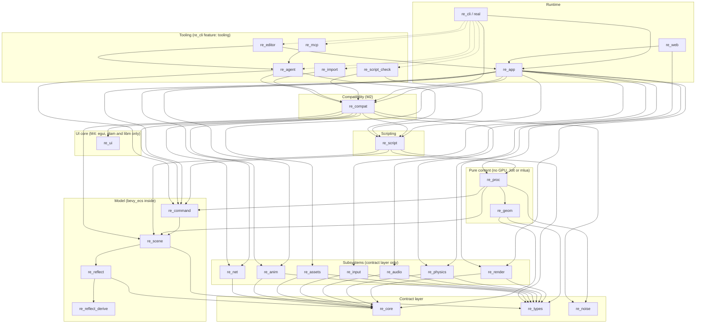

# Architecture

This document describes how Real Engine is built:
- crates and their boundaries;
- the frame loop and threads;
- the object model, and how the M2 Roblox-style layer maps onto it;
- procedural generation;
- AI integration;
- diagnostics;
- file formats.

The reasoning behind each choice is in [DECISIONS.md](DECISIONS.md), as ADR-xxxx. Versions are in [DEPENDENCIES.md](DEPENDENCIES.md).

**Status:** M1, M2 and M3 done. Implemented: the contract layer (`re_core`, `re_noise`, `re_types`), the entity model (`re_reflect` with its derive macro `re_reflect_derive`, `re_scene`, `re_command`), the subsystem crates `re_render`, `re_physics`, `re_assets`, `re_input`, `re_audio` and `re_anim`, procedural generation (`re_geom`, `re_proc`), scripting (`re_script`, `re_script_check`), AI integration (`re_agent`, `re_mcp`), the editor (`re_editor`), and the runtime and CLI (`re_app`, `re_cli`) with the `examples/island` demo, which `real verify` checks in CI. M1 is complete: every work package has merged and every item of its definition of done is checked in CI. M2 is complete: `re_compat` (the Roblox-style layer), `re_import` and the compat boot in `re_app`, with `examples/plaza` verified in CI. M3 is complete: every work package has merged and every item of its definition of done holds. It added D2 determinism across Linux, Windows and macOS, packaged games (`real build`, `game.rpak`), browser builds (`re_web`), the HDR post chain and cascaded shadows, skins and animation graphs, vehicles, ragdolls and audio buses, world streaming, generator versions, bake, Luau node kinds, polygon booleans and roads, the editor's node canvas, docking and gizmos, the script debugger, the AI track's templates, recipes, eval harness and HTTP transport, the compat follow-ups (saved data, script reload, place files, surfaces, skinned `MeshPart`s and post effects, and debugging compat scripts), the `re_net` transport and replication over postcard frames, and `examples/valley`. Every subsystem choice is backed by a design-phase spike; the entity core (§4) follows the core spike, which M1 WP0 ported.

## 1. Goals that shape the design

1. **A procedural-first 3D engine.** Worlds are described by graphs and code, generated deterministically, and edited by hand on top of the generated result.
2. **Luau scripting.** It starts with an engine-native API (M1) and grows a compatibility layer for Roblox-style projects (M2).
3. **Built to be driven by AI agents as well as humans.** Every edit goes through one command registry. Every check has a machine-readable result, and every error has a stable code. AI is optional (§6).
4. **Testable headless.** Everything except a single windowed smoke test runs in a container with software Vulkan (lavapipe), no audio device and no display.

## 2. Crate graph

All crates live in `crates/`. An arrow means "depends on". Every direct dependency in a crate's `Cargo.toml` (dev-dependencies aside) lies on a path of arrows, but not every one is drawn as its own arrow: most crates use `re_core` directly, for example.

- The **contract layer** is `re_core` and `re_types` (plus `re_noise`, which has no dependencies at all). These crates are plain data, traits and small utilities, with no heavy dependencies.
- **Subsystem crates** (`re_render`, `re_physics`, `re_audio`, `re_input`, `re_assets`, `re_anim`, and `re_net` since M3) depend only on the contract layer and on third-party crates. `re_net` depends on `re_core` and, for players in a browser, on a WebSocket crate (tungstenite natively, web-sys in the browser); `re_compat` runs its sessions over it. They never depend on each other, on `re_geom` or on `re_scene`.
- `examples/island`, `examples/plaza` and `examples/valley` are project directories (scenes, scripts, replays and goldens), not crates. `real` loads them.
- `re_web` (M3, WP29) is the browser runtime: a `cdylib` over `re_app` and `re_render` (ADR-0049).



Dashed edges exist only when `re_cli` is built with the default-on `tooling` feature. A runtime-only build (`--no-default-features`) links none of the tooling crates, so it links no tokio, rmcp or full_moon (ADR-0019, ADR-0027). The rule is simple: a subcommand that needs a tooling crate exists only in the tooling build. That covers `check`, `import` (M2), `mcp`, `agent`, `editor` and `do` (`real do` uses `re_agent`'s single-writer lock and editor-socket client), so a runtime-only `real` runs, verifies, describes and explains a project but does not edit its scenes; it does rewrite graph files, with `real migrate-graph` (M3). `build` and `verify --package` (M3) are tooling-only too (ADR-0037).

### Crate responsibilities

| Crate | Owns | Key public items | Must not depend on |
|---|---|---|---|
| `re_core` | Diagnostics, time, phases, task pool, profiling macro, logging setup | `Diagnostic`, `Severity`, `Code`, `DiagInfo`, `FixedClock`, `Phase`, `TaskPool`, `Events<T>`, `profile_scope!`, `init_logging` | anything engine-specific |
| `re_noise` | Deterministic RNG and noise (ported from the platform spike) | `Pcg32`, `SplitMix64`, `perlin*`, `simplex*`, `fbm*`, `ridged*`, `warped_fbm*`, `cellular*`, `hash2/3` | everything (zero dependencies) |
| `re_types` | Plain-data contracts between the app and subsystems, and the script host trait (no dependency on `re_core`) | `EntityId`, `RenderSnapshot`, `DrawItem`, `Camera`, `Light`, `MeshHandle`, `MaterialHandle`, `TextureRef`, `MaterialDesc`, `MeshData`, `Aabb`, `ClipData`, `PhysicsCmd`, `BodyDesc`, `ShapeDesc`, `BodyPose`, `ContactEvent`, `CharacterDesc`, `AudioCmd`, `ActionFrame`, `RawInputFrame`, `InputEvent`, `MouseLock`, `GraphDoc`, `ReplayDoc`, `RawReplayInput`, `host::HostServices` | `re_scene`, any subsystem |
| `re_reflect` | The component registry over bevy_ecs: field types, values and coercion, by-name access, script-defined components, the untyped document tree used at text boundaries, registry description and scene JSON Schema (ADR-0032) | `Registry`, `ComponentKey`, `ComponentSchema`, `FieldSchema`, `FieldType`, `ComponentOrigin`, `Value`, `Color`, `Reflect`, `component!`, `field_enum!`, `Doc`, `f32_from_parsed_f64` | subsystems, mlua |
| `re_reflect_derive` | `#[derive(Reflect)]`, the derive form of `component!`, re-exported as `re_reflect::Reflect` (a proc-macro crate, ADR-0032) | `Reflect` (derive), with `#[reflect(skip)]` and `#[reflect(crate = "...")]` | — |
| `re_scene` | The World facade over bevy_ecs (ADR-0005): stable ids, hierarchy, transforms and propagation, the built-in components, scene and prefab files, procedural sources, fragments, overrides, suppression, state hash | `World`, `Entity`, `StableId`, `IdIndex`, `IdGen`, `Transform`, `GlobalTransform`, `Name`, the built-ins of §4, `SceneDoc`, `SaveOptions`, `PrefabFile`, `Procedural`, `GraphSource`, `Generated`, `Overrides`, `GenNode`, `SceneFragment`, `GenContext`, `Generators`, `state_hash` | subsystems, mlua |
| `re_command` | Edit operations and transactions with exact undo, the log, the command registry, dry runs, the policy hook and the engine request channel (ADR-0003) | `Op`, `Transaction`, `Origin`, `History`, `LogEntry`, `CommandRegistry`, `CommandSpec`, `Tier`, `CommandOutcome`, `PolicyCheck` trait, `remote::{EngineHandle, EngineReceiver}` | subsystems, mlua, tokio |
| `re_geom` | Geometry operations over `MeshData`, polygon booleans (`polygon`) and roads (`road`) | `Heightfield`, `primitives::*`, `merge`, `transform`, `compute_normals`, `Shapes`, `road::{spline, road_mesh, footprint}` | wgpu, oxijolt, mlua |
| `re_proc` | ProcGraph IR, nodes, evaluation, cache, the `graph` generator for procedural sources, `graph.*` commands | `ProcGraph`, `NodeRegistry`, `NodeDef`, `Evaluator`, `EvalReport`, `GraphStore`, `register_generator`, `register_commands` | wgpu, oxijolt, mlua |
| `re_render` | The GPU renderer, GPU resources, headless capture and egui painting | `Gpu`, `Renderer`, `Renderer::render(&Device, &Queue, &TextureView, &RenderSnapshot)`, `Renderer::paint_ui(&Device, &Queue, &TextureView, &UiFrame)`, `upload_*` / `create_material` / `release_*`, `stats`, `RendererSettings`, `Capture`, `imgdiff` | `re_scene` |
| `re_physics` | Jolt through oxijolt | `Physics::new(PhysicsConfig, &'static TaskPool)`, `apply(&mut Vec<PhysicsCmd>)`, `step(dt)`, `poses_into(&mut Vec<BodyPose>)`, `velocity(id)`, `character(id)`, `events()`, `raycast` / `shape_cast` / `overlap_sphere` with a `QueryFilter`, `LayerTable`, `save_state` / `restore_state`, `motion_state` / `apply_motion_state` (`JoltRayonJobs` is internal) | `re_scene` |
| `re_audio` | kira playback, with a headless capture fallback | `Audio::new_or_headless`, `apply(&[AudioCmd])`, `advance(Duration)`, `set_user_volume`, `CaptureBackend` | `re_scene` |
| `re_input` | Raw input, the action map and replay | `RawInput`, `InputConfig`, `ActionMap`, `Replay`, `ReplayRecorder` | `re_scene` |
| `re_assets` | Import, material files, cache and hot reload | `AssetId`, `AssetServer`, `import_gltf`, `load_material`, `ProcessedCache`, `AssetWatcher` | `re_scene` |
| `re_ui` | The UI core (M4, ADR-0058): plain node trees laid out by the compat GUI's rules (scale-plus-offset sizes, anchors, padding, lists and grids, size and aspect limits, automatic size, scale, rotation, clipping, scrolling), text over the bundled fonts (ADR-0035, in its `assets/fonts/`) and painting as egui shapes, for the compat GUI and native UI | `UiTree`, `Node`, `Layout`, `Root`, `Item`, `Visit`, `Painter`, `Looks`, `TextStyle`, `fonts::install` | every engine crate (it uses only egui, glam and libm) |
| `re_anim` | glTF node clips, skeletal poses for skins, animation graphs, keyframe tracks, IK and tweens | `Sampler`, `Tween`, `graph::{validate, BoundGraph, GraphPlayer}` | `re_scene` |
| `re_net` | Connections over UDP with our own reliability, and over WebSockets for players in a browser; a transport seam with in-memory and conditioned links (M3, WP30, ADR-0050) | `Endpoint`, `Transport`, `UdpTransport`, `ServerTransport`, `WsTransport`, `MemoryNet`, `Conditioned` | every engine crate but `re_core` |
| `re_script` | The Luau VMs, contexts, native API, scheduler, compile check and engine type definitions | `ScriptRuntime`, `Context`, `compile_check`, `api::definitions` | subsystems (it reaches them through `HostServices`), full_moon |
| `re_script_check` | The static scan, the external type checker runner and the corpus validation suite (tooling) | `scan`, `GapReport`, `types::run`, `corpus::run` | `re_app`, tokio |
| `re_app` | The frame loop, sync glue, headless runner, verify and the runtime commands | `App`, `App::open`, `App::serve`, `AppConfig`, `run_windowed`, `run_headless`, `sync::{render, physics, audio}`, `verify::{run, VerifyStage}`; not frozen: `run_headless_observed`, `restarts`, `pending_diagnostics` | tokio, rmcp, full_moon |
| `re_cli` | The `real` binary and the `explain` command | subcommands | — |
| `re_agent` | Agent policy, sessions, checkpoints, agent commands, `AGENTS.md` and client configs, the editor socket (client and server loop; Unix only in M1) and the single-writer lock | `Policy`, `Session`, `Checkpoint`, `register_commands`, `generate_agents_md`, `remote::{connect, serve}`, `lock::{acquire, probe}` | tokio |
| `re_mcp` | The MCP server (rmcp, stdio or streamable HTTP on loopback), the tool-call recorder, and small blocking MCP clients for tests and the eval harness | `serve_stdio(EngineHandle, McpOptions)`, `http`, `record::Recorder`, `client::{HttpClient, StdioClient}` | `re_app` |
| `re_editor` | The editor UI: dockable panel tabs (layout in `.real/editor/layout.json`), translate, rotate and scale gizmos (W, E, R) on one or several selected entities, about the active one or the selection's centre, whose drags edit live as one undo step, copy, cut, paste and duplicate through the system clipboard (one undo step each), a Hierarchy context menu, renaming in place and notes, an editor camera (orbit, pan, zoom, fly, frame) and editor-only overlays (grid, axis indicator, light and camera icons, selection outline), the node canvas over graph files, the debugger panel, and the editor socket (ADR-0044, ADR-0045) | `run_editor(App, EditorOptions)`, `EditorSocket` | — |
| `re_import` | Static importer for Rojo-style projects and Studio loader scripts (tooling, M2 WP16); it never runs Luau | `import`, `ImportReport`, `new_project` | `re_app` |
| `re_web` | The browser runtime (M3, WP29): a wasm-bindgen `Session` that takes a project's archive or files and plays or replays it (ADR-0049) | `Session` | tokio, any tooling crate |
| `re_compat` | The Roblox-style compatibility layer (M2): the class layer, the class, enum and library data, the coverage table, the compat scene conventions, the datatypes and enums, the compat VM with instances, signals and core services, and the `RenderFrame` it builds for the renderer (§4) | `CompatVm`, `CompatSetup`, `Bindings`, `ValueCodec`, `SignalBehavior`, `datatypes::install`, `EnumItem`, `ClassRegistry`, `ClassRegistryBuilder`, `ClassDef`, `PropertyDef`, `Storage`, `ClassMarker`, `class::ClassIndex`, `class::ClassId`, `ServiceTag`, `CompatConfig`, `DataSet`, `CoverageFile`, `Status` | `re_render`, `re_audio`, `re_input`, `re_assets` (it reaches them through `HostServices`), full_moon, tokio. It uses `re_anim` (pure computation) for animation tracks, and `re_physics` directly: each compat world owns one `re_physics::Physics` and syncs its parts to it, as `re_app`'s physics sync does for native scenes, so the headless sample runner can step physics without `re_app`. It uses `re_noise` for the seeded particle effects and material detail textures, and `re_ui` for its GUI's layout, text, fonts and painting (ADR-0058) |

Boundaries are enforced in CI. `cargo xtask check-graph` (in `tools/xtask`) reads `cargo metadata` and fails if any "must not depend on" rule above is broken. This includes "subsystem crates reach only the contract layer", "`re_proc` does not reach wgpu, oxijolt or mlua", "only `re_reflect`, `re_scene` and `re_command` depend on bevy_ecs directly (others reach it through the `re_scene::ecs` re-export, and a crate that uses bevy's `#[derive(Component)]` or `#[derive(Resource)]`, or `re_reflect::component!`, puts `use re_scene::ecs as bevy_ecs;` in every module that uses them, because the derives otherwise emit a bare `bevy_ecs::` path)" and "`re_cli --no-default-features` reaches no tooling crate, tokio, rmcp or full_moon".

### Repository layout

```
Cargo.toml              workspace (members: crates/*, tools/*), [workspace.dependencies] with exact versions
Cargo.lock              committed
rust-toolchain.toml     channel = "1.99.1", the pinned stable release (MSRV 1.95 is checked by a CI job)
deny.toml               licenses, bans, duplicate allow-list
.github/workflows/ci.yml
crates/re_*/            the crates above
crates/re_*/explain/    one Markdown page per diagnostic code the crate owns
examples/island/        the M1 demo project (data and Luau only; not a workspace member)
examples/plaza/         the M2 compat example
examples/valley/        the M3 example: a streamed world, walked and driven
templates/              project templates and generator recipes for `real new` and `recipe.apply` (ADR-0046)
third_party/            temporary patched copies of mlua and oxijolt-sys for the browser build (ADR-0049 §2), used through [patch.crates-io]
schemas/                generated JSON Schemas (`cargo xtask schemas`; checked in CI)
docs/                   these documents
tools/xtask/            repo checks: crate-graph rules, duplicate-version allow-list, explain-page coverage, schema drift
tools/derive_alias_check/  proves bevy derives work through `use re_scene::ecs as bevy_ecs;`
tools/web-test/         the wasm smoke crate and the Node and Playwright scripts for the browser checks
tools/ci/               CI scripts (wasi-sdk, binaryen, the web clippy.toml); not a crate
```

The patched copies in `third_party/` go when mlua and oxijolt-sys releases carry the changes. To build the runtime for the browser, install wasi-sdk and set its environment with `eval "$(tools/ci/wasi-sdk.sh)"`, then build for `wasm32-unknown-unknown` (ADR-0049 §1; `real build --target web` does the rest, §8).

## 3. Frame loop and threading

### Threads

| Thread | Runs |
|---|---|
| Main | The winit event loop (or the headless driver), input, Luau (one VM per script context), sync, rendering submission, egui, and answering engine requests |
| rayon pool (N = cores − 1, at least 1) | ProcGraph node evaluation, Jolt jobs (through `JoltRayonJobs`, which implements `oxijolt::JobSystem`), asset processing. bevy_ecs gets no pool of its own: `re_scene`'s schedules run single-threaded on the main thread (ADR-0005, ADR-0007). |
| Asset watcher | notify's own thread; it posts `AssetChange` into a channel the main thread drains |
| tokio (only inside `real mcp`) | The MCP transport (stdio, or streamable HTTP with `--http`). Commands reach the main thread through `re_command::remote::EngineHandle`, a std channel. |

There is no render thread in M1. The seam for one is that `RenderSnapshot` is `Send` and owns its data (ADR-0007).

`JoltRayonJobs` comes from oxijolt's documented pattern. `max_concurrency()` returns `pool.current_num_threads() + 1`. `queue_job(job)` calls `pool.spawn(move || job.run())`, and must never block. Jobs that never ran are handed back to the stepping thread by Jolt.

### One frame

```
Input          poll winit/gilrs or the replay → RawInput → ActionMap → ActionFrame;
               asset, shader and script hot reload
PreRender      script contexts: per-frame callbacks (variable dt)
fixed steps    FixedClock.advance(frame_dt × time scale) → 0..=5 steps of 1/60 s
  PreAnimation   re_anim samples clips and tweens → Transform writes; animation graphs step,
                 and root motion moves entities and characters
  PreSimulation  world streaming (cells unloaded and loaded at this tick; scripts see stream.on_unloaded,
                 then stream.on_loaded); a CharacterController without a physics character gets one
                 first (tried once per entity), so move_character works on its first step, and an
                 entity with a Vehicle and no vehicle yet is linked the same way; then script
                 fixed-update callbacks (time.on_step); commands queued by scripts
  Physics        sync::physics::push: World changes → Vec<PhysicsCmd>, sorted by (kind, EntityId)
                 Physics::apply, Physics::step(dt) on the rayon pool
                 Physics::poses_into(&mut poses); Physics::events()
  PostSimulation sync::physics::pull: poses → Transform; contact events → script signals;
                 ragdoll poses blended into their skins; bone attachments placed
Sync           propagate GlobalTransform; interpolate between steps;
               sync::render::build → RenderSnapshot; sync::audio → Vec<AudioCmd>
Render         Renderer::render(device, queue, view, &snapshot); egui overlay through paint_ui;
               Audio::apply(&audio_cmds)
EndFrame       apply scripts' host requests (HUD text, mouse behaviour, regeneration, screenshots,
               restart); regenerate changed sources and release the derived assets they dropped;
               PerfReport sample
```

The phase order matches the order Roblox-style scripts expect: render-step work happens before simulation, "stepped" before physics, and "heartbeat" after physics (ADR-0009). This makes the M2 mapping direct.

A compat play test (M2, WP12) runs two worlds in one process, a server world and the local player's client world, each with its own script VM. Its frame is:

```
pump(server)    remotes from the client, queued character loads, scripts that became startable
server phases   PreRender .. PostSimulation, with the authoritative physics in the server world
replicate       owned components client → server, then the server's changes → client
pump(client)    player and character events, PlayerScripts and PlayerGui, removals,
                remotes from the server; scripts that became startable
client phases   PreRender .. PostSimulation; rendering and input use the client world, and
                its physics moves only client-only parts (replicated parts stand still)
```

`re_app` runs this frame for a `[compat]` project (`re_app/src/compat.rs`) in `real run`, `real verify` and `play.run`, and renders from the local player's world. Each world's phases are the `CompatVm` calls: the render step (WP14's input and `Animator` start run inside it), then per fixed step `PreAnimation`, `PreSimulation`, `physics` (parts and characters), `media` (tweens, then sounds) and `PostSimulation`. The client's sound commands go to the mixer. Server ids are seeded, so a run and its replay end with the same `state_hash`.

**Physics sync cost.** `sync::physics::push` fingerprints each body's description to find what changed. A collider backed by the shape library (mesh, convex or heightfield) is fingerprinted by the library's content hash, its kind and its scale, not by copying its data; the data is copied only when the body is added or replaced. A static body whose `Transform`, `Collider` and `RigidBody` have not changed since the last push (bevy change ticks), under a parent whose world transform is unchanged, is skipped. Dynamic, kinematic and character bodies take the full path. A sync state copied into a forked world looks at everything once.

Headless runs (`real run --headless --frames N`, tests, `real verify`) use the same loop. The differences are:
- the frame time is fixed at the step size;
- input comes from a replay;
- rendering goes into an offscreen texture that is captured only on the frames the replay asks for.

### Snapshots and command buffers

`re_types` defines what crosses the boundary (ADR-0006):

```rust
pub struct EntityId(pub u64);                // Entity::to_bits(), converted only in re_scene

pub struct RenderSnapshot {
    pub camera: Camera, pub lights: Vec<Light>,
    pub items: Vec<DrawItem>, pub debug_lines: Vec<DebugLine>,
    pub clear: [f32; 4],                     // no egui types here: UI is painted separately
    pub post: PostSettings,                  // exposure, tone mapping and the post chain (M3, ADR-0038)
    pub shadows: SunShadows,                 // the sun's shadow cascades (M3, ADR-0038)
    pub quads: Vec<WorldQuad>,               // textured quads in the world, such as GUIs on surfaces (M3)
    pub skinned: Vec<SkinnedDrawItem>,       // skinned objects (M3, ADR-0039)
    pub joint_palette: Vec<Mat4>,            // their joint matrices, one run per skinned item
}
pub struct DrawItem { pub entity: EntityId, pub mesh: MeshHandle, pub material: MaterialHandle,
                      pub world: glam::Mat4, pub flags: DrawFlags }

pub enum PhysicsCmd {
    AddBody { id: EntityId, desc: BodyDesc }, RemoveBody { id: EntityId },
    SetTransform { id: EntityId, pos: Vec3, rot: Quat }, SetKinematicTarget { id: EntityId, pos: Vec3, rot: Quat },
    ApplyImpulse { id: EntityId, impulse: Vec3 }, SetVelocity { id: EntityId, linear: Vec3, angular: Vec3 },
    SetShape { id: EntityId, shape: ShapeDesc },
    AddConstraint { id: EntityId, desc: ConstraintDesc }, RemoveConstraint { id: EntityId }, // ... characters
    RemoveVehicle { .. }, AddVehicle { .. }, SetVehicleInput { .. },            // ranks 12–14 (M3, ADR-0040)
    RemoveRagdoll { .. }, AddRagdoll { .. }, SetRagdollMode { .. },             // ranks 15–19
    SetRagdollTarget { .. }, ApplyRagdollImpulse { .. },
}
pub struct BodyPose { pub id: EntityId, pub pos: Vec3, pub rot: Quat }   // active bodies, newly asleep bodies, characters
```

- `re_types` depends only on `glam`, `serde` and `serde_json` (plus `schemars` behind its optional `schemars` feature, for the schemas of the graph and replay file formats).
- `RenderSnapshot` positions (draw items, skinned items, terrain chunks, the camera and the lights) are relative to `App::render_origin()`: world streaming's floating origin (ADR-0042), which is zero without streaming. `re_app` subtracts it when it builds the snapshot, so precision near the camera does not depend on where the camera is in the world; the editor's gizmo adds it back.
- The pose pull is one batched call to oxijolt's `active_body_poses_into`, which returns position and rotation for **active** bodies; `Physics::poses_into` adds the bodies that fell asleep during the step (with their final pose) and every character. A sleeping body is not returned again until it wakes; its `Transform` keeps the exact value it had when it fell asleep. Velocities are read per body (`Physics::velocity`) only for the entities that need them, such as characters and scripted bodies.
- egui output is not part of the snapshot. `re_app` runs egui, tessellates the shapes with `egui::Context::tessellate` (`UiFrame::from_output` does it), and passes a `UiFrame { primitives, textures_delta, size_px, pixels_per_point }` to `Renderer::paint_ui(&Device, &Queue, &TextureView, &UiFrame)`. egui types therefore appear only in `re_render`, `re_app`, `re_editor` and `re_compat` (whose 2D UI returns egui shapes, §4). `re_render` paints egui into an `Rgba8Unorm` overlay and composites it with a manual-gamma blit on every backend, so the UI looks the same on Vulkan and GL (ADR-0010).
- **Lighting convention.** A directional light's (sun's) intensity is in lux: at exposure 1, an illuminance of 1 lux makes a white diffuse surface white. A point light's intensity is in lumens (it shines `lumens / 4π` candela) with a windowed falloff that reaches zero at its `range`. Emissive colour is multiplied by the exposure too. Exposure is snapshot data (`RenderSnapshot::post`, with the post chain). The ambient light (a sky and a ground colour, a hemisphere) is a renderer setting (`re_render::RendererSettings`, beside the shadow map size and MSAA), not snapshot data: `RenderSnapshot` has no ambient field.

Meshes, textures and materials are uploaded through `Renderer::upload_mesh(&MeshData) -> Result<MeshHandle, Diagnostic>` and its siblings (`upload_texture`, `create_material`), when an asset loads or a ProcGraph produces a `Derived` mesh, not every frame. They are released through `release_mesh` and its siblings, which return `Result<(), Diagnostic>`. Handles carry a generation, so a stale handle is detected. `re_app` forgets a `Derived` mesh at the end of the frame in which a regeneration diff leaves it unreferenced, and frees its GPU copy at the next upload (`App::upload_assets`), so regenerating many times does not grow GPU memory.

## 4. Object model

### Engine model

The entity core is bevy_ecs 0.20.0 used standalone, behind our own API (ADR-0005), with our own component registry (ADR-0032). The core spike built and tested this model; M1 WP0 ports it.

- **Entity**: a bevy_ecs `Entity` (index plus generation) at run time. It is never written down.
- **Stable id**: every saved entity has a `StableId`, a string such as `e7kq2m9x4tb` (engine-made) or `player_spawn` (chosen). Files, commands, logs, undo history, agents and scripts address entities by id. The `IdIndex` resource maps ids to entities and is kept exact by component hooks. Generated entities have ids of the form `<source id>/<StableKey>` (§5).
- **Components**: bevy_ecs components registered in `re_reflect::Registry`, which gives typed, documented, defaulted fields readable and writable by name, with central coercion rules (Luau's f64 numbers into f32 fields, for example). Native components are declared with the `component!` macro; scripts and agents can declare new components at run time (`Registry::register_script`), and those are real ECS components that are queried, change-tracked, saved and undone like native ones. Field types are a closed set: `bool`, `i32`, `i64`, `f32`, `f64`, `vec3`, `quat`, `color`, `string`, `entity` and unit enums, plus (since M2) the containers `list`, `map` and `record` (ADR-0032 amendment).
- **M1 built-ins** (fields are frozen in [M1_PLAN.md, WP0](M1_PLAN.md#wp0-workspace-ci-contracts-and-the-entity-core)):
  - `Name` (written as the entity's `name` in files), `Transform` (`translation`, `rotation`, `scale`) and the derived `GlobalTransform`;
  - `MeshRef` (its `asset` is an asset path, `builtin:cube`, `builtin:sphere`, `builtin:plane`, `builtin:capsule`, or `derived:<key>` for procedural output), `MaterialRef`, `Visible`;
  - `Camera`, `Light`;
  - `RigidBody` (static, dynamic or kinematic), `Collider` (box, sphere, capsule, convex, mesh or heightfield, plus layer, group mask and sensor);
  - `CharacterController` (with its own layer and group mask);
  - `ScriptRef` (a script path and context);
  - `AudioSource`, `AnimPlayer`;
  - `Procedural` and `GraphSource` (procedural sources, §5);
  - `HudText`.
- **M2 built-ins** (WP9): `Attributes` (a string-keyed map of `Value`s) and `Tags` (a string list), both immutable components written by replacement. The `TagIndex` resource maps each tag to its entities and is kept exact by hooks, like `IdIndex`. Two opt-in resources, `AttributeFeed` and `TagFeed`, record `AttributeChanged { entity, key }` and `TagChanged { entity, tag, added }` while a world holds them; `drain()` takes the batch.
- **M3 built-ins** (so far):
  - `RigidBody.center_of_mass_offset` (a `vec3`, default zero);
  - `AudioSource.bus`: the mixer bus it plays on, empty for `[audio] default_bus` (ADR-0041);
  - `AudioSource.rate`: the playback speed, default 1, above 0 and played at most 16 times as fast; the pitch shifts with it (ADR-0041);
  - `SkinnedMesh` (`asset` is `<model path>#<skin name>`): a skinned mesh posed by its skeleton; an `AnimPlayer` on the same entity plays clips onto its joints (ADR-0039);
  - `Animator` (`graph`, `playing`, `speed`): plays an animation graph (`*.animgraph.json`) on the `SkinnedMesh` of the same entity, in place of an `AnimPlayer`; parameters and states are runtime state that scripts reach through the `anim` library (ADR-0039). It is not the compat layer's `Animator` instance (§4, M2);
  - `BoneAttachment` (`joint`): on a child of a skinned entity, places the child at that joint of its parent's skin at the end of each fixed step, after physics and the ragdoll blend (ADR-0039);
  - `Vehicle` (on a dynamic `RigidBody`) and `VehicleWheel` (on its child entities, in child order): a wheeled vehicle or motorcycle on Jolt; the default wheel tester is `Ray` (ADR-0040);
  - `Ragdoll` (on an entity with a `SkinnedMesh`): a ragdoll generated on the skin's skeleton, with the modes (the enum `RagdollControl`) `Animated` (follows the animation), `Simulated` (falls freely) and `Powered` (motors pull it toward the animated pose with a `strength` from 0 to 1); the skin shows the simulated pose blended in over `blend_seconds` (ADR-0040);
  - `Streamed` and `StreamFocus` (`re_scene::stream`): a streamed procedural source or authored root, and a focus that cells load around (ADR-0042).
- **M4 built-ins** (so far):
  - `AudioSource.rolloff` (`Natural`, `Inverse`, `Linear` or `Off`, default `Natural`), `AudioSource.min_distance` (default 1) and `AudioSource.max_distance` (default 100): how a spatial sound's volume falls with distance from the listener, changeable while it plays (M4 plan, WP45 PR "control");
  - `AudioSource.doppler` (default 0): how much a spatial sound's pitch follows its own and the listener's motion along the line between them; 1 is physical, more exaggerates;
  - `AudioListener` (`active`, default true): where sounds are heard from. The first active one in entity order hears; without one, the first active camera does.
- **Hierarchy**: bevy's `ChildOf` / `Children` relationship: ordered children, recursive despawn. Files store a `parent` id per entity. `GlobalTransform` is recomputed in the Sync phase by a change-driven propagation system that only touches subtrees whose `Transform` or `ChildOf` changed (0.42 to 1.36 ms per update at 100,100 entities in the spike, against 5.5 ms for a full pass). `world.find("Island/Crates/Crate_3")` resolves a path of names as a convenience; it is not an identity.
- **Change tracking**: bevy's per-component change ticks. Writing an equal value through the registry does not mark a component changed.
- **Edits** go through `re_command` operations and transactions (ADR-0003): atomic, with exact undo and redo, and a log. Project files the editor or an agent edits in memory (graph files) are open documents in the World, changed by the `set_doc` operation, checked by a validator per file suffix, listed as unsaved by `project.status` and written back by the scene save (ADR-0044).
- **Events**: `re_core::Events<T>`, which are typed and double-buffered, plus contact events. Scripts receive them as signals.

### Luau view (M1 native API)

Entities are `Copy` handles (index plus generation) exposed as userdata. Handles are interned in a weak-valued table, so `a == b` and `rawequal(a, b)` hold for the same entity, and handles work as table keys. A stale handle raises a clear error. Component fields are reached by name through the registry, and scripts can define their own components:

```lua
world.define_component("Collectible", { value = "i32" })
local crate = world.get("crate_3")                 -- by stable id
local t = crate:get("Transform", "translation")
crate:set("Transform", "translation", t + vector.create(0, 1, 0))
physics.impulse(crate, vector.create(0, 5, 0))
input.on_pressed("jump", function() ... end)
task.wait(0.5)
```

- Vectors are native Luau vectors, built with the builtin `vector.create` (ADR-0011).
- Each script context (`game` and `tools` in M1) is one sandboxed VM. Inside it, each script and module has its own environment table over the frozen globals, with `safeenv` set, so scripts cannot see each other's globals and builtin fastcalls stay fast.
- A CPU budget per context is enforced by a raw Luau interrupt that keeps raising once tripped, so `pcall` cannot swallow it. It is wall-clock time per resume; reading and compiling a module that `require` loads does not count against it.
- `tools` scripts may issue commands. `game` scripts may not issue destructive commands; they reach the engine through `HostServices`.
- `engine.d.luau`, generated from the binding registry, describes the whole native API for the type checker, editors and agents (`real describe --luau-defs`).
- M3 additions to the native libraries: `physics.drive` and `physics.vehicle` (vehicles); `physics.ragdoll(entity, mode, strength?)`, `physics.ragdoll_state(entity)` (root, mode, strength and `calm`; no pose) and `physics.ragdoll_impulse(entity, joint, impulse)`; `audio.play(clip, at?, volume?, bus?)`, `audio.set_rate(e, rate)` (writes `AudioSource.rate`), `audio.set_bus_volume`, `audio.set_effect` (1-based effect index), `audio.snapshot` and `audio.levels` (frame-only: an error during a fixed step). The `anim` library drives the graph an entity's `Animator` plays: `anim.set(e, param, value)`, `anim.get(e, param)`, `anim.trigger(e, param)`, `anim.state(e, layer?)` and `anim.joint(e, joint)` (world-space position and rotation from the last step's pose); an unknown or mistyped parameter is `RE7609`. The `stream` library (game and tools contexts, ADR-0042) has `stream.on_loaded`, `stream.on_unloaded`, `stream.cells()` and `stream.is_loaded(key)`; `stream.load` and `stream.release` exist in the `tools` context only. A script that starts after cells loaded gets no `on_loaded` for them, so it reads `stream.cells()` at start.
- `math` is portable (ADR-0036): every VM replaces the transcendental functions with `libm` versions through `re_script::portable_math`, and the compiler disables the matching builtins. `x ^ y` still uses the platform's `pow` unless `y` is 2, 0.5 or 3; use `math.pow` in simulated code. `real verify`'s scan stage warns about any other `^` (`RE3083`).
- Additions from the sample game (`examples/town`): `physics.set_velocity(e, linear, angular?)` (dynamic bodies only, like `physics.impulse`; either applies to a body spawned the same frame as it starts, and is dropped without an error for one destroyed the same frame); `time.set_scale(scale)` (0 to 10; 0 runs no fixed steps, so physics and `on_step` stop while `on_frame` goes on; a frame still runs at most five steps, so at 60 frames a second a scale above 5 runs as 5; a restart sets it back to 1) and `time.scale()`; `HudText.color`, the linear colour of each HUD line (a line breaks only at its `\n`s; egui would wrap it to the width its panel had the frame before). `math.random` starts from the run's seed (`[scripts] seed`, or a replay's `seed`; the `tools` context from seed + 1), and `os.clock` is 86,400 plus simulation time, so a native run repeats as compat runs do. `os.time` and `os.date` are still the wall clock.
- Generator scripts (`scripts/generators/`, ADR-0043 §4) run in VMs of their own with another API, described by a generated `generator.d.luau` (`re_script::generator::definitions()`): `proc.node`, `proc.param`, the `ctx` an `eval` gets, `quat` and `color`. `real check --types` checks them against it in a run of their own (and writes it to `.real/types/generator.d.luau`), and the API gap scan compares them with it.
- **Debugger** (M3, WP25, ADR-0045): `re_script::debug` holds Luau breakpoints, stepping and pausing, and its DAP server (`re_script::debug::dap`) listens on 127.0.0.1 only. `real run --debug [PORT]` and `real editor --debug [PORT]` serve it (default port 4711); the editor also has a debugger panel. Compat Scripts and ModuleScripts register their chunks under their source paths too, and register again when hot reload restarts them, so breakpoints keep working.

### M2 Roblox-style compatibility layer (`re_compat`)

The layer is Luau plus Rust on top of the native model. The core spike checked how a Roblox-style object model maps onto bevy_ecs: relationships, hooks, observers, change ticks and runtime-defined components cover the instance tree, its signals and script-defined classes. Two pieces were missing from M1 and are M2 work: **container field types** (lists, string-keyed maps and records, for attributes and tags) and a **class layer** over components. Both have merged (WP9). The mapping:

| Roblox-style concept | Engine mapping |
|---|---|
| Instance tree (`game`, services, `Workspace`), `Parent =`, `Destroy()` | Entities under a root `game` entity, linked by `ChildOf` / `Children` (ordered, recursive despawn); `Parent =` and `Destroy()` are the `reparent` and `despawn` operations. Each service is a singleton entity with a `ServiceTag`. `Workspace` is the world root that rendering and physics see. |
| `Name`, `FindFirstChild(name)` | The `Name` component; scan the (short) children list, or add a per-parent name index if measurements ask for it |
| `ClassName`, `IsA`, typed properties | A **class layer** over components: a class is a marker component plus a component set plus property aliases, with inheritance, in `re_compat`. For example a part class is `Transform` + a primitive shape component + `RigidBody`, with `Position` aliased to `Transform.translation` and `Anchored` to `RigidBody.kind`. The registry already gives typed, documented, defaulted properties by name; unknown properties raise `RE9001`. |
| `Folder`, `Model`, `PrimaryPart` | An entity with only `Name`; `Model` adds `PrimaryPartRef` |
| `Script`, `LocalScript`, `ModuleScript` | `ScriptRef` with context `server` or `client`. Modules are resolved by our `require`. |
| `CFrame` | Userdata over position plus a rotation matrix (f32 in M2). Every constructor and operator is in the coverage table. |
| `Vector3`, `Vector2`, `Color3`, `UDim2`, `Enum.*` | `Vector3` maps to the native Luau vector. The others are userdata or frozen tables generated from a JSON table. |
| `RBXScriptSignal`, `:Connect`, `:Once`, `:Wait`, legacy `connect` | A Luau signal library over engine events |
| `Changed`, `GetPropertyChangedSignal` | Per-component change ticks, plus a per-field diff when signals are dispatched |
| `ChildAdded`, `DescendantAdded`, `AncestryChanged` | Observers on `ChildOf` (`On<Insert<ChildOf>>`, `On<Discard<ChildOf>>`). Not hooks: `ChildOf` is a bevy relationship and already owns its `on_insert` and `on_discard` hooks, and registering a second one panics. Hooks remain fine on our own components (`StableId`, the tag index, `ClassMarker`'s class index). |
| `RunService` events (render-step bindings, `RenderStepped`, `PreAnimation`, `Stepped` / `PreSimulation`, `Heartbeat` / `PostSimulation`) | The engine phases in §3, in the same order |
| `task.*`, `wait`, `delay`, `spawn` | The `re_script` scheduler (coroutines resumed in the phases) |
| `Humanoid` and character | `CharacterController` (Jolt CharacterVirtual) plus a Humanoid state component and the event set |
| Collision groups | Jolt object layers plus a group filter table |
| Attributes (`GetAttribute`, `SetAttribute`, attribute-changed signals) | An `Attributes` component holding a small name → `Value` map. Needs the new map field type in `re_reflect`; change signals come from per-key diffing. |
| `CollectionService` tags | A `Tags` component (a list field) plus a tag index resource kept exact by hooks, like `IdIndex` |
| Several attachments, welds or constraints per part | Child entities, as in Roblox; entity-typed fields (a weld's other part) are already repaired across despawn and undo |
| `ModuleScript.Source` | Script assets referenced by path, never inline in the scene |
| `RemoteEvent`, `RemoteFunction`, `BindableEvent` | In-process queues between the `server` and `client` VMs (`net::NetLink`), delivered by each side's pump. M2 runs both worlds in one process. Values are deep-copied, with floats copied bit-exact; a value that cannot be copied is `RE9300`. |
| Services that need an online backend (teleport, marketplace) | They exist and return a clear `RE9002` "not available offline" error. Nothing hangs. Data storage works locally since M3 (saved data, below). |
| Deprecated members that real scripts still use | Implemented where cheap, each with an `RE9101` deprecation note |
| Large static maps | Static cells (ADR-0031) |

The class layer as built (WP9):
- `ClassRegistry` is built from the data files `classes/*.json`, `enums/*.json` and `libraries/*.json` (globals that are not classes: datatype tables, function libraries such as `task`, and instance globals such as `game`), which are embedded at build time. Each class has a superclass, `creatable`, the components it adds, and its properties, methods and events, each with a coverage status. A class file can `extend` a class declared in another file, so each WP owns the rows it implements.
- A property is stored in one of three ways: an alias to a native field (optionally through a converter), an `own` field of the class's host component `Compat_<Class>`, or a `builtin` Rust accessor. Host components are registered with `Registry::register_host` before a scene loads; scene files store their fields by name without declaring their schemas, so adding a property never breaks a saved scene (ADR-0032).
- Unknown and unimplemented members raise `RE9001` with a "did you mean" suggestion. A write to a read-only property raises `RE9005`, and a deprecated member gives an `RE9101` warning with its replacement.
- Every instance carries a `ClassMarker { class }`. `ClassMarker` is immutable, since an instance's class never changes, and its hooks keep the world's `ClassIndex` (each class's instances, in entity order), so `ClassRegistry::instances` finds a class's instances without walking the world. `IsA` is a bit test on the ancestor bitsets the registry works out once, when it is built. The root entity has the stable id `game` and class `DataModel`. Each service is a child of `game` whose stable id and name are its class name, with a `ServiceTag`. A script instance's `ScriptRef.context` is `Server`, `Client` or `Module`, from its class and `RunContext`; the native runtime starts only `Game` and `Tools` scripts. A compat project says `[compat] api = "roblox"` in `real.toml`, and convention breaks are reported as `RE9004`.

The runtime as built so far (WP10, WP11, WP12, WP13, WP14, WP15, WP16 "boot"):
- A compat VM is a `re_script::Context` of kind `Server` or `Client`, with the native sandbox (no `loadstring`, `getfenv` or `setfenv`), created and driven by `re_compat::CompatVm`, one per world. `ScriptRuntime` stays native-only. Each area registers its accessors, methods, globals and value conversions in `Bindings`, and `CompatSetup` refuses to start if a member marked `implemented` has no implementation.
- Yielding host calls (`WaitForChild`, `Signal:Wait`) park the calling coroutine and are woken from a later phase (`re_script`'s park and wake protocol, with timeouts). A settle hook runs at the end of each resumption cycle.
- Instance handles (`InstanceRef`) compare by identity. A destroyed handle becomes a tombstone. `Destroy` fires `Destroying`, locks `Parent`, keeps the subtree readable until the resumption cycle settles, then despawns it. `Clone` honours `Archivable` and remaps references inside the copy.
- Signals are deferred by default: handlers run in the phase after the event. `[compat] signal_behavior = "immediate"` in `real.toml` switches. Child and descendant events come from observers on `ChildOf`, attribute and tag events from the `re_scene` feeds, and `Changed` from per-field diffs gated by change ticks.
- Scripts start from the tree by the rules of M2_PLAN WP11: a `Script` runs in `server` under `Workspace` or `ServerScriptService`, a `LocalScript` runs in `client` under a player's containers or character, and `RunContext` `Server` or `Client` overrides the place, except under storage and the templates. Each started script owns its threads, so destroying it stops them. `require(module)` runs a `ModuleScript` once per context in the requiring thread and caches the result; a cycle is `RE3004` with the chain, and a module that raised raises again on every later `require`.
- `RunService` (`Heartbeat`, `Stepped`, `RenderStepped` in the client, `IsServer`, `IsClient`, `IsStudio`), `task` (`spawn`, `defer`, `delay`, `wait`, `cancel`) and the deprecated `wait`, `delay` and `spawn` run on the virtual clock, and `os.clock()` reads it (86,400 s plus the game time). `game`'s session fields (`PlaceId`, `JobId`, ...) come from `[compat.game]`, and `Random.new()` without a seed and Luau's `math.random` start from `[compat] seed` (the client context uses `seed + 1`), so runs repeat.
- `re_compat::testing::Harness` is the public headless harness: `open` or `open_with` loads a project's entry scene into a `server` and a `client` world, `start` starts their scripts, `step(n)` runs frames on the virtual clock, and `close` ends the run. `uncaught`, `stuck`, `required`, `unsupported` and `take_output` report what happened. By default the client world is a second copy of the scene without the server-only containers, with the template client scripts started in place; with `HarnessOptions::two_worlds` the run is a play test as described next.
- Two worlds (WP12): `net::CompatWorlds` holds a server world, which is authoritative and runs physics, and the local player's client world. An instance is the same instance in both when it has the same stable id; entities are never compared across worlds, and entities without a stable id are runtime-only and do not replicate. Each frame, `net::replicate` first copies the upstream components the client changed on instances the local player owns (`NetworkOwner`) to the server, then walks the replicated containers on the server and creates, diffs and removes on the client, remapping entity references by stable id. Only what the server changed since the last pass is written, per field, attribute key and tag. This is the **client-local write rule**: a client's own write to a replicated instance stays until the server next changes that same field.
- Players (WP12): `[compat] players` players join at start (default 1, and 0 is refused with `RE9302`); the first is the client's `LocalPlayer`, and the others exist only on the server and in replication. The client makes `PlayerScripts` and `PlayerGui` from their templates, and they exist only in the client world. `LoadCharacter` copies `StarterPlayer.StarterCharacter` or builds the default rig (WP14), copies `StarterCharacterScripts`, spawns at a `SpawnLocation` with a `ForceField`, and gives the player network ownership. A remote or bindable call that fails is `RE9301`.
- Physics for parts (WP13): `re_physics::parts` simulates parts as assemblies (welded parts are one Jolt body with one compound child per part), with a joint tree between assemblies, 32 collision groups checked per part pair, touch events per part pair and queries answered from exact part geometry (GJK), so a filter can skip one part of an assembly. `re_compat::physics` keeps each world's simulation in its `CompatPhysics` resource and syncs it every frame: parts scripts created, moved, changed or destroyed go in, the step runs between `PreSimulation` and `PostSimulation`, moved parts are written back, then `Touched` and `TouchEnded` fire and parts below `Workspace.FallenPartsDestroyHeight` are destroyed. Anchored parts no script touched go into static cells (ADR-0031), and maps off the origin run around a floating origin. A character's parts are never free bodies: they collide and are found by queries, and the character controller moves them. Units: one stud is one engine unit, and `Workspace.Gravity` defaults to 196.2 studs/s².
- Input (WP14): raw device input reaches the layer as `re_types::RawInputFrame` (from `HostServices::raw_input`), with buttons named as `real.toml` binds them (`KeyW`, `Space`, `Left`, `South`); `input/keymap.rs` maps them to `Enum.KeyCode` and `Enum.UserInputType`. `UserInputService` mouse behaviour goes back to the host through `HostServices::set_mouse_behavior`.
- Characters (WP14): a `Humanoid` rides a `re_physics` character controller in the compat world's `Physics`. A jump sets the vertical velocity to v + g·dt/2, where v is `JumpPower` or √(2g·`JumpHeight`), so the peak matches the configured height at the fixed step. R6 and R15 rigs and their built-in clips are data files under `assets/rigs/` (ADR-0034).
- Animation (WP14): the `Animator` samples and blends `re_anim` tracks by priority and weight, then applies `IKControl`s. A joint a script wrote in the same frame keeps the script's value, and a joint no track drives any more returns to its rest pose. `Animation.AnimationId` resolves through `[compat.animations]`; an id with no clip plays an empty clip and warns with `RE9201`.
- A compat frame runs: input, the render step (`RenderStepped`), animation, `Stepped`, the humanoid pre-simulation pass, physics, the humanoid post-simulation pass, tweens and sounds, then `Heartbeat`. `re_app` drives it per world as §3 describes.
- Saved data (WP27 "persistence", ADR-0048): `DataStoreService` and `MemoryStoreService` work on the server against the run's data folder (`ProjectFiles::writable(Data)`). Under `real run` (without `--replay`) and editor play they read and write `.real/data/` with the wall clock; in the browser the same writes go to IndexedDB (§8). `real verify`, replays, `play.run` and the test harness start from an in-memory copy of `data/seed/` on a fixed clock, so runs repeat. Requests complete after `latency_frames`, spend per-minute budgets that grow with the player count, and fail with the vendor's error numbers (`RE9400`–`RE9403`).
- Script reload (WP27 "reload", ADR-0048 §3): while `real run` (without `--replay`) or the editor runs, a changed compat `Script` or `LocalScript` restarts, and a changed `ModuleScript` restarts every running script that required it, directly or through other modules; a source that does not compile keeps the old run (`RE9420`). `Enabled`/`Disabled` stop a script and start it again from the top. `real verify`, replays and `play.run` never reload.
- Boot and play (WP16 "boot"): `real verify` boots a compat project for 600 frames and fails on an uncaught script error or a thread still waiting in `WaitForChild` (`RE0526`); its data lists `uncaught`, `stuck_yields`, `unsupported` (`RE9001` and `RE9002` with counts) and `output`. `play.run` takes `steps` after its first frames: `frames`, `add_player`, `say`, `invoke` (a `BindableFunction` test hook) and `dump_tree`; a failed step is `RE0527`. `scene.dump_tree` lives in `re_compat::dump`, so the runtime and `re_agent` share it. `real check --types` writes `.real/types/roblox.d.luau` from the class, enum and datatype tables. Compat scripts reload during play since M3 (above).
- Tweens and sound (WP15): `TweenService:Create` animates properties along an easing curve and refuses a property that cannot be tweened (`RE9352`). `Sound` keeps each sound's clock in the layer, so `TimePosition`, `IsPlaying`, `Ended` and `DidLoop` behave the same with and without an audio device. Each frame the layer queues `re_types::AudioCmd`s, and the frame driver takes them with `sound::take_commands` and hands them to `re_audio`, so `re_compat` does not depend on `re_audio`. `SoundId` resolves through `[compat] assets`; an unknown id is silent and warns once with `RE9350`.
- 2D UI (WP15): `gui::step` runs once a frame inside the host's egui pass with the containers to draw (the local player's `PlayerGui`), the viewport, the camera and the frame's input. It lays out each enabled `ScreenGui` and `BillboardGui`, writes the read-only results (`AbsolutePosition`, `AbsoluteSize`, `TextBounds`) only when they change, fires the input events, and returns egui shapes that `re_render`'s UI pass paints over the 3D view. Text uses the bundled substitute fonts (ADR-0035), so metrics can differ slightly from the original platform. An own-property write of ±infinity (`math.huge`) is stored as ±`f32::MAX`; NaN is still refused.
- 3D view (WP15 "render"): `re_compat::render::build` turns a world into a `RenderFrame` each frame: the camera and lights, one draw item per part or merged static cell (one mesh per material), the environment (ambient, fog, sky, colour grading from `Lighting`, `Atmosphere`, `Sky` and `ColorCorrectionEffect`), the effects and the GPU resources to upload or release. In a window, `re_app::compat_view` builds it from the client VM each frame, runs one egui pass of the local player's `PlayerGui` (`re_compat::gui`) with the HUD, and keeps CPU copies of the uploaded meshes, materials and textures until they are released, so the window, `screenshot` and replay screenshots all draw the same frame. The host also loads `MeshPart` models for the view (`re_app::compat::load_model`: a `.glb`, or a `.gltf` with embedded buffers, read through `ProjectFiles`), and `compat_view` uploads skinned meshes and their joint palettes. `re_render` draws it, with `SceneExtras` for the ambient light, fog, sky, spot lights, sprites, ribbons and highlights (colour grading and the other post effects go in `RenderSnapshot::post`, §8). Particles are simulated on the CPU; beams are Bézier strips between attachments and trails keep the path their attachments swept. `[compat] effect_budget` caps particles plus segments per frame (`RE9351` on overflow). `Camera` gives the projection members (`WorldToScreenPoint`, `ScreenPointToRay`, ...) and `Ray` is a datatype.
- Datatypes: `Vector3` is Luau's native vector with a frozen type metatable, so its methods stay fast calls. `CFrame` stores an f32 position and rotation matrix and looks along −Z. The other datatypes are Rust userdata. `Enum` tables are built from `enums/*.json`, with one object per item per VM, so `==`, `rawequal` and table keys work. `Random` is our own seeded generator, so its numbers differ from Roblox's (marked `partial`).

Coverage is a data file, `crates/re_compat/coverage.json`, listing each class and member with its status (`implemented`, `partial`, `stub-error` or `missing`). The static scan (§7) compares real scripts against this file. M2 also ships a compatibility definitions file, so the type checker knows the Roblox-style globals.

### Online play (M3, WP30, ADR-0050)

A compat project can be played by several people on different machines. The server world is authoritative, and each player's client owns its character (`NetworkOwner`), as on the vendor's platform. The traffic is not encrypted, so play on a LAN or with people you trust. Native `game` scripts have no networking API in M3. A built game (§8) takes the same online flags through `real run --package DIR`, and all of them but `--lockstep` through the game's own executable; a page of a web build joins a server as a client (below).
- **Roles.** A run is one of these:
  - **in-process**, the default and editor play: the server world and the local player's client world in one process, replicated every frame through the same wire frames, encoded and decoded as bytes;
  - **dedicated server** (`real run --server`): the server world only, headless, with no GPU or audio device, stepping in real time until it is stopped or `--frames` ends;
  - **host** (`real run --host`): the in-process run, which remote players join too;
  - **client** (`real run --connect HOST[:PORT]` over UDP, or `--connect ws://HOST:PORT/` over a WebSocket): the local player's world only, in a window or headless. Its local player is the one the server gives it. A page of a web build is always a client, over a WebSocket: `?connect=ws://HOST:PORT/` on the page, or `play(session, { connect, name })` (Web builds, §8). A page asked to serve fails with `RE8911`.

  A server listens on `0.0.0.0` (every interface) unless `--bind` names an address, and prints its port. Unless `[net] websocket = false`, it also takes players over a WebSocket on TCP at the same port (`re_net::ws`: each binary message carries one datagram, so both kinds of player share one endpoint and its limits) and prints where browsers join. `App::set_net` binds the socket before the first frame (`re_app/src/net.rs`), and `re_compat::net::session` runs the game over a `re_net` endpoint (`ServerNet` and `ClientNet`). A page cannot wait inside a frame, so it runs frames through `App::try_frame`, which returns at once while the client waits for its server. A built game's dedicated server keeps its saved data, as a windowed game does.
- **Joining.** `re_net`'s handshake (Hello, a Challenge with a stateless cookie, Response, then Accept or Deny) checks the transport and protocol versions and the game hash, so a client with other content is refused (`RE8905`). The game hash (`re_app::net::game_hash`) is a blake3 of the `.toml`, `.json`, `.luau` and `.lua` files the run reads, each with how it is stored. It leaves out `tests/`, top-level names that start with `.` (such as `.real/` and `.git/`) and the engine's own files, and in a built game it counts only the archive's files. So a browser and a desktop server that play one build agree, and a project and its build are different games, because the build stores its scripts compiled. The client then sends `Join` with its name. The server adds the `Player`, named by `--name` or `Player<n>` in join order and made unique with a number, before `PlayerAdded` fires. It answers `Welcome` with the player's stable id, the server's frame and a frame that binds the client's own copy of the scene; its next frame carries everything that changed since the server started, so a player who joins a game in progress gets its current state. The client starts its scripts once bound.
- **Frames.** Each side sends one reliable frame per frame: the server, a connection's replication ops and the messages for its player; a client, its owned changes and its messages. An `UnreliableRemoteEvent` message goes alone in an unreliable datagram (`RE9454` when it is too large for one). A message larger than one transport message, such as a large game's first frame, crosses in parts.
- **Limits.** The server drops a remote message over 64 KiB or one it cannot decode (`RE9450`), and a player's messages past `[compat.net] remote_rate` a second (`RE9453`). It takes only `upstream` components of instances the player owns (`RE9451` for the rest, which stays on that client), and keeps an owned part that moves faster than `max_owned_speed` where it was (`RE9452`). A connection over its backlog gets no ops that frame, and the next diff carries the difference. A connection whose unacknowledged data passes 4 MiB is closed. A disconnect or a timeout removes the player as `Players:remove_player` does, and `Player:Kick` closes the connection with its message.
- **Lockstep** (`--lockstep [N]`, for checks): a server waits for N players (default 1), then runs each frame only when every player's frame of that number arrived, and a client runs each frame only when the server's arrived. A side that waits longer than `[net] timeout_ms` with no traffic moving fails the run. Like a replay, a lockstep run starts from `data/seed/`, keeps no data and reloads nothing. A lockstep server then ends where the in-process run ends, and `real verify`'s `net` stage checks that for a compat project. Each replay is played twice by a dedicated server and one client, as child processes over loopback: once with the client over UDP and once over a WebSocket. A different state hash is `RE9455`, and an error on either side fails the stage.

## 5. Procedural system

### ProcGraph IR

```rust
pub struct ProcGraph { pub id: GraphId, pub seed: u64, pub nodes: IndexMap<NodeId, Node>, pub edges: Vec<Edge>, pub layout: BTreeMap<NodeId, [f32; 2]> /* canvas positions, never evaluated */ }
pub struct Node { pub kind: String /* "terrain.heightfield" */, pub version: u32, pub params: serde_json::Value }
pub struct Edge { pub from: (NodeId, PortName), pub to: (NodeId, PortName) }
```

The serialized form (`GraphDoc` in `re_types`) is the `*.graph.json` file.

There are two ways to author a graph:
1. Write the JSON in `graphs/` (a `GraphDoc` file).
2. Write a Luau builder script in the `tools` context (`scripts/tools/island_graph.luau`) that **records** a graph. Builders live under `scripts/` like every other script, so they can `require` shared modules:

```lua
local g = proc.graph("island", { seed = 1234 })
local h = g:node("terrain.heightfield", { size = 256, cell = 1.0, scale = 0.01, octaves = 5 })
local m = g:node("terrain.island_mask", { size = 256, cell = 1.0, falloff = 0.6 })
local t = g:node("field.combine", { op = "mul" }, { a = h, b = m })
g:node("terrain.mesh", { collider = true }, { field = t })
local pts = g:node("scatter.poisson", { radius = 4.0, slope_max = 0.5 }, { field = t })
g:node("points.instance", { prefab = "prefabs/tree.prefab.json" }, { points = pts })
return g
```

Grid spacing belongs to the fields: `cell` and `size` are parameters of `terrain.heightfield` and `terrain.island_mask`, and `terrain.mesh` takes the spacing of the field it is given. Give a mask the same `size` and `cell` as the heightfield it multiplies, or `field.combine` resamples it by UV. A builder records each input as an edge `{ from = [id, "out"], to = [id, port] }`; every node has one output port, named after its type (`field`, `mesh`, `points`, `fragment`), and `out` is an alias for it (`re_proc::OUT_ALIAS`).

Either way, `graph.set_param` does not rewrite the file or the script: it stores a per-node parameter override on the procedural source (`GraphSource.params`) through an ordinary undoable `set_field`, which works for both kinds of graph and is saved with the scene.

The builder runs once in the `tools` context and returns a `GraphDoc` (`re_types`), so `re_script` does not depend on `re_proc`. `re_proc` turns it into a `ProcGraph`, and the graph is evaluated in Rust. In M1, Luau never runs inside node evaluation.

### M1 node set

| Node | Output |
|---|---|
| `terrain.heightfield` (fbm, ridged or warped noise) | Field |
| `terrain.island_mask` (radial falloff) | Field |
| `field.combine` (add, mul, min, max, lerp) | Field |
| `field.remap` (clamp, curve, terrace) | Field |
| `terrain.mesh` (field → mesh, plus optional heightfield collider) | Fragment |
| `terrain.water_plane` | Fragment |
| `scatter.poisson` (on a field, with height and slope limits) | Points |
| `scatter.grid_jitter` | Points |
| `points.filter` (height, slope, mask, density) | Points |
| `points.pick` (weighted choice per point) | Points with tags |
| `points.instance` (a prefab file per point, through `re_scene::PrefabFile`) | Fragment |
| `mesh.primitive` (box, sphere, cylinder, capsule, plane) | Mesh |
| `mesh.transform` / `mesh.merge` | Mesh |
| `material.assign` (a `materials/*.material.json` path, loaded by `re_assets`) | Mesh |
| `fragment.merge` (graph output) | Fragment |

The table has 15 rows and 16 node kinds: `mesh.transform` and `mesh.merge` share a row.

### Polygon and road nodes (M3, ADR-0043 §5)

Two port types carry them: `shapes` (polygons with holes in the source's XZ plane, in metres) and `path` (a road centreline sampled at a fixed spacing, with width and bank per sample). `re_geom::polygon` runs booleans, offsets and strokes on i_overlay's integer engine at a fixed 1 mm grid and triangulates with earcut, so outputs are the same on every platform; `re_geom::road` makes the splines, ribbons and junctions.

| Node | Output |
|---|---|
| `shape.polygon` (points and holes) | Shapes |
| `shape.boolean` (union, intersect, difference, xor) / `shape.offset` | Shapes |
| `shape.mesh` (flat, at a height) | Mesh |
| `field.from_shapes` (a mask with falloff, on a field's grid or its own) | Field |
| `points.mask` (keep inside or outside) | Points |
| `path.spline` (centripetal Catmull-Rom through control points, optionally draped on a field) | Path |
| `road.mesh` (any number of paths; ribbons cut back around junctions, flat junction surfaces) | Mesh |
| `road.footprint` (any number of paths, plus a margin) | Shapes |
| `terrain.conform` (a field flattened under paths, blending back beside them) | Field |

`NodeRegistry::m1()` registers these with the others, the two streaming kinds of the M3 additions below included (28 kinds). Shapes and paths are stored in the disk cache like fields and meshes, and Luau nodes can take and return them (`re_script::generator`): shapes as a list of `{ outer, holes }` polygons of `{x, z}` points, a path as `{ closed, samples }` with `x`, `y`, `z`, `width`, `bank` and `distance` per sample. Bad shapes and paths are `RE4504`, coordinates beyond about ±1,000 km `RE4503`, and a failed triangulation `RE4505`.

In a streamed world (ADR-0042) these nodes stream like the others. `path.spline`, `road.footprint`, `shape.polygon`, `shape.boolean` and `shape.offset` are **global**: keyed without the window, they give every cell and terrain chunk of a source one result, which the caches share once a window has made it, so every window sees the same roads; `path.spline` drapes its control points on its field sampled on the source's grid. `terrain.conform` and `field.from_shapes` are pointwise, and `road.mesh`, `shape.mesh` and `points.mask` work per cell. A cell's road mesh holds the triangles of one joined road network whose centre lies in the cell; a cell's shape mesh is one triangulation of the shapes cut exactly at the cell's sides, so neighbouring cells meet with no gap or overlap. Both meshes are relative to the cell's corner, where their entity sits. The joined network and the triangulation are made once and kept in the evaluator's memory cache (`NodeCtx::shared`; ADR-0043's "streamed roads" amendment).

Known limits: a road's footprint is the union of its ribbon's triangles, so a curve tighter than half the road's width still gives the area it covers, but `road.mesh` overlaps itself there; junctions are found between different paths only, so a path that crosses itself makes no junction; and streamed, each cell's `shape.mesh` looks through the boxes of every triangle of the shapes' triangulation, so a very large shape costs a scan in each cell.

### Evaluation

- Nodes are evaluated in topological order. Independent nodes run in parallel on the rayon pool.
- Each node's key is `blake3(kind, version, canonical_json(params), input keys…, node_seed)`.
- `node_seed = Pcg32::from_seed(graph.seed).fork(hash64(node_id))`. Seeds come from the node id, so adding or removing a node never changes another node's random numbers.
- Results are cached in memory, and on disk in `.real/cache/proc/<key>.bin` (postcard) for heavy outputs (fields and meshes).
- `EvalReport` records per node: key, cache hit or miss, time, output size and diagnostics (`RE4xxx`). `real graph eval FILE [--seed N] [--json]` prints it; `FILE` resolves against the working directory, then the project, and on failure `--json` prints `{ ok: false, diagnostics }`. `schemas/graph.schema.json` carries every M1 node's parameter schema.
- Meshes become `AssetId::Derived(key)`. The renderer receives them through `upload_mesh`, keyed by that hash, so an unchanged mesh is never uploaded again. A mesh that no entity references any more is released (§3).

### Procedural sources and regeneration

A graph is placed in a scene by a **procedural source** entity (ADR-0017): an ordinary saved entity with `Procedural { generator: "graph", seed }`, a `GraphSource` naming the graph file or the builder script, its own `Transform`, and its `overrides`. Generated entities are children of the source and are never saved.

1. A new seed or parameter changes the source's fingerprint (generator, seed, parameters and the graph document's canonical hash). Only nodes whose keys changed recompute. The fingerprint does not cover prefab file contents, so a changed prefab file makes the runtime regenerate every procedural source; inside the evaluation, prefab contents are part of the node keys, so only the affected `points.instance` nodes recompute. A changed graph file, builder script, or Luau module beside or below a builder reloads only the sources that read it, and editing `GraphSource.graph` or `GraphSource.builder` (or a new source appearing) reloads that source's graph.
2. The output `SceneFragment` is a list of `GenNode { key, name, parent_key, components }`. The **StableKey** is `<node_id>/<local_key>`, where `local_key` is chosen by the node (point index, cell, …). The entity's id is `<source id>/<StableKey>`, for example `island/scatter/17`.
3. The fragment is applied as a diff: added, removed and changed entities, and the `Derived` meshes that are no longer referenced (`RegenReport::released_assets`). The runtime calls `GraphStore::release` for the released assets of its own `World::regenerate_changed`; `graph.regenerate` already does so. Releasing a terrain mesh also releases its heightfield collider, and a cloned `GraphStore` (as in `World::fork`) has its own copy of the derived map. Derived meshes and shapes that nothing references any more are swept every step.
4. `graph.regenerate` (`{ source, seed }`) sets the source's seed and applies the diff inside one transaction. Entities whose key is unchanged keep their `Entity`, so script handles stay valid. Physics bodies are updated through `PhysicsCmd`.
5. User overrides are re-applied. They are stored on the source by StableKey, and are a field value, a **deletion**, or (M3, ADR-0043 §3) a structural override: a move to another parent within the source, a replacement, or an inserted authored entity. Editing a generated entity through any command records an override in the same transaction, so undo removes both. A key with a deletion override is not spawned again. Overrides whose target disappeared are kept as orphans, and produce warning `RE4010`.
6. During play, a generated entity destroyed by a game script (a collected item, for example) is **suppressed** by its key for the rest of the session, so it stays gone after a regeneration. Suppression is never saved.
7. Characters are re-grounded: each character whose first terrain hit below it is a new heightfield is placed on the new ground by a downward raycast at its x and z. The ray passes through non-terrain colliders. A character with no terrain below it after the change gets warning `RE0524`, and a missing or failing graph or builder gives `RE0523`. In a verify replay, a regeneration that loses a character, leaves one off the ground after 60 frames or brings back a collected item fails with `RE0525` (ADR-0022, stage 5).

This works during play. The M1 demo regenerates the island with a new seed while the character stands on it.

### M3 additions

- **Versions** (ADR-0043): every node records its kind's version, old parameter shapes migrate in memory, and `real migrate-graph [--project DIR] [--dry-run] [--json]` rewrites graph files to the current versions, all or nothing. `graph.migration_report` (read) says what a migration would change.
- **Bake** (ADR-0043): `proc.bake { source, keys?, keep_source? }` turns a source's output into authored entities with a `Baked` provenance record, in one undoable transaction. Baked ids are `<source>.<key with / as .>` (`~N` on a clash), and derived meshes and heightfields become `.glb` and `.heightfield` files under `assets/baked/<encoded source id>/`.
- **Luau node kinds** (ADR-0043 §4): scripts under `scripts/generators/` declare `project.*` node kinds, run in the sandboxed `generator` context with the `[proc]` budget; `proc.create_source { kind, params }` places one as a source. Their implementation hash, part of every key of a node that uses one, covers the scripts compiled with the packaged options, so a packaged game, which holds that bytecode, keys its nodes and names their meshes (`derived:<key>`) as its project does.
- **Streaming** (ADR-0042): `re_proc::stream` evaluates a streamed source per cell (`c/<x>_<z>`) around the focus points, on the task pool from the tick a cell is requested, and applies it `delay_ticks` later within the per-tick budgets. `re_scene::stream` holds the per-cell apply, unload and stash hooks (`World::apply_cell`, `unload_cell`) and the `StreamCell` type. `play.run` copies remap the streamer's source handles by id (`Streamer::forked`). Streaming adds two node kinds: `terrain.erode` (hydraulic erosion of a field, output Field; streamed, it erodes region tiles and blends them, so cells meet without seams) and `terrain.chunks` (a streamed world's terrain, output Fragment: the field drawn as level-of-detail chunks, with heightfield colliders near each focus; one mesh when not streamed). A `terrain.chunks` source's level-of-detail view lives in `TerrainView`, outside `state_hash`, and is swapped in as its chunks are ready; under `Lateness::Wait`, a frame that takes a screenshot first completes it (`Streamer::complete_view`), so a golden image does not depend on worker timing.

## 6. AI integration

### Guarantees

- **AI is optional.** Every capability that agents use is an ordinary engine feature: commands, `real` subcommands, `real verify`, diagnostics and the editor. The engine never calls a model or a provider API. A runtime-only build (`real` without the `tooling` feature) contains no agent or MCP code at all.
- **Provider-neutral.** Agents connect through open interfaces: MCP over stdio or over streamable HTTP on localhost, and the `real` CLI with JSON output. No provider SDK is linked, and nothing depends on one vendor's protocol extensions. Everything an agent needs is reachable through MCP tools, because tools are the one feature that every client supports; resources and prompts are extras. `real agent init` writes each supported client's own configuration format (ADR-0025).
- **Verifiable.** Every change returns a structured outcome with its diagnostics, every mutating command supports a dry run, and `real verify --json` checks the whole project.

### Surfaces

| Surface | For | Built on |
|---|---|---|
| `real describe [--json]` | What commands, components, nodes and scripts exist | The command registry plus reflection |
| `real describe --luau-defs` / `engine.d.luau` | The exact native Luau API, for type checkers, editors and agents (prints `engine.d.luau`; not combinable with `--json`) | The binding registry in `re_script` |
| `real check [--types] [--checker PATH] [--corpus] [--scripts-dir DIR…] [--json]` | Compile and scan scripts; `--types` runs the external type checker (without luau-lsp it reports `RE3090` and exits 1); `--corpus` runs the corpus suite over the `--scripts-dir` directories, or without any over the directories listed in `REAL_SCENE_SCRIPTS` (exit 2 when neither names one); `--scripts-dir` works without a project | `re_script`, `re_script_check` |
| `real do <command> [--args '{json}'] [--dry-run] [--json]` (tooling build) | One edit from a shell. It sends the command to the editor if one is running; otherwise it takes the headless lock for the command's duration and saves the scene unless `--dry-run`. `--json` prints the `CommandOutcome` plus `via` (`"local"`, `"editor"`, or `null` when the project was never reached). Exit 0 on success, 1 when the command fails, the project is unreachable or the scene save fails (`RE0518`), 2 when `--args` is not a JSON object | The registry |
| `real run [--headless] [--frames N] [--replay FILE] [--screenshot FILE] [--exit-after] [--json] [--checkpoints K] [--debug [PORT]]`, and online `--server`, `--host` or `--connect HOST[:PORT]` with `--name NAME`, `--port P`, `--bind ADDR`, `--max-players N` and `--lockstep [N]` | Play the project in a window or headless; serve, host or join a compat game over UDP (§4, ADR-0050; the traffic is not encrypted, so play on trusted networks) | `re_app` (`App`, `App::set_net`) |
| `real verify --json` | Is the project healthy? | ADR-0022 |
| `real import <INPUT> --project <DIR> [--parent PATH] [--dry-run] [--keep-stale] [--json]` (tooling build) | Bring a Rojo-style project, a Studio loader script, or a place or model file (`.rbxl`, `.rbxlx`, `.rbxm`, `.rbxmx`, M3) into a compat project, without running its Luau; `--parent` puts a place or model file's instances under that instance; re-import is idempotent | `re_import` (`ImportReport`) |
| `real new <DIR> [--name NAME] [--template native\|roblox\|terrain\|DIR] [--set KEY=VALUE]… [--check]`, `real new --list-templates [--json]` | Create a project from a template (ADR-0046; the format is in `templates/README.md`); `roblox` makes an empty compat place; every template but `native` needs the tooling build | `re_cli`, `re_agent::templates`, `re_import::new_project` |
| `real build [--project DIR] --out DIR [--target TRIPLE\|web] [--runtime PATH] [--archive-only] [--runtime-only] [--json]`, `real verify --package DIR` (tooling build) | Package a game (ADR-0037, §8), or a browser build (ADR-0049); with `--runtime-only`, write a prebuilt runtime's folder instead; check that a packaged game plays as its project does | `re_cli::build`, `re_app::package` |
| `real agent eval SUITE [--agent NAME] [--runs N] [--out DIR] [--transport http\|stdio]` (tooling build) | Run scripted agent tasks and score them with `real verify` (ADR-0046); no model is called unless `eval.toml` names an agent command (looked up in the working directory, then `$XDG_CONFIG_HOME/real`, `~/.config/real` or `%APPDATA%\real`; `RE8025`–`RE8027` for a bad task, an unknown agent or a failed run) | `re_agent::eval`, `re_mcp::client` |
| `real explain RE####` | What an error means and how to fix it | Compiled explain pages |
| `real mcp [--http [ADDR]] [--record FILE]` | MCP clients (Claude Code, Codex, VS Code, Cursor, Gemini CLI, Zed and others), over stdio or streamable HTTP; `--record` writes one JSON line per tool call | `re_mcp` → `EngineHandle` → the registry |
| `AGENTS.md` / `CLAUDE.md` | Agent onboarding in a project | Generated by `real agent init` |

### Command flow

```
client → real mcp (tokio, background thread) → re_command::remote::EngineHandle (std channel)
       → main thread: re_app::App::serve(receiver, &dyn PolicyCheck)   (edit mode: nothing simulates)
       → PolicyCheck (re_agent::Policy: tier, path scopes, budgets)
       → CommandRegistry::dispatch(name, args, dry_run)
       → Transaction of Ops → History (undo, redo, log) → CommandOutcome { changes, diagnostics, data }
```

`re_cli` builds the engine (`App::open`) and hands the `EngineHandle` to `re_mcp::serve_stdio`, so `re_mcp` never depends on `re_app`. With `--http [ADDR]` (M3, ADR-0046), `real mcp` serves streamable HTTP at `/mcp` on a loopback address instead. Clients send `Authorization: Bearer <token>`; the token comes from `REAL_MCP_TOKEN` or is generated, and `.real/mcp-http.json` (readable by the user only) holds it with the URL. Host and Origin are checked, and the policy and tiers are the same as over stdio. The server stops on stdin EOF when stdin is a pipe, otherwise on Ctrl-C. A non-loopback address is `RE8502`, a weak token `RE8503`, and a failed bind `RE8504`. `real agent init --http ADDR` points Claude Code's `.mcp.json` at the endpoint and prints the URL and header for other clients. If an editor process is running, `real mcp` and the CLI connect to `.real/editor.sock` (`re_agent::remote::connect`) instead of opening the project themselves; otherwise the first writer (`real do`, `real mcp`) takes an operating-system file lock on `.real/editor.lock` through `re_agent::lock` and records its pid and kind in `.real/editor.owner`, and a second one gets `RE8003`. The OS releases the lock when the holder exits, so a crashed writer leaves nothing stale. There is one writer (ADR-0020, ADR-0026). `App::serve` is edit mode: it answers requests between frames without stepping the simulation, so what an agent edits is the scene on disk; running the game is `play.run` (on a copy) or `real run`.

### Safety

- **Tiers.** `read` < `edit` < `destructive`. There is no shell tier.
- **Default.** Without `.real/agent-policy.toml` an agent gets `read` only. `real agent init` writes a policy granting `edit` within the default path scopes; committing that file is the explicit opt-in. `destructive` must be granted in the policy explicitly.
- **Dry runs.** Every mutating command accepts `dry_run`, and returns the changes it would make at `read` tier.
- **Generate and play** (`graph.generate`, `play.run`) run on a world copy with budgets, and return a report plus a screenshot. They are `read` tier, because they cannot change the project. Committing a result is a separate `edit` command.
- **Policy file.** `.real/agent-policy.toml` sets the maximum tier, path scopes and budgets.
- **Checkpoints.** Each session starts with a checkpoint. `checkpoint.restore` returns to it, after saving the current state as another checkpoint.
- **Scripts.** `script.write` is compile-gated.

### MCP tool set (M1: 25 tools)

Each M1 command is one MCP tool, named after the command with `_` for `.` (`entity.get` is the tool `entity_get`), because several clients accept only `[A-Za-z0-9_-]` in tool names; the tables below give the command names. There is no generic `command.run` tool in M1, because it would hide the target command's tier from the client's annotations (ADR-0026).

| Tier | Tools | Registered by |
|---|---|---|
| Read | `describe`, `query`, `entity.get`, `command.describe` (and `project.status`, added with ADR-0044) | `re_command` |
| Read | `graph.report`, `graph.generate` | `re_proc` |
| Read | `screenshot`, `verify`, `play.run` | `re_app` |
| Read | `explain` | `re_cli` |
| Edit | `entity.spawn`, `entity.set`, `entity.reparent`, `entity.delete`, `component.add`, `component.remove`, `scene.apply` (a list of operations as one atomic transaction), `undo`, `redo` | `re_command` |
| Edit | `graph.set_param`, `graph.regenerate`, `proc.create_source` (M3, ADR-0043) | `re_proc` |
| Edit | `asset.import` | `re_app` |
| Edit | `script.write`, `checkpoint.restore` | `re_agent` |
| Destructive | `file.delete` | `re_agent` |

Annotations are derived from the tier and set explicitly on every tool (ADR-0025): `read` gives `readOnlyHint: true, destructiveHint: false`; `edit` gives `readOnlyHint: false, destructiveHint: false`; `destructive` gives `destructiveHint: true`. `idempotentHint` is set per command, and `openWorldHint` is `false` for all of them.

### M3 tools

With every M3 command so far, `real mcp` lists 53 tools.

| Tier | Tools | Registered by |
|---|---|---|
| Read | `graph.migration_report` (ADR-0043) | `re_proc` |
| Read | `template.list`, `recipe.list` (ADR-0046) | `re_cli` (`register_recipes`, over `re_agent::templates`) |
| Edit | `proc.bake`, and the structural overrides `proc.move`, `proc.replace`, `proc.insert` and `proc.clear_structure` (ADR-0043) | `re_proc` |
| Edit | `graph.add_node`, `graph.remove_node`, `graph.connect`, `graph.disconnect`, `graph.move_nodes`, `graph.set_default` (ADR-0044; idempotent except `graph.add_node`, which picks a fresh id when none is given; arguments as in `re_proc::{AddNodeArgs, RemoveNodeArgs, ConnectArgs, MoveNodesArgs, SetDefaultArgs}`) | `re_proc` |
| Edit | `recipe.apply` (ADR-0046; all or nothing: a failed step or check restores the checkpoint taken first) | `re_cli` (`register_recipes`) |
| Read | `animgraph.validate` (ADR-0039; with `skin`, it also binds the graph to that skin) | `re_app` |
| Edit | `animgraph.create`, `animgraph.edit` (a batch of `upsert` and `remove` changes to params, nodes, layers, masks, states and transitions, validated together, one undo step), `anim.set_param` (a running graph's parameter; runtime state, not undoable) (ADR-0039) | `re_app` |

Recipes are data: a recipe runs only registered commands, up to the `edit` tier, and each step goes through the policy like any call. `scene.apply` takes an optional `coalesce` key, so a run of edits under one key (an editor gizmo drag) is one undo step.

### MCP additions (M2, WP17)

- **Output schemas.** Every tool has an `outputSchema`: the outcome envelope `{ok, changes, diagnostics, data}`. `data` is typed when the command was registered with `CommandRegistry::register_typed_output`, and open otherwise. A successful call also returns `structuredContent`.
- **Resources.** The server offers the MCP resources capability (`resources/list`, `resources/read`) over the explain pages (`real://explain/RE8001`), the documents under `docs/` (`real://docs/ARCHITECTURE.md`) and the Luau definition files (`real://luau/engine.d.luau`, and `real://luau/roblox.d.luau` for the Roblox-style API). Clients without resources reach the same content through the `resource.list` and `resource.read` tools.
- **New tools:** `verify.diff` (run verify and report what changed against a checkpoint), `checkpoint.create`, `resource.list`, `resource.read`, `compat.coverage` (query the coverage table) and `scene.dump_tree` (instances with their attributes and tags, as JSON).
- **`project.import`** imports a Rojo-style project or a Studio loader script that is inside the project. It is a dry run unless `write: true`. Everything it reads must stay inside the project (no absolute paths, symbolic links, `.real/` or `.git/`, else `RE8002`); every file it writes or deletes must be in the agent policy's scopes, and removing stale instances needs `destructive` (`keep_stale: true` avoids it). A write takes a checkpoint first and brings the World to the imported scene in one transaction: `undo` reverts the World, and `checkpoint.restore` reverts the files too.
- **Luau tools.** Scripts under `scripts/tools/commands/` register commands with a JSON schema. A Luau tool is capped at the `edit` tier and runs as one transaction per call, and its direct world writes are reverted. Its result is checked against its declared output schema. Luau tools are listed in `tools/list`, `real describe` and `real do`.
- `real mcp` and `real editor` register all of these through one helper in re_cli (`register_agent_tools`), so an agent sees the same tools whether `real mcp` runs headless or serves through a running editor.

## 7. Diagnostics and error model

- **One type.** `re_core::Diagnostic { code, severity, message, location, hint, related }`. Library crates use `thiserror` enums internally and convert to `Diagnostic` at their public boundary. Binaries use `anyhow` only for top-level plumbing.
- **Code blocks.** This table is the single source for code ranges (ADR-0004 refers to it):

| Range | Owner |
|---|---|
| RE0000–0499 | `re_core` |
| RE0500–0899 | `re_app` |
| RE0900–0999 | `re_cli` |
| RE1000–1199 | `re_reflect` (field types, coercion, unknown components and fields) |
| RE1200–1999 | `re_scene` (ids, hierarchy, scene, prefab and procedural errors) |
| RE2xxx | `re_command` |
| RE3xxx | `re_script`, `re_script_check` |
| RE4000–4499 | `re_proc` |
| RE4500–4599 | `re_geom` |
| RE5xxx | `re_physics` |
| RE6xxx | `re_render` |
| RE70xx–71xx | `re_assets` |
| RE72xx | `re_input` |
| RE74xx | `re_audio` |
| RE76xx | `re_anim` |
| RE77xx | `re_ui` (M4, ADR-0058) |
| RE8000–8099 | `re_agent` |
| RE8500–8599 | `re_mcp` |
| RE8800–8899 | `re_editor` |
| RE8900–8999 | `re_net` (M3, WP30) |
| RE9000 | reserved |
| RE9001 | `re_script` ("unsupported API member", raised by every layer) |
| RE9002–9799 | `re_compat` |
| RE9800–9899 | `re_import` |
| RE9900–9999 | reserved |

Inside `re_app`'s range, `RE0600`–`RE0619` are package reading (ADR-0037) and `RE0620`–`RE0649` the web runtime (ADR-0049): `RE0620`–`RE0622` are in use and `RE0623`–`RE0649` are unused. Inside `re_cli`'s, `RE0950`–`RE0969` are `real build` and `RE0970`–`RE0989` its web target.

- **Explain pages.** Each crate has `explain/RE####.md` and exports `pub const DIAGNOSTICS: &[DiagInfo]`, built with `include_str!`. `re_cli` collects all of them. A test fails on a missing page, a duplicate code, or a code outside the crate's range, and `cargo xtask explain` fails on a page that no `include_str!` in the crate's sources references (so every code used in source is in `DIAGNOSTICS`).
- **Output.** Human output looks like rustc's: `error[RE3004]: ... --> scripts/game/player.luau:12:5`, followed by a hint. `--json` gives the same data as JSON lines.
- **Logging.** `real` logs to stderr at `warn,script=info`, so script `print` and `warn` output shows; `RUST_LOG` overrides it.
- **Panics** are bugs. A panic hook writes a crash report to `.real/crash/` and exits with code 101.
- **Script errors** carry file, line and traceback. When mlua gives no line (errors raised from Rust, timeouts at the top of a chunk), the line of the first Luau frame in the traceback is used. The duplicated "runtime error:" prefix from mlua is removed. An error in one script callback disconnects nothing and does not stop the frame. Each distinct code and location is reported once, until the script is reloaded or the game restarts.
- **Type-check results** from the external checker are parsed into the same `Diagnostic` shape (`RE3xxx`), so the CLI, the editor and agents see one format.
- **GPU errors** go through `on_uncaptured_error` to `RE6001`, instead of wgpu's default panic.

## 8. Data formats and project layout

### A project

```
my-game/
  real.toml                  project config (TOML)
  .luaurc                    require aliases, shared by the runtime and the type checker
  scenes/main.scene.json     entities, components, overrides of generated entities
  prefabs/*.prefab.json      reusable entity trees
  materials/*.material.json  PBR-lite parameters + texture asset refs
  graphs/*.graph.json        ProcGraph IR
  anims/*.animgraph.json     animation graphs (ADR-0039)
  scripts/game/**.luau       game context
  scripts/tools/**.luau      tools context (graph builders, editor helpers)
  scripts/shared/**.luau     modules require-able from both
  scripts/generators/**.luau Luau node kinds (`project.*`, ADR-0043)
  shaders/*.wgsl             WGSL files that replace or add to the engine's shader files (ADR-0038); packed by `real build`
  data/seed/**               saved data that verify runs, replays and new saves start from (ADR-0048); packed by `real build`
  assets/**                  .gltf/.glb, .png/.jpg, .wav, each with a .meta.json (uuid, import settings)
  tests/replays/*.replay.json
  tests/goldens/<backend>/*.png
  .real/agent-policy.toml    committed
  .real/cache/  .real/agent/sessions/  .real/crash/  .real/types/   ignored
  .real/data/  .real/out/  .real/editor/layout.json  .real/mcp-http.json      ignored (saved data, captures, the editor's layout (dock, gizmo, camera, view and selection), the HTTP MCP state)
  .real/editor.lock  .real/editor.owner  .real/editor.sock                 ignored; the editor or a headless writer holds an OS lock on editor.lock and writes its pid and kind to editor.owner; the socket exists only while the editor runs
  AGENTS.md  CLAUDE.md       generated by `real agent init`
```

`.real/types/engine.d.luau` is written by `real check --types` (inside a project; the type checker then uses that file) and by `real agent init`, both from the running engine's binding registry. If the file cannot be written, `agent init` reports it under `kept` and carries on.

### `real.toml`

```toml
[project]
name = "island"
entry_scene = "scenes/main.scene.json"

[sim]
fixed_hz = 60
max_steps_per_frame = 5
gravity = [0.0, -9.81, 0.0]   # m/s²

[render]
backends = ["vulkan", "gl"]   # wgpu backend preference
width = 1280                  # frame size in pixels: the window's initial size, and the headless frame size
height = 720
clear = [0.45, 0.62, 0.85, 1.0]   # linear RGBA clear colour

[render.post]                 # exposure and the post chain (M3, ADR-0038); every step is off by default
exposure = 1.0                # multiplies lights, ambient and emissive
tone_mapping = "None"         # or "PbrNeutral", "Aces", "AgX"
blur_radius = 0.0             # fraction of the target's height; 0 is off
bloom = { intensity = 0.0, threshold = 0.0, knee = 0.5, radius = 0.05 }
sun_rays = { intensity = 0.0, spread = 0.5 }
# grading = { brightness = 0.0, contrast = 0.0, saturation = 0.0, tint = [1.0, 1.0, 1.0] }   # off unless given

[render.shadows]              # the sun's shadow cascades (M3, ADR-0038)
cascades = 4                  # 1 to 4
distance = 150.0              # how far from the camera shadows reach
split_lambda = 0.75           # logarithmic (1) to uniform (0) splits
blend = 0.1                   # fraction of each cascade that fades into the next

[assets]                      # how imported textures are stored (M3, ADR-0047)
texture_compression = "bc"    # BC7, and BC5 for normal maps; or "none" (RGBA8)
texture_quality = "fast"      # or "high": about 1 dB better, 3 to 4 times slower to import

[scripts]
contexts = ["game", "tools"]
cpu_budget_ms = 4
memory_limit_mb = 256
checker = "luau-lsp"          # or a path to a patched luau-analyze (ADR-0013)
seed = 0                      # math.random's seed (a replay's seed takes its place)

[proc]                        # Luau node kinds (M3, ADR-0043 §4)
luau_budget = 20000000        # safepoints per evaluation (RE4101 past it)
luau_memory_mb = 256

[audio]                       # mixer buses, sends, effects and snapshots (M3, ADR-0041)
default_bus = "sfx"           # where sources without a bus play

[audio.buses.sfx]
sends = { world_reverb = -9.0 }
effects = [{ kind = "compressor", threshold_db = -18.0, ratio = 3.0 },
           { kind = "eq", shape = "bell", hz = 2000.0, gain_db = -3.0, q = 1.0 }]

[audio.buses.footsteps]
parent = "sfx"
effects = [{ kind = "filter", mode = "high_pass", cutoff_hz = 120.0 },
           { kind = "distortion", mode = "soft_clip", drive_db = 6.0 }]

[audio.sends.world_reverb]
effects = [{ kind = "reverb", feedback = 0.85, damping = 0.3, mix = 1.0 }]

[audio.snapshots.underwater]
buses = { sfx = -3.0 }
effects = [{ bus = "footsteps", effect = 0, cutoff_hz = 600.0 }]

[stream]                      # world streaming (M3, ADR-0042; re_proc::stream::StreamConfig); keys and defaults in the ADR
cell_size = 256.0
radius = 768.0

[input.buttons]               # action = list of bindings
jump = ["key:Space", "pad:South"]
regenerate = ["key:KeyG"]
restart = ["key:KeyR"]

[input.axes]
move = [{ composite = ["key:KeyW", "key:KeyS", "key:KeyA", "key:KeyD"] }, { stick = "left", dead_zone = 0.15 }]
look = [{ mouse_delta = 0.002 }, { stick = "right", dead_zone = 0.15 }]

[verify]
golden_mean_tolerance = 2.0    # levels (0–255): a pixel that differs by more in any channel is an outlier
golden_max_outliers = 0.01     # the largest share of outlier pixels (0–1) a matching screenshot may have

[verify.perf]                  # warnings only in M1
frame_ms_p95 = 33.0
```

A compat project adds a `[compat]` section. Every key but `api` is optional, and the importer writes only the ones that differ from the default:

```toml
[compat]
api = "roblox"
signal_behavior = "deferred"   # or "immediate"
seed = 0                       # seeds math.random and Random.new() without a seed; i64 range
players = 1                    # players that join at start; the first is the local player
effect_budget = 20000          # particles plus beam and trail segments per frame

[compat.game]                  # what game and RunService report; Studio-like defaults
place_id = 0
game_id = 0
creator_id = 0
job_id = ""
private_server_id = ""
private_server_owner_id = 0
studio = true

[compat.assets]                # asset id to a project file; "rbxassetid://N" and "N" are one id
"rbxassetid://123" = "assets/sfx/hit.wav"

[compat.animations]            # animation id to a built-in clip or a KeyframeSequence in the place
"rbxassetid://456" = "builtin:r15_walk"
"789" = "game.ReplicatedStorage.Wave"

[compat.gui]                   # SurfaceGui textures (M3, ADR-0048)
surface_redraws_per_frame = 8  # changed surfaces painted again per frame; the rest keep last frame's texture
```

A compat project can also set `[compat.data]` (M3, ADR-0048):

```toml
[compat.data]                  # DataStoreService and MemoryStoreService
enabled = true                 # false fails every call with error 403
latency_frames = 1             # frames a request takes
epoch = "2026-01-01T00:00:00Z" # the data clock's start outside `real run`
mode = "persist"               # or "session": never keep data, even in `real run`
```

Online play (M3, ADR-0050) reads `[net]`, and a compat project also `[compat.net]`. A command-line flag overrides the file:

```toml
[net]
port = 47800                   # a server listens on it; --connect HOST uses it
max_players = 16               # the most network players a server accepts
server_rate = 262144           # bytes a second a server sends each client (256 KiB/s)
client_rate = 65536            # bytes a second a client sends its server (64 KiB/s)
timeout_ms = 10000             # a silent connection closes after this; lockstep waits this long

[compat.net]                   # what a networked game takes from its clients
# upstream = ["Transform"]     # components (or "Component.field") an owner's changes send; unset: a part's
                               # pose, its animation joints and tracks, and the Humanoid's movement fields
max_owned_speed = 1000         # studs a second an owned part may move (RE9452)
remote_rate = 600              # remote messages a player may send a second (RE9453)
```

The `[render.post]` and `[render.shadows]` values are checked at load: a value out of range is `RE0501`, naming the key and the range, and is not clamped. In a compat project the exposure always comes from the place (`Lighting.ExposureCompensation`), each kind of post effect the place has (colour correction, bloom, blur, sun rays) replaces the TOML's setting of that kind, and tone mapping and the shadow settings come from the TOML. Without `[audio]`, the mixer has the buses `music`, `sfx` and `ui` and no effects. A project without `[audio]` sounds as before.

Asset paths are relative to the project and may not contain `..`. An id that is not in the table, or whose file is missing, is `RE9350` when it is used. An animation value is `builtin:` followed by `r6_` or `r15_` and one of `idle`, `walk`, `run`, `jump`, `fall`, `climb` and `sit`, or a dotted path into the place. A key that is not an asset id, a bad value, or one id listed twice is `RE9202` at load.

Input bindings name winit `KeyCode` variants (`key:KeyW`), mouse buttons (`mouse:Left`) and gilrs buttons (`pad:South`). An axis lists its sources in priority order; `composite` is up, down, left and right. An unknown name is a diagnostic, not a silent no-op.

### Scene file (excerpt)

```json
{
  "$schema": "../schemas/scene.schema.json",
  "format": "real-engine/scene",
  "version": 1,
  "entities": [
    { "id": "world", "name": "World" },
    {
      "id": "player",
      "name": "Player",
      "parent": "world",
      "components": {
        "CharacterController": { "height": 1.8, "radius": 0.4, "inner_body": true },
        "ScriptRef": { "path": "scripts/game/player.luau", "context": "Game" },
        "Transform": { "translation": [0.0, 10.0, 0.0], "rotation": [0.0, 0.0, 0.0, 1.0], "scale": [1.0, 1.0, 1.0] }
      }
    },
    {
      "id": "island",
      "name": "Island",
      "note": "Seed 1234 keeps the beach on the east side; change it with care.",
      "parent": "world",
      "components": {
        "GraphSource": { "builder": "scripts/tools/island_graph.luau", "graph": "" },
        "Procedural": { "generator": "graph", "seed": 1234 }
      },
      "overrides": [
        { "target": "scatter/17", "component": "Transform", "field": "translation", "value": [12.0, 4.5, -3.0] },
        { "target": "scatter/21", "deleted": true }
      ]
    }
  ]
}
```

A `GraphSource` names either a `builder` script or a `graph` file (`graphs/*.graph.json`). Its `params` field (omitted above because it is empty) holds the per-node parameter overrides written by `graph.set_param`.

Rules (verified by the core spike's round-trip tests, ADR-0016):
- entities are written in a stable order: roots sorted by id, then depth-first in `Children` order. A `parent` always appears before its children;
- components are sorted by name, fields are in declaration order, and lists of scalars are written on one line;
- floats are written in shortest round-trip form, and parsed exactly (including the f32 double-rounding fix of ADR-0032);
- unknown keys are errors that name the entity index, id, component and field;
- an entity's `note` is its comment (JSON has none): free text for people and agents, kept by every save and set with the `set_note` operation, never read by the game and not part of `state_hash`;
- generated entities are not written; the schemas of the script-defined components the saving world had registered (including those only generated entities use) are declared in a top-level `script_components` list, so the file loads before any script runs. A declaration stays until it is removed from the file while no world that loaded it saves again;
- a file always ends with a newline, and save → load → save is byte-identical;
- the `version` field is migrated forwards by `re_scene::migrate`, one function per version.

### Replay file

```json
{ "$schema": "../../schemas/replay.schema.json", "version": 1, "seed": 1234, "frames": 600,
  "input": [ { "frame": 30, "action": "move", "axis": [0, 1] }, { "frame": 90, "action": "jump", "down": true } ],
  "commands": [ { "frame": 300, "name": "graph.regenerate", "args": { "source": "island", "seed": 99 } } ],
  "checks": [ { "frame": 600, "screenshot": "tests/goldens/{backend}/island_600.png" } ] }
```

The `seed` is the run's seed: native scripts' `math.random` starts from it (it takes the place of `[scripts] seed`), as compat scripts' `Random` and `math.random` start from `[compat] seed`.

A replay may also carry `raw` rows (`RawReplayInput`) for layers that read keys rather than actions. Each row has one change: a `key`, `mouse_button` or `pad_button` with `down`, or a `mouse_move`, `mouse_position` or `wheel`. Buttons use the `real.toml` names without the device prefix, and `raw` is left out when empty, so action-only replays are unchanged:

```json
"raw": [ { "frame": 30, "key": "KeyW", "down": true }, { "frame": 31, "mouse_move": [12, -4] } ]
```

Goldens are kept per backend, because GL and Vulkan differ in small ways (ADR-0010). `verify` compares against the set for the backend it ran on, using `[verify]` `golden_mean_tolerance` and `golden_max_outliers` from `real.toml`. `real verify --update-goldens` rewrites the current backend's set from this run; review the images before committing them. The dx12 and metal sets can only be rendered on Windows and macOS: the `goldens` workflow renders them there for a branch and commits them to it (ADR-0023).

### Caches

Caches are postcard with a `(magic, format_version)` header, stored in `.real/cache/`. Keys are blake3 hashes. Every cache is safe to delete. Runtime code reaches them through `ProjectFiles::writable(Cache)` (`assets/` and `proc/` inside it), never by joining paths itself. The compat boot no longer writes `.real/defaults/`: an engine layer serves the default scripts.

### Project files at run time

Every runtime read of a project file goes through `re_core::files::ProjectFiles` (ADR-0037): an ordered list of read-only layers, first match wins, plus the writable folders (`writable(Cache | Data | Crash | Out)`, each a `WritableDir`).
- A development run (`real run`, `real verify`, the editor, MCP): the engine layer (`.real/defaults/**`), then the project directory. The writable folders are `.real/cache`, `.real/data`, `.real/crash` and `.real/out`.
- A packaged game: the engine layer, then `game.rpak`, then the folder that holds it (source files only). The writable folders are per user, under `[package] identifier`: the cache in `$XDG_CACHE_HOME` (default `~/.cache`), `~/Library/Caches` or `%LOCALAPPDATA%`; data, crash reports and captures in `$XDG_DATA_HOME` (default `~/.local/share`), `~/Library/Application Support` or `%APPDATA%`. `--data-dir DIR` overrides both. Headless packaged runs do not save data, except a dedicated server's (`--server`); lockstep runs (`--lockstep`, for checks) never do.
- A browser build: the same layers over the archive in memory; the writable folders are memory, with data and crash reports mirrored to IndexedDB (below).

### Packaged games

`real build` (ADR-0037) writes the game for the target's OS. Its runtime binary is `re_cli` built with `--no-default-features --features game` and the `packaged` cargo profile (`release` with `strip = "debuginfo"`; cargo reserves the name `package`), renamed after `[project] name`:
- **Linux:** a folder with `<name>`, `game.rpak` and `THIRD_PARTY_NOTICES.txt`, and with an icon also `<name>.png` and `<name>.desktop`. The desktop entry is a template: its `Exec` and `Icon` hold bare names for an installer or a distribution package to complete. Ship the folder as a `.tar.gz`, because zip loses the executable bit. The game needs glibc 2.35 or newer (Ubuntu 22.04) and the system libraries in DEPENDENCIES.md.
- **Windows:** a folder with `<name>.exe`, `game.rpak` and `THIRD_PARTY_NOTICES.txt`. The C runtime is linked statically, so no Visual C++ redistributable is needed. The `.exe` has no icon of its own (the window has one) and no signature.
- **macOS:** `<display name>.app`, with `Contents/Info.plist`, `Contents/MacOS/<name>`, and `game.rpak`, `<name>.icns` and `THIRD_PARTY_NOTICES.txt` in `Contents/Resources/`. Built on a Mac, the app is sealed ad hoc (`codesign --force --sign -`), which lets it run on that Mac. On another Mac, Gatekeeper blocks a downloaded app that is not signed with a Developer ID and notarised, until the player allows it under System Settings, Privacy & Security. To ship one, sign it with `codesign --force --options runtime --timestamp --sign "Developer ID Application: …" <app>`, zip it with `ditto -c -k --keepParent`, send the zip to `xcrun notarytool submit --wait` with your credentials, then run `xcrun stapler staple <app>`. arm64 and x86_64 apps are built separately.

`THIRD_PARTY_NOTICES.txt` lists every third-party crate the runtime is built from, with its license and the license texts it ships (or the standard text, with its authors, when it ships none, and the notice a font states in its name table when its crate ships no license text for it), then the license files of the fonts the engine bundles and the game's own `[package] notices`; the game prints it with `--notices`. `[package] icon`, a square PNG of at least 512 px, is the window's icon, the macOS app's and the desktop entry's. `--runtime PATH` takes a prebuilt runtime, checked with its `--runtime-info` (or the `runtime.json` beside a runtime for another OS), and its folder must hold its `THIRD_PARTY_NOTICES.txt`. `real build --runtime-only --out DIR` writes such a folder, and each release publishes one for Linux x86_64, Windows x86_64 and macOS arm64, so a game can be built without the engine's source, and for another OS. The archive (`crates/re_app/src/package/`):
- a 72-byte header: the magic `RPAK\r\n\x1a\n`, `format_version: u32` (1), `flags: u32` (0), `index_offset`, `index_stored_size` and `index_size` as `u64`, and the blake3 of the stored index; all integers little-endian;
- the entries' bytes, back to back, in index order; an entry is zstd-compressed (level 9) only when that saves at least 10%;
- the index: postcard, zstd-compressed, sorted by path: the engine, Luau, bytecode and compiler versions (`COMPILER_ID`, ADR-0036), the `[package]` name, identifier and version, and per entry its path, form (`Source`, `Bytecode` or `Processed`), offset, sizes, compression and the blake3 of its bytes.

The default content is `real.toml`, `.luaurc`, `scenes/`, `prefabs/`, `materials/`, `graphs/`, `anims/`, `scripts/`, `shaders/`, `assets/` and `data/seed/`; `tests/`, `.real/`, `.git/`, `AGENTS.md` and `CLAUDE.md` are never packed. Animation graphs (`*.animgraph.json`) go in `anims/`; elsewhere one is packed when it lies in another default folder or matches `[package] include`, and a packed scene that names a file the archive leaves out fails the build (`RE0957`). Scripts are stored as Luau bytecode. Every read checks the entry's hash, and an archive from another engine, Luau or compiler version is refused (`RE0602`). `[package]` in `real.toml` sets the identifier, display name, version, icon, the scripts and assets forms, `exclude`, `include` and `notices`. `real verify --package DIR` runs the packaged game as a child process (a boot and every replay) and compares its `state_hash`es with the project's.

### Web builds

`real build --target web` (ADR-0049) writes a folder a static server can host: `index.html`, `boot.js`, `wasi.js`, `real.js` (wasm-bindgen's glue), `real_bg.wasm` (the `re_web` runtime, built with `[profile.web]` and `wasm-opt -Oz`), `runtime.json`, `THIRD_PARTY_NOTICES.txt` (the web runtime's crates, then the game's own notices) and the same `game.rpak` as a desktop build. `runtime.json` names the engine, Luau, bytecode and compiler versions and the target; `--runtime DIR` checks it. An earlier web build is a valid runtime folder, and so are a release's `real-web-runtime` folder and one written by `real build --runtime-only --target web`. The page needs WebGPU or WebGL2 and wasm exnref exception handling, in a secure context (HTTPS or `localhost`). CI fails a runtime above 10 MB gzipped, and `build-web`'s job summary shows its size and margin.
- **The page contract.** `boot({ archive = 'game.rpak', project, extra, onProgress })` checks the browser, loads the engine and hands it the game: the archive by default, or with `project` a project folder's loose files listed in its `files.json`; `extra` adds `[path, url]` files. `play(session, { gameId, onReport, connect, name })` starts the game in a canvas after a click; with `connect` (a server's `ws://host:port/`, or the page's `?connect=`), a Roblox-style game joins that server as a network client instead (ADR-0050's amendment for PR "web"), and a page cannot serve (`RE8911`). The engine reports through `globalThis.realEngine.report(kind, message)`, with the kinds `running`, `warning`, `problem` and `error`, and stores saved files through `globalThis.realEngine.persist(key, bytes)`, which never throws into wasm.
- **Saved data.** `Data` and `Crash` are memory folders whose changes the page stores in an IndexedDB database named `real-engine:<id>`, under the keys `data/<path>` and `crash/<path>`; `<id>` is the archive's `[package] identifier` (or the project's name). They are loaded before the game starts, so compat saves (WP27, ADR-0048) last across page loads. When the browser refuses storage, saves stay in memory. Crash reports are written only by the desktop `real` binary's panic hook; in the browser a panic is `RE0622` on the console and the page.
- WebGPU is used when the browser has an adapter, else WebGL2, chosen before the surface exists. `cargo xtask web-test` runs the CI checks: the island and the plaza built for the web, their replays from `game.rpak` in headless Chromium compared with the native hashes, the plaza's replays again with the browser as a lockstep client of `real run --package --server` on the same build, and the island's game page.
