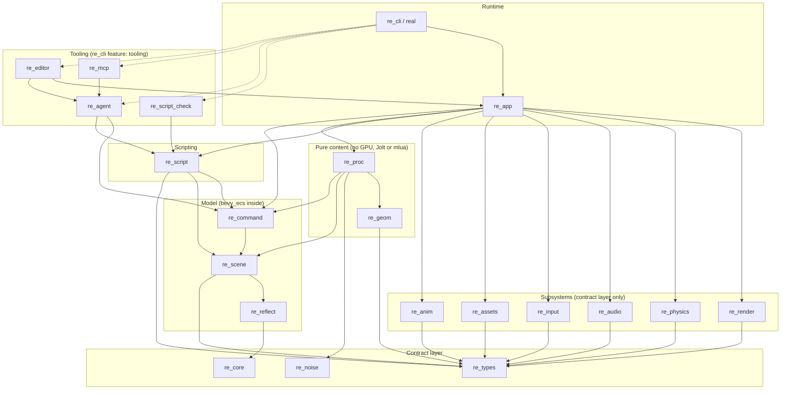

# Architecture

This document describes how Real Engine is built:
- crates and their boundaries;
- the frame loop and threads;
- the object model, and how the M2 Roblox-style layer maps onto it;
- procedural generation;
- AI integration;
- diagnostics;
- file formats.

The reasoning behind each choice is in [DECISIONS.md](DECISIONS.md), as ADR-xxxx. Versions are in [DEPENDENCIES.md](DEPENDENCIES.md).

**Status:** partly implemented (M1 in progress). The contract layer (`re_core`, `re_noise`, `re_types`), the entity model (`re_reflect`, `re_scene`, `re_command`) and the subsystem crates `re_render`, `re_physics`, `re_assets`, `re_input`, `re_audio` and `re_anim`, plus `re_script` (compile checks and script diagnostics), `re_agent` (the project lock and editor socket), `re_app` (the runtime, `App::open` and `App::serve`), `re_cli` (the `real` CLI with the tooling stubs), `re_geom` and `re_proc` (geometry and the procedural core), exist; `re_script_check`, `re_mcp`, `re_editor` and `re_compat` are still design, and `re_script`, `re_agent`, `re_app` and `re_cli` are partial. Every subsystem choice is backed by a design-phase spike; the entity core (§4) follows the core spike, which M1 WP0 ported.

## 1. Goals that shape the design

1. **A procedural-first 3D engine.** Worlds are described by graphs and code, generated deterministically, and edited by hand on top of the generated result.
2. **Luau scripting.** It starts with an engine-native API (M1) and grows a compatibility layer for Roblox-style projects (M2).
3. **Built to be driven by AI agents as well as humans.** Every edit goes through one command registry. Every check has a machine-readable result, and every error has a stable code. AI is optional (§6).
4. **Testable headless.** Everything except a single windowed smoke test runs in a container with software Vulkan (lavapipe), no audio device and no display.

## 2. Crate graph

All crates live in `crates/`. An arrow means "depends on".

- The **contract layer** is `re_core` and `re_types` (plus `re_noise`, which has no dependencies at all). These crates are plain data, traits and small utilities, with no heavy dependencies.
- **Subsystem crates** (`re_render`, `re_physics`, `re_audio`, `re_input`, `re_assets`, `re_anim`) depend only on the contract layer and on third-party crates. They never depend on each other, on `re_geom` or on `re_scene`.
- `examples/island` is a project directory (scenes, scripts, replays and goldens), not a crate. `real` loads it.



Dashed edges exist only when `re_cli` is built with the default-on `tooling` feature. A runtime-only build (`--no-default-features`) links none of the tooling crates, so it links no tokio, rmcp or full_moon (ADR-0019, ADR-0027). The rule is simple: a subcommand that needs a tooling crate exists only in the tooling build. That covers `check`, `mcp`, `agent`, `editor` and `do` (`real do` uses `re_agent`'s single-writer lock and editor-socket client), so a runtime-only `real` runs, verifies, describes and explains a project but does not edit it.

### Crate responsibilities

| Crate | Owns | Key public items | Must not depend on |
|---|---|---|---|
| `re_core` | Diagnostics, time, phases, task pool, profiling macro, logging setup | `Diagnostic`, `Severity`, `Code`, `DiagInfo`, `FixedClock`, `Phase`, `TaskPool`, `Events<T>`, `profile_scope!`, `init_logging` | anything engine-specific |
| `re_noise` | Deterministic RNG and noise (ported from the platform spike) | `Pcg32`, `SplitMix64`, `perlin*`, `simplex*`, `fbm*`, `ridged*`, `warped_fbm*`, `cellular*`, `hash2/3` | everything (zero dependencies) |
| `re_types` | Plain-data contracts between the app and subsystems, and the script host trait (no dependency on `re_core`) | `EntityId`, `RenderSnapshot`, `DrawItem`, `Camera`, `Light`, `MeshHandle`, `MaterialHandle`, `TextureRef`, `MaterialDesc`, `MeshData`, `Aabb`, `ClipData`, `PhysicsCmd`, `BodyDesc`, `ShapeDesc`, `BodyPose`, `ContactEvent`, `CharacterDesc`, `AudioCmd`, `ActionFrame`, `GraphDoc`, `ReplayDoc`, `host::HostServices` | `re_scene`, any subsystem |
| `re_reflect` | The component registry over bevy_ecs: field types, values and coercion, by-name access, script-defined components, the untyped document tree used at text boundaries, registry description and scene JSON Schema (ADR-0032) | `Registry`, `ComponentKey`, `ComponentSchema`, `FieldSchema`, `FieldType`, `ComponentOrigin`, `Value`, `Color`, `Reflect`, `component!`, `field_enum!`, `Doc`, `f32_from_parsed_f64` | subsystems, mlua |
| `re_scene` | The World facade over bevy_ecs (ADR-0005): stable ids, hierarchy, transforms and propagation, the built-in components, scene and prefab files, procedural sources, fragments, overrides, suppression, state hash | `World`, `Entity`, `StableId`, `IdIndex`, `IdGen`, `Transform`, `GlobalTransform`, `Name`, the built-ins of §4, `SceneDoc`, `SaveOptions`, `PrefabFile`, `Procedural`, `GraphSource`, `Generated`, `Overrides`, `GenNode`, `SceneFragment`, `GenContext`, `Generators`, `state_hash` | subsystems, mlua |
| `re_command` | Edit operations and transactions with exact undo, the log, the command registry, dry runs, the policy hook and the engine request channel (ADR-0003) | `Op`, `Transaction`, `Origin`, `History`, `LogEntry`, `CommandRegistry`, `CommandSpec`, `Tier`, `CommandOutcome`, `PolicyCheck` trait, `remote::{EngineHandle, EngineReceiver}` | subsystems, mlua, tokio |
| `re_geom` | Geometry operations over `MeshData` | `Heightfield`, `primitives::*`, `merge`, `transform`, `compute_normals` | wgpu, oxijolt, mlua |
| `re_proc` | ProcGraph IR, nodes, evaluation, cache, the `graph` generator for procedural sources, `graph.*` commands | `ProcGraph`, `NodeRegistry`, `NodeDef`, `Evaluator`, `EvalReport`, `GraphStore`, `register_generator`, `register_commands` | wgpu, oxijolt, mlua |
| `re_render` | The GPU renderer, GPU resources, headless capture and egui painting | `Gpu`, `Renderer`, `Renderer::render(&Device, &Queue, &TextureView, &RenderSnapshot)`, `Renderer::paint_ui(&Device, &Queue, &TextureView, &UiFrame)`, `upload_*` / `create_material` / `release_*`, `stats`, `RendererSettings`, `Capture`, `imgdiff` | `re_scene` |
| `re_physics` | Jolt through oxijolt | `Physics::new(PhysicsConfig, &'static TaskPool)`, `apply(&mut Vec<PhysicsCmd>)`, `step(dt)`, `poses_into(&mut Vec<BodyPose>)`, `velocity(id)`, `character(id)`, `events()`, `raycast` / `shape_cast` / `overlap_sphere` with a `QueryFilter`, `LayerTable`, `save_state` / `restore_state`, `motion_state` / `apply_motion_state` (`JoltRayonJobs` is internal) | `re_scene` |
| `re_audio` | kira playback, with a headless capture fallback | `Audio::new_or_headless`, `apply(&[AudioCmd])`, `CaptureBackend` | `re_scene` |
| `re_input` | Raw input, the action map and replay | `RawInput`, `InputConfig`, `ActionMap`, `Replay`, `ReplayRecorder` | `re_scene` |
| `re_assets` | Import, material files, cache and hot reload | `AssetId`, `AssetServer`, `import_gltf`, `load_material`, `ProcessedCache`, `AssetWatcher` | `re_scene` |
| `re_anim` | Animation-lite: sampling glTF node clips, and tweens | `Sampler`, `Tween` | `re_scene` |
| `re_script` | The Luau VMs, contexts, native API, scheduler, compile check and engine type definitions | `ScriptRuntime`, `Context`, `compile_check`, `api::definitions` | subsystems (it reaches them through `HostServices`), full_moon |
| `re_script_check` | The static scan, the external type checker runner and the corpus validation suite (tooling) | `scan`, `GapReport`, `types::run`, `corpus::run` | `re_app`, tokio |
| `re_app` | The frame loop, sync glue, headless runner, verify and the runtime commands | `App`, `App::open`, `App::serve`, `AppConfig`, `run_windowed`, `run_headless`, `sync::{render, physics, audio}`, `verify::{run, VerifyStage}` | tokio, rmcp, full_moon |
| `re_cli` | The `real` binary and the `explain` command | subcommands | — |
| `re_agent` | Agent policy, sessions, checkpoints, agent commands, `AGENTS.md` and client configs, the editor socket (client and server loop; Unix only in M1) and the single-writer lock | `Policy`, `Session`, `Checkpoint`, `register_commands`, `generate_agents_md`, `remote::{connect, serve}`, `lock::{acquire, probe}` | tokio |
| `re_mcp` | The MCP server (rmcp, stdio) | `serve_stdio(EngineHandle, McpOptions)` | `re_app` |
| `re_editor` | Editor-lite UI and the editor socket | `run_editor(App, EditorOptions)`, `EditorSocket` | — |

Boundaries are enforced in CI. `cargo xtask check-graph` (in `tools/xtask`) reads `cargo metadata` and fails if any "must not depend on" rule above is broken. This includes "subsystem crates reach only the contract layer", "`re_proc` does not reach wgpu, oxijolt or mlua", "only `re_reflect`, `re_scene` and `re_command` depend on bevy_ecs directly (others reach it through the `re_scene::ecs` re-export, and a crate that uses bevy's `#[derive(Component)]` or `#[derive(Resource)]`, or `re_reflect::component!`, puts `use re_scene::ecs as bevy_ecs;` in every module that uses them, because the derives otherwise emit a bare `bevy_ecs::` path)" and "`re_cli --no-default-features` reaches no tooling crate, tokio, rmcp or full_moon".

### Repository layout

```
Cargo.toml              workspace (members: crates/*, tools/*), [workspace.dependencies] with exact versions
Cargo.lock              committed
rust-toolchain.toml     channel = "stable" (MSRV 1.95 is checked by a CI job)
deny.toml               licenses, bans, duplicate allow-list
.github/workflows/ci.yml
crates/re_*/            the crates above
crates/re_*/explain/    one Markdown page per diagnostic code the crate owns
examples/island/        the M1 demo project (data and Luau only; not a workspace member)
schemas/                generated JSON Schemas (`cargo xtask schemas`; checked in CI)
docs/                   these documents
tools/xtask/            repo checks: crate-graph rules, duplicate-version allow-list, explain-page coverage, schema drift
tools/derive_alias_check/  proves bevy derives work through `use re_scene::ecs as bevy_ecs;`
```

## 3. Frame loop and threading

### Threads

| Thread | Runs |
|---|---|
| Main | The winit event loop (or the headless driver), input, Luau (one VM per script context), sync, rendering submission, egui, and answering engine requests |
| rayon pool (N = cores − 1, at least 1) | ProcGraph node evaluation, Jolt jobs (through `JoltRayonJobs`, which implements `oxijolt::JobSystem`), asset processing. bevy_ecs gets no pool of its own: `re_scene`'s schedules run single-threaded on the main thread (ADR-0005, ADR-0007). |
| Asset watcher | notify's own thread; it posts `AssetChange` into a channel the main thread drains |
| tokio (only inside `real mcp`) | The MCP stdio transport. Commands reach the main thread through `re_command::remote::EngineHandle`, a std channel. |

There is no render thread in M1. The seam for one is that `RenderSnapshot` is `Send` and owns its data (ADR-0007).

`JoltRayonJobs` comes from oxijolt's documented pattern. `max_concurrency()` returns `pool.current_num_threads() + 1`. `queue_job(job)` calls `pool.spawn(move || job.run())`, and must never block. Jobs that never ran are handed back to the stepping thread by Jolt.

### One frame

```
Input          poll winit/gilrs or the replay → RawInput → ActionMap → ActionFrame
PreRender      script contexts: per-frame callbacks (variable dt)
fixed steps    FixedClock.advance(frame_dt) → 0..=5 steps of 1/60 s
  PreAnimation   re_anim samples clips and tweens → Transform writes
  PreSimulation  script fixed-update callbacks; commands queued by scripts
  Physics        sync::physics::push: World changes → Vec<PhysicsCmd>, sorted by (kind, EntityId)
                 Physics::apply, Physics::step(dt) on the rayon pool
                 Physics::poses_into(&mut poses); Physics::events()
  PostSimulation sync::physics::pull: poses → Transform; contact events → script signals
Sync           propagate GlobalTransform; interpolate between steps;
               sync::render::build → RenderSnapshot; sync::audio → Vec<AudioCmd>
Render         Renderer::render(device, queue, view, &snapshot); egui overlay through paint_ui
EndFrame       flush the command journal; release unreferenced GPU resources; PerfReport sample;
               asset and script hot reload; answer queued engine requests; events cleared
```

The phase order matches the order Roblox-style scripts expect: render-step work happens before simulation, "stepped" before physics, and "heartbeat" after physics (ADR-0009). This makes the M2 mapping direct.

Headless runs (`real run --headless --frames N`, tests, `real verify`) use the same loop. The differences are:
- the frame time is fixed at the step size;
- input comes from a replay;
- rendering goes into an offscreen texture that is captured only on the frames the replay asks for.

### Snapshots and command buffers

`re_types` defines what crosses the boundary (ADR-0006):

```rust
pub struct EntityId(pub u64);                // Entity::to_bits(), converted only in re_scene

pub struct RenderSnapshot {
    pub camera: Camera, pub lights: Vec<Light>,
    pub items: Vec<DrawItem>, pub debug_lines: Vec<DebugLine>,
    pub clear: [f32; 4],                     // no egui types here: UI is painted separately
}
pub struct DrawItem { pub entity: EntityId, pub mesh: MeshHandle, pub material: MaterialHandle,
                      pub world: glam::Mat4, pub flags: DrawFlags }

pub enum PhysicsCmd {
    AddBody { id: EntityId, desc: BodyDesc }, RemoveBody { id: EntityId },
    SetTransform { id: EntityId, pos: Vec3, rot: Quat }, SetKinematicTarget { id: EntityId, pos: Vec3, rot: Quat },
    ApplyImpulse { id: EntityId, impulse: Vec3 }, SetVelocity { id: EntityId, linear: Vec3, angular: Vec3 },
    SetShape { id: EntityId, shape: ShapeDesc },
    AddConstraint { id: EntityId, desc: ConstraintDesc }, RemoveConstraint { id: EntityId }, // ... characters
}
pub struct BodyPose { pub id: EntityId, pub pos: Vec3, pub rot: Quat }   // active bodies, newly asleep bodies, characters
```

- `re_types` depends only on `glam`, `serde` and `serde_json` (plus `schemars` behind its optional `schemars` feature, for the schemas of the graph and replay file formats).
- The pose pull is one batched call to oxijolt's `active_body_poses_into`, which returns position and rotation for **active** bodies; `Physics::poses_into` adds the bodies that fell asleep during the step (with their final pose) and every character. A sleeping body is not returned again until it wakes; its `Transform` keeps the exact value it had when it fell asleep. Velocities are read per body (`Physics::velocity`) only for the entities that need them, such as characters and scripted bodies.
- egui output is not part of the snapshot. `re_app` runs egui, tessellates the shapes with `egui::Context::tessellate` (`UiFrame::from_output` does it), and passes a `UiFrame { primitives, textures_delta, size_px, pixels_per_point }` to `Renderer::paint_ui(&Device, &Queue, &TextureView, &UiFrame)`. egui types therefore appear only in `re_render`, `re_app` and `re_editor`. `re_render` paints egui into an `Rgba8Unorm` overlay and composites it with a manual-gamma blit on every backend, so the UI looks the same on Vulkan and GL (ADR-0010).
- **Lighting convention.** A directional light's (sun's) intensity is in lux: at exposure 1, an illuminance of 1 lux makes a white diffuse surface white. A point light's intensity is in lumens (it shines `lumens / 4π` candela) with a windowed falloff that reaches zero at its `range`. Emissive colour is multiplied by the exposure too. Exposure and the ambient light (a sky and a ground colour, a hemisphere) are renderer settings (`re_render::RendererSettings`), not snapshot data: `RenderSnapshot` has no ambient field.

Meshes, textures and materials are uploaded through `Renderer::upload_mesh(&MeshData) -> Result<MeshHandle, Diagnostic>` and its siblings (`upload_texture`, `create_material`), when an asset loads or a ProcGraph produces a `Derived` mesh, not every frame. They are released through `release_mesh` and its siblings, which return `Result<(), Diagnostic>`. Handles carry a generation, so a stale handle is detected. `re_app` releases a `Derived` mesh at the end of the frame in which a regeneration diff leaves it unreferenced, so regenerating many times does not grow GPU memory.

## 4. Object model

### Engine model

The entity core is bevy_ecs 0.20.0 used standalone, behind our own API (ADR-0005), with our own component registry (ADR-0032). The core spike built and tested this model; M1 WP0 ports it.

- **Entity**: a bevy_ecs `Entity` (index plus generation) at run time. It is never written down.
- **Stable id**: every saved entity has a `StableId`, a string such as `e7kq2m9x4tb` (engine-made) or `player_spawn` (chosen). Files, commands, logs, undo history, agents and scripts address entities by id. The `IdIndex` resource maps ids to entities and is kept exact by component hooks. Generated entities have ids of the form `<source id>/<StableKey>` (§5).
- **Components**: bevy_ecs components registered in `re_reflect::Registry`, which gives typed, documented, defaulted fields readable and writable by name, with central coercion rules (Luau's f64 numbers into f32 fields, for example). Native components are declared with the `component!` macro; scripts and agents can declare new components at run time (`Registry::register_script`), and those are real ECS components that are queried, change-tracked, saved and undone like native ones. Field types are a closed set: `bool`, `i32`, `i64`, `f32`, `f64`, `vec3`, `quat`, `color`, `string`, `entity` and unit enums.
- **M1 built-ins** (fields are frozen in [M1_PLAN.md, WP0](M1_PLAN.md#wp0-workspace-ci-contracts-and-the-entity-core)):
  - `Name` (written as the entity's `name` in files), `Transform` (`translation`, `rotation`, `scale`) and the derived `GlobalTransform`;
  - `MeshRef`, `MaterialRef`, `Visible`;
  - `Camera`, `Light`;
  - `RigidBody` (static, dynamic or kinematic), `Collider` (box, sphere, capsule, convex, mesh or heightfield, plus layer, group mask and sensor);
  - `CharacterController` (with its own layer and group mask);
  - `ScriptRef` (a script path and context);
  - `AudioSource`, `AnimPlayer`;
  - `Procedural` and `GraphSource` (procedural sources, §5);
  - `HudText`.
- **Hierarchy**: bevy's `ChildOf` / `Children` relationship: ordered children, recursive despawn. Files store a `parent` id per entity. `GlobalTransform` is recomputed in the Sync phase by a change-driven propagation system that only touches subtrees whose `Transform` or `ChildOf` changed (0.42 to 1.36 ms per update at 100,100 entities in the spike, against 5.5 ms for a full pass). `world.find("Island/Crates/Crate_3")` resolves a path of names as a convenience; it is not an identity.
- **Change tracking**: bevy's per-component change ticks. Writing an equal value through the registry does not mark a component changed.
- **Edits** go through `re_command` operations and transactions (ADR-0003): atomic, with exact undo and redo, and a log.
- **Events**: `re_core::Events<T>`, which are typed and double-buffered, plus contact events. Scripts receive them as signals.

### Luau view (M1 native API)

Entities are `Copy` handles (index plus generation) exposed as userdata. Handles are interned in a weak-valued table, so `a == b` and `rawequal(a, b)` hold for the same entity, and handles work as table keys. A stale handle raises a clear error. Component fields are reached by name through the registry, and scripts can define their own components:

```lua
world.define_component("Collectible", { value = "i32" })
local crate = world.get("crate_3")                 -- by stable id
local t = crate:get("Transform", "translation")
crate:set("Transform", "translation", t + vector.create(0, 1, 0))
physics.impulse(crate, vector.create(0, 5, 0))
input.on_pressed("jump", function() ... end)
task.wait(0.5)
```

- Vectors are native Luau vectors, built with the builtin `vector.create` (ADR-0011).
- Each script context (`game` and `tools` in M1) is one sandboxed VM. Inside it, each script and module has its own environment table over the frozen globals, with `safeenv` set, so scripts cannot see each other's globals and builtin fastcalls stay fast.
- A CPU budget per context is enforced by a raw Luau interrupt that keeps raising once tripped, so `pcall` cannot swallow it.
- `tools` scripts may issue commands. `game` scripts may not issue destructive commands; they reach the engine through `HostServices`.
- `engine.d.luau`, generated from the binding registry, describes the whole native API for the type checker, editors and agents (`real describe --luau-defs`).

### M2 Roblox-style compatibility layer (`re_compat`)

The layer is Luau plus Rust on top of the native model. The core spike checked how a Roblox-style object model maps onto bevy_ecs: relationships, hooks, observers, change ticks and runtime-defined components cover the instance tree, its signals and script-defined classes. Two pieces are missing from M1 and are M2 work: **container field types** (a string-keyed map and lists, for attributes and tags) and a **class layer** over components. The mapping:

| Roblox-style concept | Engine mapping |
|---|---|
| Instance tree (`game`, services, `Workspace`), `Parent =`, `Destroy()` | Entities under a root `game` entity, linked by `ChildOf` / `Children` (ordered, recursive despawn); `Parent =` and `Destroy()` are the `reparent` and `despawn` operations. Each service is a singleton entity with a `ServiceTag`. `Workspace` is the world root that rendering and physics see. |
| `Name`, `FindFirstChild(name)` | The `Name` component; scan the (short) children list, or add a per-parent name index if measurements ask for it |
| `ClassName`, `IsA`, typed properties | A **class layer** over components: a class is a marker component plus a component set plus property aliases, with inheritance, in `re_compat`. For example a part class is `Transform` + a primitive shape component + `RigidBody`, with `Position` aliased to `Transform.translation` and `Anchored` to `RigidBody.kind`. The registry already gives typed, documented, defaulted properties by name; unknown properties raise `RE9001`. |
| `Folder`, `Model`, `PrimaryPart` | An entity with only `Name`; `Model` adds `PrimaryPartRef` |
| `Script`, `LocalScript`, `ModuleScript` | `ScriptRef` with context `server` or `client`. Modules are resolved by our `require`. |
| `CFrame` | Userdata over position plus a rotation matrix (f32 in M2). Every constructor and operator is in the coverage table. |
| `Vector3`, `Vector2`, `Color3`, `UDim2`, `Enum.*` | `Vector3` maps to the native Luau vector. The others are userdata or frozen tables generated from a JSON table. |
| `RBXScriptSignal`, `:Connect`, `:Once`, `:Wait`, legacy `connect` | A Luau signal library over engine events |
| `Changed`, `GetPropertyChangedSignal` | Per-component change ticks, plus a per-field diff when signals are dispatched |
| `ChildAdded`, `DescendantAdded`, `AncestryChanged` | Observers on `ChildOf` (`On<Insert<ChildOf>>`, `On<Discard<ChildOf>>`). Not hooks: `ChildOf` is a bevy relationship and already owns its `on_insert` and `on_discard` hooks, and registering a second one panics. Hooks remain fine on our own components (`StableId`, the tag index). |
| `RunService` events (render-step bindings, `RenderStepped`, `PreAnimation`, `Stepped` / `PreSimulation`, `Heartbeat` / `PostSimulation`) | The engine phases in §3, in the same order |
| `task.*`, `wait`, `delay`, `spawn` | The `re_script` scheduler (coroutines resumed in the phases) |
| `Humanoid` and character | `CharacterController` (Jolt CharacterVirtual) plus a Humanoid state component and the event set |
| Collision groups | Jolt object layers plus a group filter table |
| Attributes (`GetAttribute`, `SetAttribute`, attribute-changed signals) | An `Attributes` component holding a small name → `Value` map. Needs the new map field type in `re_reflect`; change signals come from per-key diffing. |
| `CollectionService` tags | A `Tags` component (a list field) plus a tag index resource kept exact by hooks, like `IdIndex` |
| Several attachments, welds or constraints per part | Child entities, as in Roblox; entity-typed fields (a weld's other part) are already repaired across despawn and undo |
| `ModuleScript.Source` | Script assets referenced by path, never inline in the scene |
| `RemoteEvent`, `RemoteFunction`, `BindableEvent` | In-process queues between the `server` and `client` contexts. M2 runs both in one process. Values are deep-copied, with floats copied bit-exact. |
| Services that need an online backend (data storage, teleport, marketplace) | They exist and return a clear `RE9002` "not available offline" error. Nothing hangs. |
| Deprecated members that real scripts still use | Implemented where cheap, each with an `RE9101` deprecation note |
| Large static maps | Static cells (ADR-0031) |

Coverage is a data file, `crates/re_compat/coverage.json`, listing each class and member with its status (`implemented`, `partial`, `stub-error` or `missing`). The static scan (§7) compares real scripts against this file. M2 also ships a compatibility definitions file, so the type checker knows the Roblox-style globals.

## 5. Procedural system

### ProcGraph IR

```rust
pub struct ProcGraph { pub id: GraphId, pub seed: u64, pub nodes: IndexMap<NodeId, Node>, pub edges: Vec<Edge> }
pub struct Node { pub kind: String /* "terrain.heightfield" */, pub version: u32, pub params: serde_json::Value }
pub struct Edge { pub from: (NodeId, PortName), pub to: (NodeId, PortName) }
```

The serialized form (`GraphDoc` in `re_types`) is the `*.graph.json` file.

There are two ways to author a graph:
1. Write the JSON in `graphs/` (a `GraphDoc` file).
2. Write a Luau builder script in the `tools` context (`scripts/tools/island_graph.luau`) that **records** a graph. Builders live under `scripts/` like every other script, so they can `require` shared modules:

```lua
local g = proc.graph("island", { seed = 1234 })
local h = g:node("terrain.heightfield", { size = 256, cell = 1.0, scale = 0.01, octaves = 5 })
local m = g:node("terrain.island_mask", { size = 256, cell = 1.0, falloff = 0.6 })
local t = g:node("field.combine", { op = "mul" }, { a = h, b = m })
g:node("terrain.mesh", { collider = true }, { field = t })
local pts = g:node("scatter.poisson", { radius = 4.0, slope_max = 0.5 }, { field = t })
g:node("points.instance", { prefab = "prefabs/tree.prefab.json" }, { points = pts })
return g
```

Grid spacing belongs to the fields: `cell` and `size` are parameters of `terrain.heightfield` and `terrain.island_mask`, and `terrain.mesh` takes the spacing of the field it is given. Give a mask the same `size` and `cell` as the heightfield it multiplies, or `field.combine` resamples it by UV. A builder records each input as an edge `{ from = [id, "out"], to = [id, port] }`; every node has one output port, named after its type (`field`, `mesh`, `points`, `fragment`), and `out` is an alias for it (`re_proc::OUT_ALIAS`).

Either way, `graph.set_param` does not rewrite the file or the script: it stores a per-node parameter override on the procedural source (`GraphSource.params`) through an ordinary undoable `set_field`, which works for both kinds of graph and is saved with the scene.

The builder runs once in the `tools` context and returns a `GraphDoc` (`re_types`), so `re_script` does not depend on `re_proc`. `re_proc` turns it into a `ProcGraph`, and the graph is evaluated in Rust. In M1, Luau never runs inside node evaluation.

### M1 node set

| Node | Output |
|---|---|
| `terrain.heightfield` (fbm, ridged or warped noise) | Field |
| `terrain.island_mask` (radial falloff) | Field |
| `field.combine` (add, mul, min, max, lerp) | Field |
| `field.remap` (clamp, curve, terrace) | Field |
| `terrain.mesh` (field → mesh, plus optional heightfield collider) | Fragment |
| `terrain.water_plane` | Fragment |
| `scatter.poisson` (on a field, with height and slope limits) | Points |
| `scatter.grid_jitter` | Points |
| `points.filter` (height, slope, mask, density) | Points |
| `points.pick` (weighted choice per point) | Points with tags |
| `points.instance` (a prefab file per point, through `re_scene::PrefabFile`) | Fragment |
| `mesh.primitive` (box, sphere, cylinder, capsule, plane) | Mesh |
| `mesh.transform` / `mesh.merge` | Mesh |
| `material.assign` (a `materials/*.material.json` path, loaded by `re_assets`) | Mesh |
| `fragment.merge` (graph output) | Fragment |

The table has 15 rows and 16 node kinds: `mesh.transform` and `mesh.merge` share a row.

### Evaluation

- Nodes are evaluated in topological order. Independent nodes run in parallel on the rayon pool.
- Each node's key is `blake3(kind, version, canonical_json(params), input keys…, node_seed)`.
- `node_seed = Pcg32::from_seed(graph.seed).fork(hash64(node_id))`. Seeds come from the node id, so adding or removing a node never changes another node's random numbers.
- Results are cached in memory, and on disk in `.real/cache/proc/<key>.bin` (postcard) for heavy outputs (fields and meshes).
- `EvalReport` records per node: key, cache hit or miss, time, output size and diagnostics (`RE4xxx`). `real graph eval --json` prints it.
- Meshes become `AssetId::Derived(key)`. The renderer receives them through `upload_mesh`, keyed by that hash, so an unchanged mesh is never uploaded again. A mesh that no entity references any more is released (§3).

### Procedural sources and regeneration

A graph is placed in a scene by a **procedural source** entity (ADR-0017): an ordinary saved entity with `Procedural { generator: "graph", seed }`, a `GraphSource` naming the graph file or the builder script, its own `Transform`, and its `overrides`. Generated entities are children of the source and are never saved.

1. A new seed or parameter changes the source's fingerprint (generator, seed, parameters and the graph document's canonical hash). Only nodes whose keys changed recompute. The fingerprint does not cover prefab file contents, so after a prefab edit the runtime calls `graph.regenerate`; inside the evaluation, prefab contents are part of the node keys, so only the affected `points.instance` nodes recompute.
2. The output `SceneFragment` is a list of `GenNode { key, name, parent_key, components }`. The **StableKey** is `<node_id>/<local_key>`, where `local_key` is chosen by the node (point index, cell, …). The entity's id is `<source id>/<StableKey>`, for example `island/scatter/17`.
3. The fragment is applied as a diff: added, removed and changed entities, and the `Derived` meshes that are no longer referenced (`RegenReport::released_assets`). The runtime calls `GraphStore::release` for the released assets of its own `World::regenerate_changed`; `graph.regenerate` already does so. Releasing a terrain mesh also releases its heightfield collider, and a cloned `GraphStore` (as in `World::fork`) has its own copy of the derived map.
4. `graph.regenerate` (`{ source, seed }`) sets the source's seed and applies the diff inside one transaction. Entities whose key is unchanged keep their `Entity`, so script handles stay valid. Physics bodies are updated through `PhysicsCmd`.
5. User overrides are re-applied. They are stored on the source by StableKey, and are either a field value or a **deletion**. Editing a generated entity through any command records an override in the same transaction, so undo removes both. A key with a deletion override is not spawned again. Overrides whose target disappeared are kept as orphans, and produce warning `RE4010`.
6. During play, a generated entity destroyed by a game script (a collected item, for example) is **suppressed** by its key for the rest of the session, so it stays gone after a regeneration. Suppression is never saved.
7. Characters are re-grounded: each one is placed on the new ground by a downward raycast at its x and z.

This works during play. The M1 demo regenerates the island with a new seed while the character stands on it.

## 6. AI integration

### Guarantees

- **AI is optional.** Every capability that agents use is an ordinary engine feature: commands, `real` subcommands, `real verify`, diagnostics and the editor. The engine never calls a model or a provider API. A runtime-only build (`real` without the `tooling` feature) contains no agent or MCP code at all.
- **Provider-neutral.** Agents connect through open interfaces: MCP over stdio, and the `real` CLI with JSON output. No provider SDK is linked, and nothing depends on one vendor's protocol extensions. Everything an agent needs is reachable through MCP tools, because tools are the one feature that every client supports; resources and prompts are extras. `real agent init` writes each supported client's own configuration format (ADR-0025).
- **Verifiable.** Every change returns a structured outcome with its diagnostics, every mutating command supports a dry run, and `real verify --json` checks the whole project.

### Surfaces

| Surface | For | Built on |
|---|---|---|
| `real describe [--json]` | What commands, components, nodes and scripts exist | The command registry plus reflection |
| `real describe --luau-defs` / `engine.d.luau` | The exact native Luau API, for type checkers, editors and agents | The binding registry in `re_script` |
| `real do <command> --args '{json}' [--dry-run]` (tooling build) | One edit from a shell | The registry |
| `real verify --json` | Is the project healthy? | ADR-0022 |
| `real explain RE####` | What an error means and how to fix it | Compiled explain pages |
| `real mcp` | MCP clients (Claude Code, Codex, VS Code, Cursor, Gemini CLI, Zed and others) | `re_mcp` → `EngineHandle` → the registry |
| `AGENTS.md` / `CLAUDE.md` | Agent onboarding in a project | Generated by `real agent init` |

### Command flow

```
client → real mcp (tokio, background thread) → re_command::remote::EngineHandle (std channel)
       → main thread: re_app::App::serve(receiver, &dyn PolicyCheck)   (edit mode: nothing simulates)
       → PolicyCheck (re_agent::Policy: tier, path scopes, budgets)
       → CommandRegistry::dispatch(name, args, dry_run)
       → Transaction of Ops → History (undo, redo, log) → CommandOutcome { changes, diagnostics, data }
```

`re_cli` builds the engine (`App::open`) and hands the `EngineHandle` to `re_mcp::serve_stdio`, so `re_mcp` never depends on `re_app`. If an editor process is running, `real mcp` and the CLI connect to `.real/editor.sock` (`re_agent::remote::connect`) instead of opening the project themselves; otherwise the first writer (`real do`, `real mcp`) takes an operating-system file lock on `.real/editor.lock` through `re_agent::lock` and records its pid and kind in `.real/editor.owner`, and a second one gets `RE8003`. The OS releases the lock when the holder exits, so a crashed writer leaves nothing stale. There is one writer (ADR-0020, ADR-0026). `App::serve` is edit mode: it answers requests between frames without stepping the simulation, so what an agent edits is the scene on disk; running the game is `play.run` (on a copy) or `real run`.

### Safety

- **Tiers.** `read` < `edit` < `destructive`. There is no shell tier.
- **Default.** Without `.real/agent-policy.toml` an agent gets `read` only. `real agent init` writes a policy granting `edit` within the default path scopes; committing that file is the explicit opt-in. `destructive` must be granted in the policy explicitly.
- **Dry runs.** Every mutating command accepts `dry_run`, and returns the changes it would make at `read` tier.
- **Generate and play** (`graph.generate`, `play.run`) run on a world copy with budgets, and return a report plus a screenshot. They are `read` tier, because they cannot change the project. Committing a result is a separate `edit` command.
- **Policy file.** `.real/agent-policy.toml` sets the maximum tier, path scopes and budgets.
- **Checkpoints.** Each session starts with a checkpoint. `checkpoint.restore` returns to it, after saving the current state as another checkpoint.
- **Scripts.** `script.write` is compile-gated.

### MCP tool set (M1: 25 tools)

Each M1 command is one MCP tool. There is no generic `command.run` tool in M1, because it would hide the target command's tier from the client's annotations (ADR-0026).

| Tier | Tools | Registered by |
|---|---|---|
| Read | `describe`, `query`, `entity.get`, `command.describe` | `re_command` |
| Read | `graph.report`, `graph.generate` | `re_proc` |
| Read | `screenshot`, `verify`, `play.run` | `re_app` |
| Read | `explain` | `re_cli` |
| Edit | `entity.spawn`, `entity.set`, `entity.reparent`, `entity.delete`, `component.add`, `component.remove`, `scene.apply` (a list of operations as one atomic transaction), `undo`, `redo` | `re_command` |
| Edit | `graph.set_param`, `graph.regenerate` | `re_proc` |
| Edit | `asset.import` | `re_app` |
| Edit | `script.write`, `checkpoint.restore` | `re_agent` |
| Destructive | `file.delete` | `re_agent` |

Annotations are derived from the tier and set explicitly on every tool (ADR-0025): `read` gives `readOnlyHint: true, destructiveHint: false`; `edit` gives `readOnlyHint: false, destructiveHint: false`; `destructive` gives `destructiveHint: true`. `idempotentHint` is set per command, and `openWorldHint` is `false` for all of them.

## 7. Diagnostics and error model

- **One type.** `re_core::Diagnostic { code, severity, message, location, hint, related }`. Library crates use `thiserror` enums internally and convert to `Diagnostic` at their public boundary. Binaries use `anyhow` only for top-level plumbing.
- **Code blocks.** This table is the single source for code ranges (ADR-0004 refers to it):

| Range | Owner |
|---|---|
| RE0000–0499 | `re_core` |
| RE0500–0899 | `re_app` |
| RE0900–0999 | `re_cli` |
| RE1000–1199 | `re_reflect` (field types, coercion, unknown components and fields) |
| RE1200–1999 | `re_scene` (ids, hierarchy, scene, prefab and procedural errors) |
| RE2xxx | `re_command` |
| RE3xxx | `re_script`, `re_script_check` |
| RE4000–4499 | `re_proc` |
| RE4500–4599 | `re_geom` |
| RE5xxx | `re_physics` |
| RE6xxx | `re_render` |
| RE70xx–71xx | `re_assets` |
| RE72xx | `re_input` |
| RE74xx | `re_audio` |
| RE76xx | `re_anim` |
| RE8000–8099 | `re_agent` |
| RE8500–8599 | `re_mcp` |
| RE8800–8899 | `re_editor` |
| RE9xxx | compatibility (`re_script` in M1, `re_compat` in M2) |

- **Explain pages.** Each crate has `explain/RE####.md` and exports `pub const DIAGNOSTICS: &[DiagInfo]`, built with `include_str!`. `re_cli` collects all of them. A test fails on a missing page, a duplicate code, or a code outside the crate's range, and `cargo xtask explain` fails on a page that no `include_str!` in the crate's sources references (so every code used in source is in `DIAGNOSTICS`).
- **Output.** Human output looks like rustc's: `error[RE3004]: ... --> scripts/game/player.luau:12:5`, followed by a hint. `--json` gives the same data as JSON lines.
- **Panics** are bugs. A panic hook writes a crash report to `.real/crash/` and exits with code 101.
- **Script errors** carry file, line and traceback. When mlua gives no line (errors raised from Rust, timeouts at the top of a chunk), the line of the first Luau frame in the traceback is used. The duplicated "runtime error:" prefix from mlua is removed. An error in one script callback disconnects nothing and does not stop the frame. It is reported once per distinct location per second.
- **Type-check results** from the external checker are parsed into the same `Diagnostic` shape (`RE3xxx`), so the CLI, the editor and agents see one format.
- **GPU errors** go through `on_uncaptured_error` to `RE6001`, instead of wgpu's default panic.

## 8. Data formats and project layout

### A project

```
my-game/
  real.toml                  project config (TOML)
  .luaurc                    require aliases, shared by the runtime and the type checker
  scenes/main.scene.json     entities, components, overrides of generated entities
  prefabs/*.prefab.json      reusable entity trees
  materials/*.material.json  PBR-lite parameters + texture asset refs
  graphs/*.graph.json        ProcGraph IR
  scripts/game/**.luau       game context
  scripts/tools/**.luau      tools context (graph builders, editor helpers)
  scripts/shared/**.luau     modules require-able from both
  assets/**                  .gltf/.glb, .png/.jpg, .wav, each with a .meta.json (uuid, import settings)
  tests/replays/*.replay.json
  tests/goldens/<backend>/*.png
  .real/agent-policy.toml    committed
  .real/cache/  .real/agent/  .real/sessions/  .real/crash/  .real/types/   ignored
  .real/editor.lock  .real/editor.owner  .real/editor.sock                 ignored; the editor or a headless writer holds an OS lock on editor.lock and writes its pid and kind to editor.owner; the socket exists only while the editor runs
  AGENTS.md  CLAUDE.md       generated by `real agent init`
```

`.real/types/engine.d.luau` is written by `real check --types` and `real agent init` from the running engine's binding registry.

### `real.toml`

```toml
[project]
name = "island"
entry_scene = "scenes/main.scene.json"

[sim]
fixed_hz = 60
max_steps_per_frame = 5

[render]
backends = ["vulkan", "gl"]   # wgpu backend preference

[scripts]
contexts = ["game", "tools"]
cpu_budget_ms = 4
memory_limit_mb = 256
checker = "luau-lsp"          # or a path to a patched luau-analyze (ADR-0013)

[input.buttons]               # action = list of bindings
jump = ["key:Space", "pad:South"]
regenerate = ["key:KeyG"]
restart = ["key:KeyR"]

[input.axes]
move = [{ composite = ["key:KeyW", "key:KeyS", "key:KeyA", "key:KeyD"] }, { stick = "left", dead_zone = 0.15 }]
look = [{ mouse_delta = 0.002 }, { stick = "right", dead_zone = 0.15 }]

[verify.perf]                  # warnings only in M1
frame_ms_p95 = 33.0
```

Input bindings name winit `KeyCode` variants (`key:KeyW`), mouse buttons (`mouse:Left`) and gilrs buttons (`pad:South`). An axis lists its sources in priority order; `composite` is up, down, left and right. An unknown name is a diagnostic, not a silent no-op.

### Scene file (excerpt)

```json
{
  "$schema": "../schemas/scene.schema.json",
  "format": "real-engine/scene",
  "version": 1,
  "entities": [
    { "id": "world", "name": "World" },
    {
      "id": "player",
      "name": "Player",
      "parent": "world",
      "components": {
        "CharacterController": { "height": 1.8, "radius": 0.4, "inner_body": true },
        "ScriptRef": { "path": "scripts/game/player.luau", "context": "Game" },
        "Transform": { "translation": [0.0, 10.0, 0.0], "rotation": [0.0, 0.0, 0.0, 1.0], "scale": [1.0, 1.0, 1.0] }
      }
    },
    {
      "id": "island",
      "name": "Island",
      "parent": "world",
      "components": {
        "GraphSource": { "builder": "scripts/tools/island_graph.luau", "graph": "" },
        "Procedural": { "generator": "graph", "seed": 1234 }
      },
      "overrides": [
        { "target": "scatter/17", "component": "Transform", "field": "translation", "value": [12.0, 4.5, -3.0] },
        { "target": "scatter/21", "deleted": true }
      ]
    }
  ]
}
```

A `GraphSource` names either a `builder` script or a `graph` file (`graphs/*.graph.json`). Its `params` field (omitted above because it is empty) holds the per-node parameter overrides written by `graph.set_param`.

Rules (verified by the core spike's round-trip tests, ADR-0016):
- entities are written in a stable order: roots sorted by id, then depth-first in `Children` order. A `parent` always appears before its children;
- components are sorted by name, fields are in declaration order, and lists of scalars are written on one line;
- floats are written in shortest round-trip form, and parsed exactly (including the f32 double-rounding fix of ADR-0032);
- unknown keys are errors that name the entity index, id, component and field;
- generated entities are not written; the schemas of script-defined components used in the file are declared in a top-level `script_components` list, so the file loads before any script runs;
- a file always ends with a newline, and save → load → save is byte-identical;
- the `version` field is migrated forwards by `re_scene::migrate`, one function per version.

### Replay file

```json
{ "$schema": "../../schemas/replay.schema.json", "version": 1, "seed": 1234, "frames": 600,
  "input": [ { "frame": 30, "action": "move", "axis": [0, 1] }, { "frame": 90, "action": "jump", "down": true } ],
  "commands": [ { "frame": 300, "name": "graph.regenerate", "args": { "source": "island", "seed": 99 } } ],
  "checks": [ { "frame": 600, "screenshot": "tests/goldens/{backend}/island_600.png" } ] }
```

Goldens are kept per backend, because GL and Vulkan differ in small ways (ADR-0010). `verify` compares against the set for the backend it ran on.

### Caches

Caches are postcard with a `(magic, format_version)` header, stored in `.real/cache/`. Keys are blake3 hashes. Every cache is safe to delete.
