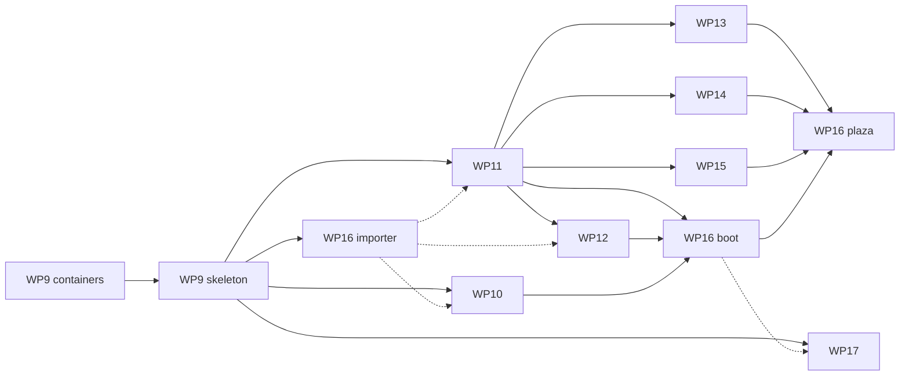

# M2 plan

M2 is the Roblox-style compatibility layer. When it is done, Roblox-style projects run on Real Engine through a new crate, `re_compat`, which maps Roblox-style globals, services, instances, datatypes, enums and events onto the native engine of M1 ([ARCHITECTURE.md §4](ARCHITECTURE.md#m2-roblox-style-compatibility-layer-re_compat), ADR-0012). The owner chose "Demo first": M1 shipped the island demo on the native API, and M2's goal is the owner's two sample projects running through this layer. A new public example, `examples/plaza`, is written for this repository in the Roblox style, so CI can check the layer without the private samples.

This plan splits M2 into nine work packages: WP9 to WP17. Numbering continues from M1, so a WP number always means one thing.
- **WP9 comes first.** It lands in two PRs:
  - **PR "containers"**: list, map and record field types in `re_reflect`, plus the `Attributes` and `Tags` components and the tag index in `re_scene`;
  - **PR "skeleton"**: the `re_compat` crate, with the class layer, the class and enum data formats, the coverage file and the compat scene conventions.
- After "skeleton", **WP10** (datatypes and enums), **WP11** (the data model, signals and the scheduler), **WP16** (the importer) and **WP17** (the M2 AI track) start.
- After WP11's first PR, "data model", **WP12** (players, server and client, remotes and services), **WP13** (physics), **WP14** (characters, animation and input) and **WP15** (rendering, UI, tweens and sound) start.
- **WP16** lands in three PRs: "importer" (with the private sample runner), "boot" (which integrates `re_compat` into `re_app` and `real` and adds the boot stage of `real verify`) and "plaza" (`examples/plaza`).

**Every WP section below is a self-contained brief**, as in [M1_PLAN.md](M1_PLAN.md). It gives the goal, the owned paths, when the WP starts, the interfaces it consumes, what to build, the non-goals, the acceptance commands and the definition of done.

**Private material.** The sample projects, their scripts, the scene analyses and the M2 sizing live in the private research folder (`/mnt/project-files/real-engine/research/`, written `research/…` below). The M1 rules still hold: nothing from the samples is committed, and no public file names them, quotes their code or gives their counts, timings or layout. The sizing behind this plan's WP split is in `research/m2/sizing.md`, and the samples' acceptance list is in `research/m2/acceptance.md`. WP threads read both. Public tests use synthetic fixtures and `examples/plaza`, which are written from scratch for this repository.

**How the work is ordered.** The validation suite's static gap report (ADR-0014, ADR-0024) ranks the members real scripts use by how often they use them. Inside each WP, members are implemented in that order, so coverage of real code rises fastest. Run it with `real check --corpus --scripts-dir <DIR> --json`. Its `scan.gap.missing` table is the work list, and WP9's PR "skeleton" switches it to read `crates/re_compat/coverage.json`.

## Defaults this plan picks

These are open questions or owner-set values. The plan goes ahead with the default and changes when the owner decides.

| Question | Default | Who decides |
|---|---|---|
| Must sample scripts run unchanged, or may a mechanical migration step come first (open question 3)? | **Unchanged.** No `real migrate`. If the owner accepts migration, WP12–WP15 drop members a migration tool can rewrite, and a `real migrate` WP is added. | Owner |
| Gap threshold for the exit criterion (ROADMAP M2) | **No `missing` member used by the samples' live code.** Every member used is `implemented`, `partial` or `stub-error`. Members out of scope are listed as `stub-error`. | Owner |
| Large static map size and budgets (ADR-0031) | **250,000 anchored parts.** Load in ≤ 30 s, a mean fixed step ≤ 8 ms over 600 frames, and peak RSS ≤ 4 GB, in the reference container. | Owner |
| Networking | **One process.** Server and client run as two contexts with two worlds in one process (WP12). There is no real networking in M2. | Plan |
| Online services (data storage, memory store, teleport, text filtering, marketplace) | They exist and fail with `RE9002`. Nothing hangs. Local-file persistence is M3. | Plan |
| Determinism in tests | Verify and the sample runner use a virtual clock and seed `math.random`, `Random.new()` and `os.clock` from the run seed. | Plan |
| License and Windows/macOS blocking | Unchanged: the license is open, and Windows and macOS become blocking at M3 ([DECISIONS.md, open questions](DECISIONS.md#open-questions-for-the-owner)). | Owner |

## Ownership in M2

The M1 ownership rule ([M1_PLAN.md](M1_PLAN.md)) carries over, with these changes:
- The maintainer keeps every path WP0 owned (the root files, `.github/`, `tools/`, `README.md`, `docs/`, and the crates `re_core`, `re_noise`, `re_types`, `re_reflect`, `re_scene`, `re_command`).
  - One exception is planned: WP9 edits `re_reflect` and `re_scene` for its PR "containers", which the maintainer reviews as a frozen-contract change.
  - `re_types::HostServices` grows during M2. A WP that needs a new host call asks the maintainer, who adds it as a provided method whose default body returns `RE9001`, so nothing else breaks. WP16 implements it in `re_app`.
- M1's WP crates pass to the M2 WP that changes them:
  - `re_script` to WP11;
  - `re_physics` to WP13;
  - `re_input` and `re_anim` to WP14;
  - `re_render` and `re_audio` to WP15;
  - `re_app`, `re_cli` (except `tooling/{mcp,agent,editor}.rs`), `re_script_check` and `examples/` to WP16;
  - `re_agent`, `re_mcp` and `re_cli/src/tooling/{mcp,agent}.rs` to WP17;
  - `re_assets`, `re_geom`, `re_proc` and `re_editor` to the maintainer, who folds in requests.
- `re_compat` is split by directory, as listed in each WP. `crates/re_compat/Cargo.toml`, `src/lib.rs` and `src/codes.rs` belong to WP9. Other WPs ask WP9's owner (the maintainer, once WP9 is done) for new modules, dependencies and code blocks.
- Class, enum and library data are split into one file per area under `crates/re_compat/classes/`, `enums/` and `libraries/`. Each class or enum file belongs to the WP named in its section; `enums/core.json`, which WP9 created for `RunContext`, belongs to WP10. Each `libraries/*.json` file belongs to the WP that implements the globals it declares. A class file may `extend` a class from another file, so a WP adds rows to a class it does not own in its own file. Nobody edits `crates/re_compat/coverage.json` by hand: `cargo xtask coverage` writes it from the class, enum, datatype and service tables, like `schemas/`.

## Common rules for every WP

The M1 common rules hold unchanged: build settings, toolchain, one-time setup, headless, GPU tests, errors, clean ports, lints and output files. Five rules are added:
- **Diagnostic codes.** `re_compat` owns `RE9002`–`RE9799`, and the new tooling crate `re_import` owns `RE9800`–`RE9899`. `re_script` keeps `RE3000`–`RE3999` and `RE9001` ("unsupported API member"), which every layer raises for a member with no implementation. `RE9000` and `RE9900`–`RE9999` are reserved: no crate owns them, so the range check fails if any code in them is raised or given an explain page. A later milestone assigns them through the maintainer. WP9 changes the ranges in `tools/xtask/src/explain.rs` and ARCHITECTURE §7. Every code has an explain page, as in M1. Inside `re_compat`'s range, each WP gets its own block, reserved in `src/codes.rs`: WP9 `RE9002`–`RE9005` and `RE9101`, WP11 `RE9006`–`RE9019`, WP14 `RE9200`–`RE9249`, WP13 `RE9250`–`RE9299`, WP12 `RE9300`–`RE9349` and WP15 `RE9350`–`RE9399`. A WP that needs more asks the maintainer.
- **No copied reference text.** Class, member, enum and type names, signatures and default values are facts about an API and may be written into our data files. Descriptions, examples and other prose from any vendor's documentation are not copied. Each doc string in a data file is written for this repository (ADR-0034).
- **Coverage status is honest.**
  - `implemented` means the behaviour matches for the cases our tests cover.
  - `partial` means it exists with a documented gap, and the gap is written in the row's `note`.
  - `stub-error` means calling it raises `RE9001` or `RE9002` with the member's name.
  - A member that returns `nil` silently is a bug.
- **Synthetic fixtures only.** Each WP's public tests use small Luau fixtures written for this repository under `crates/re_compat/tests/fixtures/<area>/`. They must not be paraphrases of sample code.
- **The sample runner is public, the kit is private.** `crates/re_compat/tests/samples.rs` lands in WP16 PR "importer", before any WP needs it, and prints `skipped: REAL_SAMPLE_KIT not set` and passes when the variable is unset. It imports each sample with `re_import` (a dev-dependency, which the dependency graph allows) and runs it headless through `re_compat::testing` (WP11 "runtime"), so it needs neither `re_app` nor WP16 "boot". A WP whose private checks need a step the runner lacks adds it in its own module under `crates/re_compat/tests/samples/`, which that WP owns. A WP's definition of done names the private checks that must pass, so the WP needs WP16 "importer" merged before it can be done, though not before it starts. They run in the reference container with `REAL_SAMPLE_KIT` set, and a PR description says only whether its private checks pass ("private sample checks: passing"), with no counts, sample names, output or paths; counts and details go in the private research folder (`research/m2/`).

---

## Cross-WP contracts

A contract is **frozen** at the point named here. After that, changing it follows the ownership rule.

| Contract | Defined in | Defined by | Frozen at | Consumed by |
|---|---|---|---|---|
| Container field types: `FieldType::{List, Map, Record}`, `Value::{List, Map, Record}`, `RecordSchema`, their coercion, JSON form, Luau mapping and per-element diff | `crates/re_reflect/src/value.rs`, `record.rs` | WP9 | WP9 PR "containers" | all |
| `Attributes` (string → `Value` map) and `Tags` (string list) components, `TagIndex` (exact, kept by hooks), the attribute and tag change events | `crates/re_scene/src/attributes.rs`, `tags.rs` | WP9 | WP9 PR "containers" | WP11–WP16 |
| Class layer: `ClassDef`, `ClassRegistry`, `PropertyDef` (alias to a native field, or storage in the class's own runtime component), `MethodDef`, `EventDef`, inheritance and `IsA`, `ClassMarker` | `crates/re_compat/src/class/` | WP9 | WP9 PR "skeleton" | WP10–WP16 |
| Class, enum, library and coverage data formats (`classes/*.json`, `enums/*.json`, `libraries/*.json`, `coverage.json`, with their JSON Schemas in `schemas/`) | `crates/re_compat/src/data.rs` | WP9 | WP9 PR "skeleton" | WP10–WP17, `re_script_check` |
| Compat scene conventions: the `game` root entity, `ServiceTag`, the `ClassMarker` per class, `ScriptRef` with `context` = `Server`, `Client` or `Module`, `RunContext`, how the importer writes a project (`real.toml` `[compat] api = "roblox"`) | `crates/re_compat/src/scene.rs` | WP9 | WP9 PR "skeleton" | WP11, WP12, WP16 |
| Datatypes on the Rust side: `CFrame` (f32 position and rotation matrix), `Color3`, `UDim`, `UDim2`, `Rect`, `NumberRange`, `NumberSequence`, `ColorSequence`, `TweenInfo`, `PhysicalProperties`, `EnumItem`, and their `Value::Record` forms | `crates/re_compat/src/datatypes/` | WP10 | WP10 PR "core datatypes" | WP11–WP16 |
| Instance handles: `InstanceRef` (Luau userdata over `Entity`, with identity equality), property get and set by name through the class layer, member functions that work when read as values (`f(inst, ...)`) | `crates/re_compat/src/instance/` | WP11 | WP11 PR "data model" | WP12–WP16 |
| Signals: `SignalHub`, `Signal::fire`, `Connection`, the Luau `RBXScriptSignal` shape (`Connect`, `Once`, `Wait`, `Disconnect`, legacy `connect` and `disconnect`), deferred and immediate firing | `crates/re_compat/src/signal/` | WP11 | WP11 PR "data model" | WP12–WP16 |
| Script contexts: `ContextKind::{Server, Client}` in `re_script`, one VM per context, yielding host calls (`HostYield`), resume order within a phase | `crates/re_script/src/{vm,scheduler}.rs` | WP11 | WP11 PR "data model" | WP12, WP14, WP16 |
| Two worlds: `CompatWorlds { server, client }`, the replication pass (`replicate(server, client, &ReplicationSet)`), the client-local write rule | `crates/re_compat/src/net/` | WP12 | WP12 PR "two worlds" | WP13–WP16 |
| `re_import` output: a project directory, scene files and scripts, plus an `ImportReport` (created, adopted, removed, failed, unrecognised statements) | `crates/re_import/src/lib.rs` | WP16 | WP16 PR "importer" | WP17 (`project.import` tool) |
| Raw input: `InputEvent { phase, kind: InputKind, button, position, delta }`, `RawInputFrame`, `MouseLock`, `HostServices::raw_input` and `set_mouse_behavior`, `ReplayDoc.raw` rows (`RawReplayInput`) | `crates/re_types/src/{input,host,replay}.rs` | WP14 | WP14 PR (#62) | WP16 (`re_app` host and replays) |
| `VerifyStage::Boot` and its JSON (`frames`, `uncaught`, `stuck_yields`, `unsupported[]`, `output[]`) | `crates/re_app/src/verify.rs` | WP16 | WP16 PR "boot" | WP17 |

---

## WP9: Container types and the compat skeleton

**Status:** done. PR "containers" merged in #38 and PR "skeleton" in #42. WP9's paths in `re_compat` now belong to the maintainer.

**Goal.** Give the entity model the data shapes the compatibility layer needs. Then create `re_compat` with the class layer, the data formats, the coverage file and the scene conventions, so that WP10–WP17 can work in parallel.

**Owned paths:**
- `crates/re_compat/{Cargo.toml, src/lib.rs, src/codes.rs, src/class/, src/data.rs, src/scene.rs}`;
- `crates/re_compat/classes/core.json` and `crates/re_compat/enums/README.md`;
- for PR "containers" only, the changes to `crates/re_reflect/` and `crates/re_scene/` that it lists. These are reviewed by the maintainer, who owns those crates.

**Starts after:** M1 is merged. It needs no M1 work beyond what is on `main`.

**Build, PR "containers":**
- `FieldType::List(Box<FieldType>)` and `FieldType::Map` (string keys, `Value` values).
- `FieldType::Record(RecordId)`: a named, fixed tuple of scalar fields, registered once, for small datatypes such as `UDim2`, `NumberRange`, a CFrame or a sequence keypoint. The record set is closed at registration time, so the field types stay a closed set (ADR-0032).
- The coercion rules, the JSON form and the Luau form. A list is a Luau array, a map is a string-keyed table, and a record is a frozen table until WP10 replaces it with userdata.
- Change detection: writing an equal container trips nothing, and the diff reports changed indices or keys.
- Scene file round trip, `World::describe()` and `scene_json_schema()` output for the new types.
- `Attributes` and `Tags` components. `TagIndex` stays exact across spawn, despawn, undo and scene load, like `IdIndex`. `AttributeChanged { entity, key }` and `TagChanged { entity, tag, added }` events.
- ADR-0032 amendment text for the maintainer.

**Build, PR "skeleton":**
- The crate itself, which is a runtime crate (ADR-0027). It depends on `re_core`, `re_types`, `re_reflect`, `re_scene`, `re_command`, `re_script` and `mlua`.
- `ClassRegistry`, loaded from `classes/*.json` at start-up:
  - Each class has a superclass, `creatable`, the component set it adds, its properties, methods and events, and a status per member.
  - A property is either an alias to a native field (`Position` → `Transform.translation`, `Anchored` → `RigidBody.kind`) or stored in the class's own runtime component, registered with `Registry::register_host` as the host component `Compat_<Class>` (component names are identifiers), so it is saved, undone and reflected like any other component, and saved scenes store only its field values (ADR-0032 amendment).
  - Unknown members raise `RE9001` with a "did you mean" suggestion.
- `classes/core.json` covers `Instance`, `Folder`, `Model`, `Configuration`, `ModuleScript`, `Script` and `LocalScript`.
- The data formats and their JSON Schemas, plus `cargo xtask coverage`, which writes `coverage.json`. `re_script_check`'s gap report reads `coverage.json` instead of its built-in list. WP16 owns `re_script_check` later; this one change is WP9's, with WP16's review.
- The scene conventions, and a fixture project that loads and saves through them.
- The new code ranges and their first explain pages (`RE9002` "not available offline" and `RE9101` "deprecated member used").

**Non-goals:** behaviour. WP9 adds no globals to any VM.

**Acceptance:**
```sh
cargo test --locked -p re_reflect -p re_scene -p re_compat
cargo xtask coverage --check      # coverage.json is up to date
cargo xtask check
```
- The `re_reflect` round-trip tests extend to the new types: text, JSON and the scene file.
- A tag-index fuzz test runs 10,000 random spawn, tag, untag, despawn, undo and redo steps, and the index equals a full scan after every step.

**Definition of done:** both PRs merged. The M1 suite still passes, and `real verify --project examples/island --json` still exits 0.

---

## WP10: Datatypes and enums

**Status:** done. Its one PR, "core datatypes", merged in #45.

**Goal.** Every Roblox-style datatype and enum that real scripts use, exact in arithmetic order and conventions, with no world needed.

**Owned paths:** `crates/re_compat/src/datatypes/`, `crates/re_compat/src/enums.rs`, `crates/re_compat/enums/*.json` and `crates/re_compat/tests/fixtures/datatypes/`.

**Starts after:** WP9 PR "skeleton".

**Build**, in gap-report order:
- `Vector3` as the native Luau vector, with the vector metatable: `Magnitude`, `Unit`, `Dot`, `Cross`, `Lerp`, `FuzzyEq`, `Abs`, `Floor`, `Min`, `Max`, the `X`/`Y`/`Z` fields, and the constants `zero`, `one`, `xAxis`, `yAxis` and `zAxis`. Also `Vector2`, as userdata.
- `CFrame`:
  - constructors: `new` (3, 7 and 12 numbers), `Angles` and `fromEulerAnglesXYZ` (in X, then Y, then Z order), `fromEulerAnglesYXZ`, `fromOrientation`, `lookAt`, `fromAxisAngle`, `fromMatrix` and `identity`;
  - operators: `*` with a CFrame or a Vector3, and `+` and `-` with a Vector3;
  - methods: `Inverse`, `Lerp`, `ToObjectSpace`, `ToWorldSpace`, `PointToObjectSpace`, `PointToWorldSpace`, `VectorToObjectSpace`, `VectorToWorldSpace`, `ToEulerAnglesXYZ`, `ToEulerAnglesYXZ`, `ToOrientation`, `ToAxisAngle`, `GetComponents`;
  - fields: `Position`, the `LookVector`, `RightVector` and `UpVector` vectors, `X`, `Y` and `Z`, and `Rotation`.
  - The look direction is −Z, as in Roblox.
- `Color3` (`new`, `fromRGB`, `fromHSV`, `fromHex`, `Lerp`, `ToHSV`, `ToHex`), `UDim` and `UDim2` (`new`, `fromScale`, `fromOffset`, `Lerp`), `Rect`, `NumberRange`, `NumberSequence` and `ColorSequence` with their keypoints, `TweenInfo`, `PhysicalProperties`, `Font`, `Random` (`new`, `NextNumber`, `NextInteger`, `NextUnitVector`, `Shuffle`, `Clone`; our own generator, seeded from the run seed when no seed is given), `RaycastParams` and `OverlapParams`. `RaycastResult` is constructed by WP13.
- `typeof` returns the Roblox-style type names for all of these. `tostring` follows the usual formats.
- `Enum`: frozen tables generated from `enums/*.json`. Each `EnumItem` has `Name`, `Value` and `EnumType`. Supported operations are `Enum.X:GetEnumItems()`, `==`, and the coercion of an item, its name or its number when writing an enum property.
- `math.noise` (deterministic Perlin, documented as not bit-identical to Roblox) and `table.clone`, if they are missing from mlua's Luau.

**Non-goals:** instance properties of these types. That is the class layer's job, through the record forms.

**Acceptance:**
```sh
cargo test --locked -p re_compat datatypes
cargo test --locked -p re_compat enums
```
- Property tests check `CFrame` against a reference matrix model: composition, inverse, the object and world space round trips, and Euler angles in both orders. Errors stay within 1e-5 over 10,000 random cases.
- Hand-computed golden values check `Angles` order, `lookAt` with an up vector parallel to the look direction, `fromMatrix` with a non-orthonormal input, and `Lerp` at 0, 0.5 and 1.
- Private (needs WP16 "importer"): the samples' pure-function reference checks pass (`research/m2/acceptance.md`, "first").

**Definition of done:** merged, with every datatype member that real scripts use either `implemented` or listed in its `note` as `partial`.

---

## WP11: The data model, signals and the scheduler

**Status:** done. PR "data model" merged in #47 and PR "runtime" in #56. `RE9006`–`RE9019` are WP11's; "data model" uses `RE9007` and `RE9008`.

**Goal.** The instance tree that scripts see: `game`, services, `workspace` and `script`; instance handles with properties, methods and events; signals; attributes and tags; `require` by instance; `RunService`; and `task`, `wait`, `delay` and `spawn`, all running in `server` and `client` script contexts.

**Owned paths:**
- `crates/re_compat/src/{instance,signal,runtime,services/core}/`;
- `crates/re_compat/classes/{instance,services}.json`;
- `crates/re_compat/tests/fixtures/model/`;
- `crates/re_script/`.

**Starts after:** WP9 PR "skeleton". WP11 lands in two PRs. The first, "data model", is the gate for WP12–WP15. The second, "runtime", adds the script runtime on top of it. WP12–WP15 may start on "data model" alone; their tests that start scripts from the tree, `require` modules, step `RunService` or call `task` wait for "runtime".

**Build, PR "data model"**, exactly this list:
- `re_script` gains `ContextKind::Server` and `ContextKind::Client`, one VM each, with the M1 sandbox, budget and memory limit. Each context keeps its own module cache.
- `HostYield` lets a host call suspend the calling coroutine and resume it from a later phase. `WaitForChild`, `Signal:Wait`, `task.wait`, `InvokeServer` and `LoadCharacter` all use it.
- `InstanceRef` userdata:
  - `Name`, `Parent` (the `reparent` command), `ClassName`, `IsA`, `Destroy` (the `despawn` command, with `Destroying` fired first), `Clone` (deep, honouring `Archivable`), `ClearAllChildren`;
  - `FindFirstChild` (with the recursive form), `FindFirstChildOfClass`, `FindFirstChildWhichIsA`, `FindFirstAncestor`, `FindFirstAncestorOfClass`, `FindFirstAncestorWhichIsA`;
  - `GetChildren` and `GetDescendants` (in child order), `IsDescendantOf` and `IsAncestorOf`, `GetFullName`;
  - `WaitForChild`. It warns after 5 s, as in Roblox, and keeps yielding. With a timeout, it returns `nil` when the timeout runs out.
  - Member functions are cached function values, so `inst.FindFirstChild(inst, "x")` and `pcall(game.GetService, game, name)` work.
- Property get and set by name through the class layer, with coercion and `RE9001` for unknown names.
- Attributes: `GetAttribute`, `SetAttribute` (allowed types only), `GetAttributes`, `GetAttributeChangedSignal`, `AttributeChanged`. Tags: `AddTag`, `RemoveTag`, `HasTag`, `GetTags`, the same calls on `CollectionService`, plus `GetTagged`, `GetInstanceAddedSignal` and `GetInstanceRemovedSignal`.
- Signals:
  - `Connect`, `Once`, `Wait`, `Disconnect`, `Connected`, and the legacy `connect` and `disconnect`;
  - `Changed` and `GetPropertyChangedSignal`, from the per-field diff over change ticks, fired in the phase after the write;
  - `ChildAdded`, `ChildRemoved`, `DescendantAdded`, `DescendantRemoving` and `AncestryChanged`, from observers on `ChildOf` (ARCHITECTURE §4: never hooks on `ChildOf`);
  - deferred firing by default, with immediate firing as a config switch (`real.toml` `[compat] signal_behavior`).
- `game:GetService(name)` and `game.<Service>` for the core services (`Workspace`, `ReplicatedStorage`, `ServerScriptService`, `ServerStorage`, `StarterPlayer` with `StarterPlayerScripts` and `StarterCharacterScripts`, `StarterGui`, `Lighting`, `CollectionService`, `RunService`). Unknown services raise `RE9001`. `RunService` exists as an instance here; its events and members come in "runtime".

**Build, PR "runtime":**
- `require(moduleScript)`: cached per context, cycle-safe (a cycle raises `RE3xxx` with the chain), and resolved by instance, not path.
- Script start: `Script` instances under `ServerScriptService` and `Workspace` run in `server`. `LocalScript` instances under the player's `PlayerScripts`, `PlayerGui`, `Backpack` and character run in `client`. `RunContext` is honoured. Scripts under `ServerStorage` and `ReplicatedStorage` never start.
- `RunService`:
  - render-step bindings by priority (`BindToRenderStep`, `UnbindFromRenderStep`), `RenderStepped`, `PreAnimation`, `Stepped` and `PreSimulation`, `Heartbeat` and `PostSimulation`, in the engine phases of ARCHITECTURE §3;
  - `IsServer`, `IsClient` and `IsStudio` (true by default, set in `real.toml`).
- `task.spawn`, `task.defer`, `task.delay`, `task.wait`, `task.cancel`, `task.synchronize` and `task.desynchronize` (both no-ops, since M2 has no parallel Luau), and the legacy `wait`, `delay` and `spawn`, each with an `RE9101` note. `debug.profilebegin` and `debug.profileend` map to `profile_scope!`.
- `game.JobId`, `PlaceId`, `PrivateServerId` and `PrivateServerOwnerId`, with Studio-like values set in `real.toml`. `game:BindToClose` callbacks run on shutdown.

**Non-goals:** players and replication (WP12) and part physics (WP13).

- A public headless test harness, `re_compat::testing`, that loads a compat scene into the server and client contexts and steps frames with the virtual clock. The frame-order test and the sample runner use it.

**Acceptance:**
```sh
cargo test --locked -p re_script
cargo test --locked -p re_compat model
```
"data model" passes the signal, `WaitForChild`, `Clone` and `Destroy` tests below. "runtime" adds the frame-order test.
- Frame-order test: a fixture records the order of every `RunService` event and render-step binding over 3 frames. The order must equal ARCHITECTURE §3 exactly, including priorities 199, 200 and 201 around the camera priority.
- Signal tests cover deferred against immediate firing, `Wait` across phases, and disconnect while firing.
- `WaitForChild` tests cover the 5 s warning (once), the timeout, and an instance added later in the same frame.
- `Clone` and `Destroy` keep the `TagIndex` and attributes exact.

**Definition of done:** both PRs merged. Private (needs WP16 "importer"): the samples' import graph and script start checks pass, and both samples reach their first frame with no uncaught error, with the players' parts stubbed until WP12.

---

## WP12: Players, server and client, remotes and services

**Status:** done. Its one PR, "two worlds", merged in #58 (`RE9300`–`RE9302`, `[compat] players`, `HarnessOptions::two_worlds`). Follow-up for WP11's code: a script set back to `Disabled = false` is not restarted yet.

**Goal.** Run the server and the client side by side in one process, the way a Studio play test does: separate worlds, replication from server to client, remotes, players and characters spawning, plus the remaining services and the offline stubs.

**Owned paths:**
- `crates/re_compat/src/{net,players,services/extra}/`;
- `crates/re_compat/classes/{players,remotes,services_extra}.json`;
- `crates/re_compat/tests/fixtures/net/`.

**Starts after:** WP11 PR "data model".

**Build, PR "two worlds":**
- `CompatWorlds`:
  - The server world is authoritative: physics runs there, and it is what is saved.
  - The client world is a replica. Each frame, a replication pass copies instance creation, destruction, reparenting, property, attribute and tag changes for the replicated containers (`Workspace`, `ReplicatedStorage`, the `Players` subtree, `Lighting`) from server to client, using change ticks.
  - Client-only containers (`PlayerGui`, `PlayerScripts`, client-created instances) exist only in the client world.
  - A client write to a replicated instance stays local until the server next changes that property.
  - Instance identity maps one-to-one across the two worlds.
- `RemoteEvent`, `RemoteFunction`, `UnreliableRemoteEvent`, `BindableEvent` and `BindableFunction`:
  - Arguments are deep-copied. Floats are copied bit for bit, so NaN survives.
  - Instance references are translated between the worlds.
  - Tables with mixed keys follow the Roblox rules, and an unsupported value raises an error instead of being dropped silently.
  - `InvokeServer` and `InvokeClient` yield through `HostYield`.
  - Remotes are delivered in the next phase, in order.
- `Players`:
  - `LocalPlayer` on the client, `GetPlayers`, `PlayerAdded`, `PlayerRemoving`, `GetPlayerFromCharacter`, `GetPlayerByUserId`;
  - `CharacterAutoLoads` and `LoadCharacter`, which spawns at a `SpawnLocation` (`Enabled`, `Neutral`, `Duration`, with a `ForceField` for that duration), and `CharacterAdded` and `CharacterRemoving`;
  - the per-player `PlayerGui`, `PlayerScripts` and `Backpack`, copied from the starter containers.
  - The harness adds N simulated players (`real.toml` `[compat] players`, and `play.run` `add_player`).
- The services `HttpService` (`GenerateGUID`, `JSONEncode` with Roblox's empty-table rule, `JSONDecode`; `GetAsync` and `PostAsync` give `RE9002`), `Debris` (`AddItem`), `ProximityPromptService` and `ProximityPrompt` (the nearest prompt within range, hold duration, `Triggered`, `PromptShown` and `PromptHidden`), `TextChatService` with `TextChatCommand` and `Player.Chatted` (the harness can "say" text as a player), `GuiService` (insets), `StarterGui:SetCore`, `GetCore` and `SetCoreGuiEnabled` (recorded, without effect), and `SoundService` (properties only; sound is WP15).
- Offline stubs: `DataStoreService`, `MemoryStoreService`, `TeleportService`, `TextService` filtering, `MarketplaceService`, `BadgeService` and `MessagingService`. Each exists, and each call fails at once with `RE9002`, raised as a Luau error that `pcall` can catch.

**Non-goals:** real networking, latency simulation and network ownership beyond bookkeeping (`SetNetworkOwner` records the owner).

**Acceptance:**
```sh
cargo test --locked -p re_compat net
```
- Replication tests cover property, attribute and tag changes, reparenting across replicated and non-replicated containers, destroy, and the client-local write rule.
- Remote tests cover the argument round trip (NaN, nested tables, instance refs, rejected values), ordering, and `InvokeServer` yielding across frames.
- Two simulated players join, spawn, leave and rejoin, and a spawned character appears in both worlds.

**Definition of done:** merged. Private (needs WP16 "importer"): both samples boot 600 frames with one player, and their boot output checks pass.

---

## WP13: Physics for parts

**Status:** done. Its one PR, "physics for parts", merged in #65. ADR-0031 is Accepted with the `bigmap` numbers (250,000 parts load in 3.9 s, with a mean step of 4.6 ms and a peak RSS of 1282 MB). Maps up to 10 km wide run around a floating origin, and a part that still cannot fit is `RE5006`.

**Goal.** Parts, assemblies, constraints, collision groups and spatial queries on Jolt, with Roblox-style units and behaviour.

**Owned paths:**
- `crates/re_compat/src/physics/` and `crates/re_compat/classes/physics.json`;
- `crates/re_compat/tests/fixtures/physics/`;
- `crates/re_physics/`.

**Starts after:** WP11 PR "data model". It needs WP12 PR "two worlds" only for its client-side tests.

**Physics ownership.** `re_compat` depends on `re_physics` directly (an exception to "subsystems through `HostServices`", ARCHITECTURE §2). `re_compat::physics` owns one `re_physics::Physics` per compat world, as a world resource, and syncs parts to it, the way `re_app`'s physics sync does for native scenes; WP16 "boot" only calls it. `re_physics` stays contract-only and never depends on `re_scene`. Characters (WP14) use the same `Physics`.

**Build:**
- `BasePart`, `Part` (`Shape` Block, Ball, Cylinder along X, and Wedge), `WedgePart`, `CornerWedgePart`, `TrussPart` and `SpawnLocation`, mapped to `Transform`, a primitive shape component and `RigidBody`:
  - `Size`, `CFrame`, `Position`, `Orientation`, `Anchored`, `CanCollide`, `CanQuery`, `CanTouch`, `Massless`, `CustomPhysicalProperties` (with Roblox's density units), `Material` (friction and density defaults per material);
  - `AssemblyLinearVelocity` and `AssemblyAngularVelocity` (read and write), `AssemblyMass`, `AssemblyCenterOfMass`, `ApplyImpulse`, `ApplyImpulseAtPosition`, `ApplyAngularImpulse`, `GetMass`, `RootPriority`, `PivotTo` and `GetPivot` (on parts and models);
  - `Touched` and `TouchEnded` from contact events.
- Assemblies: `WeldConstraint`, `Weld` and `Motor6D`. A Motor6D's `Transform` is applied as `Part0 · C0 · Transform · C1⁻¹`. Welded parts form one Jolt body with a compound shape, rebuilt when a weld changes.
- Constraints and movers: `Attachment`, `LinearVelocity`, `AngularVelocity`, `AlignPosition`, `AlignOrientation`, `VectorForce`, `BallSocketConstraint`, `HingeConstraint` and `RopeConstraint`, as Jolt constraints or per-step forces. `Enabled`, `MaxForce`, `RelativeTo`, `VelocityConstraintMode` and the other modes the scripts use.
- `PhysicsService` collision groups: `RegisterCollisionGroup`, `CollisionGroupSetCollidable`, `CollisionGroupsAreCollidable`, `GetRegisteredCollisionGroups`, `IsCollisionGroupRegistered`, and the part's `CollisionGroup`. They map onto Jolt object layers and a group filter table in `re_physics`.
- `Workspace` queries:
  - `Raycast`, `Blockcast`, `Spherecast` and `Shapecast` returning `RaycastResult`;
  - `GetPartBoundsInBox`, `GetPartBoundsInRadius`, `GetPartsInPart`;
  - `RaycastParams` and `OverlapParams` (Include and Exclude filters by instance subtree, `CollisionGroup`, `IgnoreWater`, `RespectCanCollide`, `MaxParts`).
- `Workspace.Gravity` (default 196.2 studs/s²), `FallenPartsDestroyHeight` (parts below it are destroyed), `BulkMoveTo`, `CurrentCamera` (the object only; WP15 renders through it) and an empty `Terrain` object.
- Units: one stud is one engine unit, documented in ARCHITECTURE §4.
- Static cells (ADR-0031), measured. Anchored parts that no script touches are merged per spatial cell into one mesh per material (with WP15) and one static compound body. A script that touches a part splits it out of its cell. The synthetic map generator (`crates/re_compat/tests/fixtures/physics/bigmap.rs`) builds the 250,000-part map.

**Non-goals:** terrain voxels, vehicles beyond what `Seat` needs (WP14), and buoyancy.

**Acceptance:**
```sh
cargo test --locked -p re_physics
cargo test --locked -p re_compat physics
cargo run --release --locked -p re_compat --example bigmap -- --parts 250000 --frames 600 --json > out/bigmap.json
```
- A free-falling part moves 98.1 ± 0.5 studs in 1 s.
- Query tests compare `Raycast`, `Blockcast` and the box and radius queries against a brute-force reference over 1,000 random queries with filters and groups.
- A collision matrix test drops a part on a static part for every ordered pair of groups, and it rests on or passes through as the table says.
- Weld tests: welded parts move as one body, and breaking a weld splits it.
- `out/bigmap.json` meets the budgets in "Defaults this plan picks". ADR-0031 moves to Accepted with these numbers.

**Definition of done:** merged. Private (needs WP16 "importer"): the samples' physics checks pass.

---

## WP14: Characters, animation and input

**Status:** done. Merged in #62 (`RE9200`–`RE9202`, `[compat.animations]`, the raw input contract) and #66 (frame phases, `Players:CreateHumanoidModelFromDescription`, and `RE9203`, the offline-default warning `GetHumanoidDescriptionFromUserId` gives instead of `RE9101`). WP16 "boot" implements `raw_input` and `set_mouse_behavior` in `re_app`'s host. Characters on the shared physics world, seats and touches merged in #72.

**Goal.** Humanoid characters that walk, jump, sit, take damage and die, driven by the default player scripts or by game scripts; rigs and animation; and the input services.

**Owned paths:**
- `crates/re_compat/src/{humanoid,anim,input}/`;
- `crates/re_compat/classes/{humanoid,anim,input}.json`;
- `crates/re_compat/assets/rigs/` and `crates/re_compat/tests/fixtures/character/`;
- `crates/re_input/` and `crates/re_anim/`.

**Starts after:** WP11 PR "data model". It needs WP13's part mapping for its full tests, and WP12's `LoadCharacter` for spawning.

**Build:**
- `Humanoid` on `CharacterController` (Jolt CharacterVirtual):
  - movement: `WalkSpeed`, `JumpPower`, `JumpHeight`, `UseJumpPower`, `HipHeight`, `AutoRotate`, `MoveDirection`, `Move`, `MoveTo` and `MoveToFinished` (straight line, no pathfinding), `Jump`, `Sit` and `SeatPart`;
  - health: `Health`, `MaxHealth`, `TakeDamage`, `Died`, `BreakJointsOnDeath`, `RequiresNeck`;
  - state: `FloorMaterial`, `GetState`, `ChangeState`, `SetStateEnabled`, `StateChanged`, `Running`, `Jumping`, `FreeFalling` and `Seated`;
  - display: `RigType`, `DisplayName`, and the name and health display properties.
  - The state machine covers Running, Jumping, Freefall, Landed, Seated, Physics, Ragdoll, FallingDown, GettingUp and Dead, the states the scripts read.
- Rigs: procedural R6 and R15 rigs with the standard part, joint and attachment names, sizes and C0 and C1 values. They are written for this repository as data in `assets/rigs/`. `HumanoidDescription` with body colours and scales, `ApplyDescription`, `Players:CreateHumanoidModelFromDescription` and `GetHumanoidDescriptionFromUserId` (which returns a default description offline, with an `RE9203` offline-default warning), and `StarterCharacter` override.
- Default player scripts, built in and replaced when a project supplies its own: WASD and space movement into the Humanoid, the default (`Custom`) camera with mouse orbit and zoom, and seat exit on jump.
- `Seat` and `VehicleSeat` seating (`SeatWeld`, `Occupant`). Throttle and steer come from input, and the vehicle simulation is the game's own.
- Animation:
  - `Animator`, `LoadAnimation` and `AnimationTrack` (`Play` and `Stop` with fade, `Looped`, `Priority`, `Speed`, `TimePosition`, `AdjustSpeed`, `KeyframeReached`, `GetMarkerReachedSignal`, `Stopped`), on `re_anim`;
  - `Animation` assets by id resolve through a substitute table in `real.toml`. An unknown id plays an empty clip with an `RE9xxx` warning.
  - The pose rule: a script's write to `Motor6D.Transform` in a frame wins over the Animator in that frame.
  - `IKControl` with a basic two-bone solve for `Position` and `LookAt`.
- Input:
  - `UserInputService`: `InputBegan`, `InputChanged` and `InputEnded` with `KeyCode`, `UserInputType`, `Position`, `Delta` and `gameProcessed`; `IsKeyDown`, `IsMouseButtonPressed`, `GetMouseLocation`, `MouseBehavior`, `MouseIconEnabled`; the `KeyboardEnabled`, `MouseEnabled`, `TouchEnabled` and `GamepadEnabled` flags; `GetLastInputType` and `LastInputTypeChanged`; `GetFocusedTextBox`.
  - `ContextActionService`: `BindAction`, `UnbindAction`, `SetTitle` and `BindActionAtPriority`, with `ContextActionResult` sinking.
  - Gamepad buttons map through `re_input` where a device exists. Touch is reported as absent.
  - Replays inject these events headless (M1 replay format plus the new event kinds).

**Non-goals:** pathfinding, full NPC behaviour (that is the game's Luau), emotes, layered clothing and skinned meshes.

**Acceptance:**
```sh
cargo test --locked -p re_input -p re_anim
cargo test --locked -p re_compat character
```
- Walk speed tests: a character holding a key moves at `WalkSpeed` ± 0.5 studs/s.
- Jump height tests match `JumpPower` and the gravity formula within 5 %.
- The R6 and R15 rigs have the standard names and stand at the right root height (± 0.1 studs).
- A pose-order test: an Animator track and a script both write one joint, and the script's value is final.
- Replay test: a recorded `InputBegan` and `InputEnded` sequence gives the same character path on two runs (`state_hash`).

**Definition of done:** merged. Private (needs WP16 "importer"): the samples' movement and combat checks pass.

---

## WP15: Rendering, UI, tweens and sound

**Status:** PR "tweens and sound" merged in #55 (`RE9350`–`RE9352`, `[compat] assets` and `effect_budget`) PR "UI" in #61 (layout, text, painting, input, billboards and the fonts of ADR-0035), and PR "render" in #69 (parts, materials, lighting, camera, particles, beams, trails and highlights). Post effects other than `ColorCorrectionEffect` (`Bloom`, `Blur`, `SunRays`) are stored but not drawn, and marked `partial`. The host calls `re_compat::render::build` once a frame after `post_simulation`; WP16 "plaza" wired it into `re_app` (#73). WP15 is done.

**Goal.** Draw what Roblox-style projects build (parts with materials, lights, effects, billboards and screen UI) and play their tweens and sounds.

**Owned paths:**
- `crates/re_compat/src/{render,gui,tween,sound}/`;
- `crates/re_compat/classes/{render,gui,sound}.json`;
- `crates/re_compat/assets/fonts/` and `crates/re_compat/tests/fixtures/gui/`;
- `crates/re_render/` and `crates/re_audio/`.

**Starts after:** WP11 PR "data model". It renders from the client world (WP12).

**Build:**
- Parts to `DrawItem`s:
  - `Color`, `Transparency` and `Reflectance` (approximated);
  - a per-`Material` look table (base colour tint, roughness, metalness and a procedural detail pattern), with `Neon` emissive;
  - `CastShadow` and `LocalTransparencyModifier`;
  - a merged mesh per static cell (with WP13).
- Lighting:
  - `Lighting` (`Ambient`, `OutdoorAmbient`, `Brightness`, `ClockTime`, which sets the sun direction, `FogStart`, `FogEnd` and `FogColor`);
  - `PointLight` and `SpotLight`, with a cap on light count;
  - `Atmosphere`, `Sky` and the post effects (`BloomEffect`, `ColorCorrectionEffect`, `BlurEffect`, `SunRaysEffect`) as `partial`, with documented gaps.
- Effects:
  - `Highlight` (outline and fill, `DepthMode`);
  - `Beam` and `Trail` as camera-facing ribbon strips with `ColorSequence`, `NumberSequence` width and transparency, and texture-less defaults;
  - `ParticleEmitter` as CPU-simulated billboards: `Rate`, `Lifetime`, `Speed`, `SpreadAngle`, `Acceleration`, `Drag`, the sequences, `Emit(n)`, and the shapes `Box`, `Sphere`, `Cylinder` and `Disc`;
  - a per-frame budget, with the overflow reported in PerfReport.
- `Camera`:
  - `CFrame`, `Focus`, `FieldOfView`, `ViewportSize`, `CameraType` (`Custom` and `Scriptable`) and `CameraSubject`;
  - `WorldToScreenPoint`, `WorldToViewportPoint`, `ScreenPointToRay` and `ViewportPointToRay`.
- 2D UI, laid out in `re_compat` and painted through `re_render`'s egui `UiFrame`:
  - containers: `ScreenGui` (`DisplayOrder`, `IgnoreGuiInset`, `ResetOnSpawn`, `ZIndexBehavior`, `Enabled`) and `BillboardGui` (`Adornee`, `Size`, `StudsOffset`, `MaxDistance`, `AlwaysOnTop`, `LightInfluence`);
  - elements: `Frame`, `TextLabel`, `TextButton`, `TextBox`, `ImageLabel` and `ImageButton` (the images are placeholders until assets resolve), and `ScrollingFrame`;
  - layouts and decorators: `UIListLayout`, `UIGridLayout`, `UIPadding`, `UISizeConstraint`, `UIAspectRatioConstraint`, `UIScale`, `UICorner`, `UIStroke` and `UIGradient`;
  - properties: `AnchorPoint`, `Position`, `Size`, `Rotation`, `ZIndex`, `LayoutOrder`, `ClipsDescendants`, `AutomaticSize`, `AbsoluteSize` and `AbsolutePosition`, `Visible`, `BackgroundColor3`, `BackgroundTransparency`;
  - text: `Text`, `TextColor3`, `TextSize`, `TextScaled`, `TextWrapped`, `TextTruncate`, `TextXAlignment`, `TextYAlignment`, `Font` and `FontFace`. The Roblox font names map to bundled open-licence substitutes (ADR needed; see "Dependencies and ADRs");
  - button events (`Activated`, `MouseButton1Click`, `MouseEnter`, `MouseLeave`) and `GuiService.SelectedObject`.
- `TweenService:Create(instance, TweenInfo, goals)`, `Play`, `Pause`, `Cancel`, `Completed` and `PlaybackState`. It works over number, `Vector3`, `CFrame`, `Color3`, `UDim2` and enum-free properties, with every `EasingStyle` and `EasingDirection` used.
- `Sound` on `re_audio`:
  - `SoundId`, `Volume`, `PlaybackSpeed`, `Looped`, `Playing`, `TimePosition`, `Play`, `Stop`, `Ended`;
  - 3D roll-off (`RollOffMode`, `RollOffMinDistance`, `RollOffMaxDistance`) when the sound's parent is a part or attachment;
  - asset ids resolve through `real.toml`, and an unknown id is silent with a warning;
  - headless runs record play events.

**Non-goals:** shadows beyond M1's, real post-processing (M3), `SurfaceGui` and `ViewportFrame` (`stub-error`), and rich text beyond bold and colour.

**Acceptance:**
```sh
RE_BACKENDS=vulkan cargo test --locked -p re_render -- --test-threads=1
RE_BACKENDS=vulkan cargo test --locked -p re_compat --test render --test gui --test tween --test sound -- --test-threads=1
cargo test --locked -p re_audio
```
- UI layout tests check `AbsolutePosition` and `AbsoluteSize` for nested frames with scale and offset, anchor points, list and grid layouts, padding, size constraints, aspect ratio and `AutomaticSize`, against hand-computed values.
- Golden images (per backend, as in M1) cover a part-material sheet, a UI sheet, beams, trails and particles at a fixed seed and time, and a billboard at three distances.
- Tween tests check the value at 0, 25, 50, 75 and 100 % for each easing pair.

**Definition of done:** merged. Private (needs WP16 "importer"): the samples' rendering checks pass.

---

## WP16: Import, runtime integration and the plaza example

**Status:** PR "importer" merged in #46, with the sample runner, and PR "boot" in #53 (the compat frame loop in `re_app`, the `real verify` boot stage with `RE0526`, the `play.run` steps with `RE0527`, `roblox.d.luau` from `real check --types`, and the template's `cpu_budget_ms = 10000`). PR "plaza" merged in #73: `examples/plaza`, drawing a compat game through `re_app::compat_view`, and the required `verify-plaza` job. WP16 is done. Compat scripts do not hot-reload yet: a changed script takes effect at the next `world.restart`.

**Goal.** Bring Roblox-style projects in with `real import`, run them through `real run` and `real verify`, and prove the layer in CI with `examples/plaza`.

**Owned paths:**
- `crates/re_import/` (a new tooling crate);
- `crates/re_app/`, `crates/re_cli/` (except `tooling/{mcp,agent,editor}.rs`) and `crates/re_script_check/`;
- `crates/re_compat/tests/samples.rs` (the runner's step modules under `crates/re_compat/tests/samples/` belong to the WP that adds each);
- `examples/plaza/`.

**Starts after:** WP9 PR "skeleton" for PR "importer"; WP10, both WP11 PRs and WP12 for PR "boot"; WP13–WP15 for PR "plaza".

**Build, PR "importer":**
- `re_import` reads two input forms without executing any Luau:
  - **Rojo-style projects**: a `*.project.json` tree, `init.luau`, `*.server.luau`, `*.client.luau` and `*.model.json`/`*.meta.json` files.
  - **Studio command-bar loader scripts**: a Luau file that creates instances and assigns each script's `Source`. It is parsed with full_moon and interpreted statically for the statement shapes it recognises. Anything else is reported as unrecognised.
  - A general `.rbxl`/`.rbxlx` reader is M3 (M3_PLAN WP27).
- It writes a Real Engine project: `real.toml` with `[compat] api = "roblox"`, `scenes/main.scene.json` in the compat scene conventions, and the scripts under `scripts/`, with names that keep dots and odd characters intact.
- Re-importing into an existing project is idempotent: it creates, adopts, removes and fails by path, and only removes instances it created.
- `real import <INPUT> --project <DIR> [--dry-run] [--json]` prints the `ImportReport`.
- `real new --template roblox` creates an empty compat project.
- `samples.rs`, the private sample runner (ADR-0033). It reads the expectation files in `REAL_SAMPLE_KIT`, skips when it is unset, imports each sample and checks the import. Checks that need only a script context, such as WP10's pure-function checks, run the sample's modules in a bare compat VM; checks that boot a sample use WP11's `re_compat::testing` harness once WP11 "runtime" has merged. The `play.run` drivers of ADR-0033 join it in PR "boot".

**Build, PR "boot":**
- `re_app`:
  - with `[compat]` set, it installs `re_compat` into the server and client contexts and keeps `CompatWorlds`;
  - it renders and plays input from the client world;
  - it implements the new `HostServices` calls.
- `VerifyStage::Boot`, a new stage after `compile`. It runs N frames (default 600) headless with the virtual clock and the run seed, and fails on any uncaught error or any coroutine still yielding in `WaitForChild` at the end. It reports `unsupported[]`, the `RE9001` and `RE9002` hits with counts, and the script output.
- `play.run` gains `add_player`, `say` (chat text as a player), `invoke` (call a `BindableFunction` with arguments, for a project's own test hooks) and `dump_tree` (instances with attributes and tags, as JSON).
- `real check --types` loads a compatibility definitions file, `roblox.d.luau`, generated from the class, enum and datatype tables, when `[compat]` is set.
- `samples.rs` gains the `play.run` drivers (ADR-0033), run through `re_app`.

**Build, PR "plaza":**
- `examples/plaza` is a small original game, written for this repository in Roblox-style Luau. It uses:
  - a server `Script` that spawns tagged coin parts from a seed;
  - `Touched` collection with a debounce attribute;
  - a `RemoteEvent` that updates a `ScreenGui` counter built in code, and a `BindableFunction` test hook;
  - a door opened with `TweenService`, a `ProximityPrompt` shop, an R15 character with the default player scripts, a `Heartbeat` spinner, and `task.wait` and `WaitForChild` everywhere they are natural.
- Its `real verify` covers schema, compile, scan (with `missing` empty), boot, two replays with matching `state_hash`, goldens and PerfReport.
- A `verify-plaza` CI job joins the required set (ADR-0023 amendment for the maintainer).

**Non-goals:** export to Roblox formats, and `real migrate` (not planned unless the owner accepts migration).

**Acceptance:**
```sh
cargo test --locked -p re_import -p re_app -p re_cli -- --test-threads=1
real import crates/re_import/tests/fixtures/loader_basic.luau --project out/imp --json
real verify --project examples/plaza --json          # exits 0
xvfb-run -a -s "-screen 0 1280x720x24" real run --project examples/plaza --frames 300 --exit-after   # RUN OK
```
- Import fixtures cover nested folders, dotted names, every script class, duplicate names, a statement the reader does not know (reported, not run), and a loader whose final statement would raise an error if executed (imports identically).
- Private: the samples' import checks pass, then boot for 600 frames, then the whole acceptance list (`research/m2/acceptance.md`).

**Definition of done:** all three PRs merged, and `verify-plaza` is required and green.

---

## WP17: The M2 AI track

**Status:** done. PRs merged in #48 (output schemas, resources, Luau tools, verify-diff), #52 (the editor serves the same agent tools as `real mcp`) and #68 (`project.import`, and `roblox.d.luau` as an MCP resource). The new `play.run` steps came with WP16 "boot" (#53).

**Goal.** The M2 row of the ROADMAP AI track: Luau-defined tools, MCP resources, structured output schemas and a verify-diff loop, plus MCP access to the new compat features.

**Owned paths:** `crates/re_agent/`, `crates/re_mcp/`, `crates/re_cli/src/tooling/{mcp,agent}.rs` and `crates/re_cli/tests/mcp_e2e.rs`.

**Starts after:** WP9 PR "skeleton". The compat tools wait for WP16 PR "boot".

**Build:**
- Scripts in the `tools` context register commands with a JSON schema, capped at the `edit` tier and under the same policy (ADR-0026 answer 7). They are listed in `tools/list` and `real describe`.
- MCP resources: the explain pages, `docs/`, `engine.d.luau` and `roblox.d.luau`. Clients without resources still reach everything through tools.
- Structured output schemas on every tool.
- `verify.diff`, which runs verify and reports the stages and values a change altered against the last checkpoint.
- Tools: `project.import` (dry run by default), `compat.coverage` (query the coverage table), `play.run` with the new steps, and `scene.dump_tree`.

**Acceptance:**
```sh
cargo test --locked -p re_agent -p re_mcp
cargo test --locked -p re_cli --test mcp_e2e -- --test-threads=1
```
- The end-to-end test registers a Luau tool, calls it, is refused at `destructive`, reads a resource, imports a fixture project, and runs verify with a diff.

**Definition of done:** merged, with the M1 MCP end-to-end checks still passing.

---

## Dependencies and ADRs

No new crate dependency is expected. `re_import` uses full_moon, which is already in the workspace for tooling, and everything else uses M1's stack. If a WP finds it needs a dependency, the M1 rule applies: an ADR and a `DEPENDENCIES.md` row through the maintainer.

The ADRs this plan adds or changes:
- ADR-0032 amendment (WP9): the list, map and record field types.
- ADR-0031 (WP13): Accepted with measured numbers (#65).
- ADR-0033: the private sample runner and its expectation kit.
- ADR-0034: class and enum data, which are facts and not copied prose.
- ADR-0023 amendment (WP16): `verify-plaza` becomes a required job.
- ADR-0035 (WP15): open-licensed font substitutes (Montserrat, Source Sans 3, Roboto Mono) bundled as files for the Roblox font names. It is tied to the ADR-0019 font exceptions and to the open license question.

## Dependency graph



A solid arrow means "starts after". WP11's arrows to WP12–WP15 mean its "data model" PR, and its arrow to WP16 "boot" means both its PRs. A dotted arrow from WP16 "importer" means the private sample runner, which those WPs need before they are done; WP13–WP15 need it too, and come after WP16 "importer" in any order that reaches them. The dotted arrow to WP17 means its compat tools only.

Critical path: WP9 → WP11 → WP12 → WP16 "boot" → WP16 "plaza", with WP13–WP15 running beside WP12 and "boot" and all three needed for "plaza". WP14 starts after WP11 "data model", like WP13 and WP15; it is on the critical path only because "plaza" needs it. WP11 is the widest WP and gates four others, so its first PR, "data model", stays small: contexts and `HostYield`, `InstanceRef`, property access, attributes and tags, signals, and `GetService` for the core services. `require`, script start, `RunService`, `task` and the `game` fields follow in "runtime".

## Definition of done for M2

M2 is done when **all** of these are true on a clean checkout in the reference container, after the one-time setup:

1. The CI-required jobs of ADR-0023, plus `verify-plaza`, pass on Linux. Windows and macOS jobs run and are reported.
2. `real verify --project examples/plaza --json` exits 0 with every stage ok, including boot (600 frames, no uncaught error, no stuck yield), two replays with matching `state_hash`, goldens and PerfReport. `real verify --project examples/island --json` still exits 0.
3. The private acceptance list for the two sample projects passes (`research/m2/acceptance.md`, run with `REAL_SAMPLE_KIT` set). Each sample:
   - imports from its unmodified source with `real import`;
   - boots through `re_compat` for 600 headless frames with no uncaught script error and every unsupported member reported as `RE9001` or `RE9002`;
   - passes its scripted playthroughs of movement and the core game loop.
4. The tier-2 gap report over the samples' live code shows no `missing` member, against `coverage.json`.
5. The frame-order test (WP11) passes: render-step bindings, `RenderStepped`, `PreAnimation`, `Stepped`, physics and `Heartbeat` in that order.
6. The 250,000-part synthetic static map meets the budgets in "Defaults this plan picks", and ADR-0031 records the numbers.
7. The MCP end-to-end tests of M1 and WP17 pass.
8. `real check --types` with `roblox.d.luau` runs over the samples and reports its counts. It is advisory and does not gate.
9. No document describes an unimplemented feature as done, and `coverage.json` matches the code. A test calls every `implemented` member at least once from a fixture: the `test` job records the members each test's scripts reach and `cargo xtask members` checks the union against `coverage.json`.
