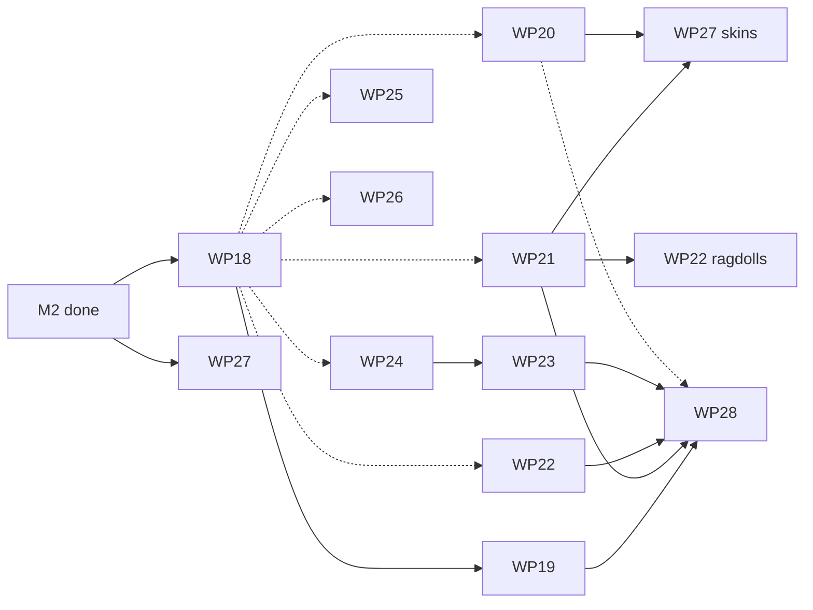

# M3 plan (draft)

**Status:** draft. No M3 work package has started. M3 starts when M2's definition of done holds; until then, M2 work comes first. The owner's decisions in "Defaults this plan picks" may change the WP list before it starts.

M3 turns Real Engine from an engine that runs games from a project directory into one that ships them. When it is done, a developer can build a large procedural world that streams in as the player moves, put skinned characters and vehicles in it, light it with post-processing and cascaded shadows, debug its scripts, edit its graphs on a node canvas, and package it as a standalone game for Windows, macOS and Linux. Every platform blocks merges in CI, and runs repeat bit for bit across machines (D2). A new public example, `examples/valley`, exercises all of it, and `real verify` checks it in CI like the island and the plaza.

The items come from [ROADMAP.md, "M3 and later"](ROADMAP.md#m3-and-later) and its AI track, plus the M2 follow-ups the M2 plan deferred (local persistence, `SurfaceGui` and `ViewportFrame`, compat hot reload). Each item still needs an ADR before its WP starts, as the roadmap says; this plan names them.

This plan splits M3 into eleven work packages: WP18 to WP28. Numbering continues from M2, so a WP number always means one thing.
- **WP18** (platforms and D2 determinism) starts first, because every later WP must stay green on three platforms.
- **WP19** (export and packaging), **WP20** (rendering), **WP21** (skinned animation), **WP22** (vehicles, ragdolls and audio effects), **WP24** (procedural workflow), **WP25** (editor and debugger), **WP26** (the M3 AI track) and **WP27** (compat follow-ups) start in parallel once their ADRs are accepted.
- **WP23** (world streaming and terrain) starts after WP24's PR "versioning", because streaming caches generated cells by generator version.
- **WP28** (`examples/valley`) starts once WP19, WP21, WP22 and WP23 have each merged their first PR, and closes M3.

**Every WP section below is a self-contained brief**, as in [M1_PLAN.md](M1_PLAN.md) and [M2_PLAN.md](M2_PLAN.md). It gives the goal, the owned paths, when the WP starts, what to build, the non-goals, the acceptance commands and the definition of done.

**Private material.** The M2 rules carry over unchanged: nothing from the owner's sample projects is committed, and no public file names them, quotes their code or gives their counts, timings or layout. Private checks report in a PR description only whether they pass.

## Defaults this plan picks

These are open questions or owner-set values. The plan goes ahead with the default and changes when the owner decides.

| Question | Default | Who decides |
|---|---|---|
| Scope of M3 | **Every item of ROADMAP "M3 and later"**, grouped into WP18–WP27, with `examples/valley` as the goal. The render thread is built only if PerfReport shows render submission is the bottleneck (WP20). | **Decided** (owner: "finish the whole thing") |
| Platforms for packaged games | **Windows x86_64, macOS (arm64 and x86_64) and Linux x86_64**, desktop only. The web (wasm with WebGPU) and consoles are not in M3. | Owner |
| Second platform for the D2 exit check | **Windows x86_64**, the most common target that differs from Linux in compiler and maths library. | Plan |
| Real networking for Roblox-style projects | **Not in M3.** Server and client stay two worlds in one process (M2 WP12). | Owner |
| Luau type checker (DECISIONS, open question 2) | **(a) unchanged**: luau-lsp as an external tool. `real build` does not need it. | Owner |
| License (DECISIONS, open question 1) | Whatever the owner settles. Packaged games (WP19) list the third-party notices the build contains either way. | Owner |
| Scripts in packaged games | **Luau bytecode**, compiled at build time with mlua's `Compiler` at the engine's Luau version. Source is not shipped unless the project asks. | Plan (ADR-0037) |
| Example name | `examples/valley`. | Plan |

## Ownership in M3

The M1 and M2 ownership rules carry over, with these changes:
- The maintainer keeps every path it owns at the end of M2: the root files, `.github/`, `tools/`, `README.md`, `docs/`, the WP0 crates, `re_assets`, `re_geom`, `re_proc`, `re_editor`, and `re_compat`'s shared files (`Cargo.toml`, `src/lib.rs`, `src/codes.rs`, `src/class/`, `src/data.rs`, `src/scene.rs`).
- The maintainer also runs the **entity-core track** (ROADMAP "Entity-core extensions"): a `#[derive]` component macro, undo coalescing for drags, a typed fast path for bulk spawns and scene loads, and comments in scene files. These touch only maintainer crates and frozen WP0 contracts, so they are maintainer PRs reviewed by the WPs that consume the changed contract.
- Crates pass to the M3 WP that changes them most:
  - `.github/workflows/` and `tools/xtask/src/d2.rs` to WP18, for its PRs only; the maintainer reviews each change, and the files return to the maintainer when WP18 is done;
  - `re_cli/src/build/` (new) and the packaging parts of `re_app` to WP19;
  - `re_render` to WP20;
  - `re_anim` to WP21, and the skin import in `re_assets` to WP21 through a maintainer-reviewed PR;
  - `re_physics` and `re_audio` to WP22;
  - `re_proc` and `re_geom` to WP24, and the streaming module `re_proc/src/stream/` (new) to WP23;
  - `re_editor` and `re_script`'s debugger module to WP25;
  - `re_agent`, `re_mcp`, `re_cli/src/tooling/{mcp,agent}.rs` and `templates/` (new) to WP26;
  - `re_compat` (except its shared files) and `re_import` to WP27;
  - `examples/valley/` to WP28.
- `re_app` and `re_cli` are shared. WP19 owns `re_app/src/package.rs` and `re_cli/src/build/`; every other change to them goes through a small PR that the maintainer reviews, as M2 did for `re_compat`'s shared files.

## Common rules for every WP

The M1 and M2 common rules hold unchanged. Four rules are added:
- **Three platforms from the start.** From WP18 PR "blocking" on, `build-windows` and `build-macos` run the full test suite and block merges. A WP's acceptance commands must pass on all three. A test that cannot run on a platform says so with `#[cfg]` and a reason, never by being skipped silently.
- **D2 is kept.** From WP18 PR "d2" on, `cargo xtask d2` runs the island's and the plaza's replays and compares `state_hash` across the three CI platforms. A WP that changes simulation, physics, procedural output or script scheduling keeps it green.
- **Diagnostic codes.** New crates get a range through the maintainer. The current owners keep their ranges; WP19's packaging codes go in `re_app`'s and `re_cli`'s ranges, WP23's streaming codes in `re_proc`'s and WP25's debugger codes in `re_script`'s.
- **New dependencies** need an ADR and a `docs/DEPENDENCIES.md` row through the maintainer, as before. This plan expects a few (texture compression, the node canvas, HTTP transport); each WP lists its candidates below, and the ADR picks one after checking the crate's real API and version.

---

## Cross-WP contracts

A contract is **frozen** at the point named here. After that, changing it follows the ownership rule.

| Contract | Defined in | Defined by | Frozen at | Consumed by |
|---|---|---|---|---|
| D2 harness: `cargo xtask d2` input (project, replay, frames) and its JSON report (`state_hash` per platform and frame) | `tools/xtask/src/d2.rs` | WP18 | WP18 PR "d2" | every WP that changes simulation |
| Package layout: the archive format, its index, the runtime-only binary's lookup order (archive, then project directory) and `real build` options | `crates/re_app/src/package.rs`, `docs/ARCHITECTURE.md` §8 | WP19 | WP19 PR "archive" | WP23, WP28 |
| Post-processing settings in `RenderSnapshot` (exposure, tone mapping, bloom, colour grading) and the cascade settings of the sun | `crates/re_types/src/render.rs` | WP20 | WP20 PR "post" | WP27 (compat effects), WP28 |
| Skins: `SkinData` (joints, inverse bind matrices, per-vertex weights), the skinned draw item, `AnimGraph` (states, transitions, blend nodes) as plain data | `crates/re_types/src/{render,anim}.rs` | WP21 | WP21 PR "skins" | WP22 (ragdolls), WP27, WP28 |
| Vehicle and ragdoll commands in `PhysicsCmd` and their poses in the physics readout | `crates/re_types/src/physics.rs` | WP22 | WP22 PR "vehicles" | WP28 |
| Generator versions: a version per generator and node kind in the per-node cache key, and the bake format | `crates/re_proc/src/` | WP24 | WP24 PR "versioning" | WP23, WP25 |
| Streaming: `StreamCell` (key, bounds, generator version), the load and unload events scripts see, and the budget settings in `real.toml` | `crates/re_proc/src/stream/`, `crates/re_scene/` | WP23 | WP23 PR "cells" | WP28 |

Changes to `re_types` stay maintainer-reviewed frozen-contract changes, as in M2: a new field is added with a default, so nothing else breaks.

---

## WP18: Platforms and D2 determinism

**Goal.** Windows and macOS block merges in CI, and the same replay gives the same `state_hash` on Linux x86_64 and Windows x86_64 (D2, ROADMAP).

**Owned paths:** `.github/workflows/` and `tools/xtask/src/d2.rs` for its PRs (see "Ownership in M3"), plus the platform `#[cfg]` fixes it needs in any crate, each reviewed by that crate's owner.

**Starts after:** M2 is done.

**Build, PR "blocking":**
- The raw Luau interrupt verified on MSVC and on macOS (the CPU budget stops a runaway script on both).
- `build-windows` and `build-macos` run the whole test suite, the GPU tests on a software adapter where the runner has one (WARP on Windows; macOS reports the GPU tests it cannot run), and `real verify` on the island and the plaza.
- Both jobs become required (ADR-0023 amendment).

**Build, PR "d2":**
- ADR-0036: D2 determinism. It turns on oxijolt's `cross-platform-deterministic` feature (present in oxijolt 1.1.0), audits floating-point use in `re_scene`'s transforms, `re_proc`, `re_noise` and the compat datatypes (no fused multiply-add, no platform maths functions in simulated paths; `libm` or our own where needed), and measures the cost on the physics benchmarks.
- `cargo xtask d2`: runs each replay and writes the `state_hash` per checkpoint frame; a CI job collects the three platforms' reports and fails on any difference.

**Non-goals:** determinism across CPU architectures other than x86_64 and arm64 macOS; GPU output determinism (goldens keep their tolerance).

**Acceptance:**
```sh
cargo xtask d2 --project examples/island --json
cargo xtask d2 --project examples/plaza --json
```
- The CI `d2` job shows identical hashes on Linux x86_64 and Windows x86_64 for both projects, and reports macOS.
- The physics benchmarks with `cross-platform-deterministic` are within the ADR's stated cost.

**Definition of done:** both PRs merged; Windows and macOS block merges; the `d2` job is required.

---

## WP19: Export and packaging

**Goal.** `real build` turns a project into a standalone game: a runtime-only binary, a packed asset archive and the platform's bundle, with no tooling linked.

**Owned paths:** `crates/re_cli/src/build/`, `crates/re_app/src/package.rs`, `tests/build/` under `re_cli`.

**Starts after:** ADR-0037 is accepted. It needs WP18 PR "blocking" to test the bundles on all three platforms.

**Build, PR "archive":**
- ADR-0037: package format. One archive per game with an index (path, offset, size, hash) over the processed assets from `.real/cache`, the scenes, the compiled Luau bytecode and `real.toml`. The runtime reads the archive first, then the project directory, so a development run and a packaged run use one code path.
- `real build --out <DIR> [--target <triple>]`: processes every asset, compiles every script with mlua's `Compiler` (failing on any compile error), writes the archive and copies the runtime binary built with `--no-default-features` (ADR-0027).
- The packaged game runs `real verify`'s boot and replay stages against the archive, so CI checks a build, not only a project.

**Build, PR "bundles":**
- Per-platform output: a Windows folder with the `.exe`, a macOS `.app` bundle (unsigned; signing and notarisation are the developer's step, documented), and a Linux folder with an executable and a `.desktop` file.
- A third-party notices file generated from `cargo metadata` and the bundled asset licences (fonts, rigs).

**Non-goals:** installers, code signing, app stores, patching or delta updates, and the web.

**Acceptance:**
```sh
real build --project examples/island --out out/island-build
out/island-build/island --headless --frames 600
```
- The packaged island and plaza boot and replay with the same `state_hash` as `real verify` on the project.
- The build contains no tooling crate (`cargo xtask check-graph` on the runtime binary).

**Definition of done:** both PRs merged, with a `build-package` CI job on all three platforms.

---

## WP20: Rendering

**Goal.** HDR rendering with tone mapping and bloom, cascaded shadows for the sun, compressed textures and shader hot reload; and a render thread if, and only if, PerfReport shows it is needed.

**Owned paths:** `crates/re_render/`.

**Starts after:** ADR-0038 (post-processing and shadows) is accepted.

**Build:**
- PR "post": an HDR target, exposure, a tone-mapping operator chosen in ADR-0038, bloom, and colour grading moved from `SceneExtras` into the post chain. The settings join `RenderSnapshot` with defaults that keep today's goldens within tolerance or re-bless them in the same PR with before and after images.
- PR "shadows": cascaded shadow maps for the sun (cascade count and split scheme in ADR-0038), stable under camera motion.
- PR "textures": BC7 or BC1/BC3 on desktop through the asset cache, picked per adapter feature, with an uncompressed fallback. The encoder crate is chosen in an ADR after checking crates.io (candidates to evaluate: `intel_tex_2`, `texpresso`, a KTX2 reader). ASTC is not needed for desktop targets.
- PR "hot reload": WGSL files under the project or the engine reload on change in a development run, keeping the last good pipeline and reporting errors as `RE6xxx` with file and line.
- Render thread: WP20 measures render submission on the valley scene once it exists. If it is above the ADR's threshold, a PR moves submission to a render thread over the existing `RenderSnapshot: Send` seam (ADR-0007); otherwise the ADR records the numbers and the decision not to.

**Non-goals:** GPU-driven rendering, global illumination, ray tracing.

**Acceptance:**
```sh
cargo test --locked -p re_render
real verify --project examples/island --json
```
- Goldens for tone mapping, bloom and cascades on lavapipe and GL.
- A shadow stability test: the shadowed texels of a static scene do not change as the camera moves along a path.

**Definition of done:** the four PRs merged; ADR-0038 records the render-thread measurement and decision.

---

## WP21: Skinned animation and blend trees

**Goal.** Skinned meshes from glTF, skinned on the GPU, driven by clips blended through an animation graph that scripts and the editor can edit.

**Owned paths:** `crates/re_anim/`, the skin parts of `crates/re_assets/src/gltf/` (maintainer-reviewed).

**Starts after:** ADR-0039 is accepted.

**Build:**
- PR "skins": glTF skins and their clips imported into `SkinData` and `ClipData`; GPU skinning in `re_render` (a vertex-shader path with up to four weights per vertex), coordinated with WP20; the `SkinnedMesh` component.
- PR "graphs": `AnimGraph`, a plain-data graph of states, transitions with conditions and blend nodes (1D and 2D blend spaces, additive layers, masks by joint), evaluated by `re_anim`. Luau reads and sets graph parameters (`anim.set(entity, "speed", 3.2)`), and the graph is editable as data through commands, so agents and the editor change it without code.
- Root motion as an option per clip.

**Non-goals:** inverse kinematics beyond the two-bone solver `re_anim` has, facial animation, retargeting between skeletons with different joint names.

**Acceptance:**
```sh
cargo test --locked -p re_anim
```
- Sampling and blending match a reference evaluator to 1e-5 on synthetic skeletons.
- A golden of a skinned character in three poses.

**Definition of done:** both PRs merged.

---

## WP22: Vehicles, ragdolls and audio effects

**Goal.** Wheeled vehicles and ragdolls on Jolt, and an audio effects graph with buses, reverb and filters.

**Owned paths:** `crates/re_physics/`, `crates/re_audio/`.

**Starts after:** ADR-0040 (vehicles and ragdolls) and ADR-0041 (audio effects) are accepted. Ragdolls need WP21 PR "skins".

**Build:**
- PR "vehicles": oxijolt 1.1.0's `vehicle` module (wheeled vehicles, with its motorcycle and tracked variants evaluated in the ADR) behind `PhysicsCmd`, so `re_physics` still hides oxijolt. A `Vehicle` component, throttle, brake and steering inputs, and a Luau API.
- PR "ragdolls": the `ragdoll` module mapped onto a skeleton from WP21, with blending between animated and simulated poses.
- PR "audio": buses, per-bus effects (reverb, low-pass and high-pass filters, delay, compressor) through kira's effects, a mixer snapshot in `real.toml`, and a Luau API. The headless fallback applies the same graph, so tests check levels without a device.

**Non-goals:** soft bodies, destruction, HRTF spatial audio.

**Acceptance:**
```sh
cargo test --locked -p re_physics
cargo test --locked -p re_audio
```
- A vehicle drives a fixed path on flat and sloped ground and ends within a stated tolerance of the reference pose; with WP18's D2 on, the pose is identical across platforms.
- Effect graph tests compare rendered buffers against reference buffers.

**Definition of done:** the three PRs merged.

---

## WP23: World streaming and large terrains

**Goal.** Worlds larger than memory: procedural and authored content streams in and out by cell around the player, with terrain level of detail, generated off the main thread.

**Owned paths:** `crates/re_proc/src/stream/`, a terrain module in `crates/re_geom/` agreed with WP24.

**Starts after:** WP24 PR "versioning" and ADR-0042 are accepted.

**Build:**
- PR "cells": `StreamCell` keyed by `StableKey`, the streaming radius and memory budget in `real.toml`, load and unload of entities by cell with their overrides kept, and script events when a cell loads or unloads.
- PR "async": generation of a cell's graph on worker threads with results applied between frames, so a frame never waits on generation; cancelled when the player turns away.
- PR "terrain": heightfield terrain in chunks with level of detail and seams stitched between levels, matching physics heightfields per chunk, and a hydraulic erosion node in the ProcGraph node set.
- Floating origin for native scenes, built on the same idea as ADR-0031's for compat physics.

**Non-goals:** voxel terrain, streaming over the network.

**Acceptance:**
```sh
cargo test --locked -p re_proc stream
cargo run --release --locked -p re_proc --example stream_walk -- --json > out/stream.json
```
- A 16 km by 16 km generated world walked end to end in a replay: frame time and resident memory within the budgets ADR-0042 sets, no frame waiting on generation, and the same `state_hash` on two runs.

**Definition of done:** the three PRs merged.

---

## WP24: Procedural workflow

**Goal.** The procedural workflow extensions of the roadmap: bake to authored entities, structural overrides, generator versioning, Luau generators and Luau nodes in the ProcGraph, and polygon booleans with roads.

**Owned paths:** `crates/re_proc/` (except `src/stream/`), `crates/re_geom/` (except the terrain module).

**Starts after:** ADR-0043 is accepted.

**Build:**
- PR "versioning": a version per generator and node kind in the per-node cache key; an old project opens with its recorded versions, and `real migrate-graph` upgrades them explicitly with a report.
- PR "bake": a command that turns a procedural source's output into authored entities in one undoable transaction, keeping a record of where they came from.
- PR "overrides": structural overrides beyond deletion: move, replace and insert, stored against stable keys, and kept when the generator re-runs.
- PR "luau": generators and ProcGraph nodes written in Luau, run in a `generator` context with a CPU budget and no world access, so their output stays a pure function of their inputs and seed. It needs the scripting numbers on node-sized work, which the PR measures first.
- PR "booleans and roads": polygon booleans and a road node (spline, width, banking, junctions). The ADR checks `i_overlay` again, which was too new when M1 looked.

**Non-goals:** GPU evaluation of graphs.

**Acceptance:**
```sh
cargo test --locked -p re_proc
cargo test --locked -p re_geom
```
- A versioned graph from before the PR loads unchanged, and migrates with a report.
- Bake followed by undo restores the source exactly.
- A Luau node and the same node in Rust give identical output on the test graphs.

**Definition of done:** the five PRs merged.

---

## WP25: Editor and script debugger

**Goal.** A node canvas for ProcGraph, transform gizmos and docking in the editor, and a Luau script debugger.

**Owned paths:** `crates/re_editor/`, `crates/re_script/src/debug/` (new).

**Starts after:** ADR-0044 (canvas and docking crates) for the editor PRs; a spike, then ADR-0045, for the debugger.

**Build:**
- PR "canvas": a node canvas over `GraphDoc`. Every edit on it is a `graph.*` command, so it is undoable and agents see the same changes. The canvas crate is chosen in ADR-0044 after checking crates.io for one that matches egui 0.36.
- PR "gizmos and docking": translate, rotate and scale gizmos that emit commands, and dockable panels whose layout is saved per project.
- Debugger spike: Luau builds have no `set_hook`, so the spike tries breakpoints and stepping on the interrupt callback and stack inspection, and measures the cost when no breakpoint is set.
- PR "debugger": breakpoints, step, locals and the call stack, in the editor and over the Debug Adapter Protocol for external editors, if the spike shows it can be done at an acceptable cost; otherwise ADR-0045 records why not and what is offered instead (a stack and locals dump on error).

**Non-goals:** a full scene-editing suite (terrain painting, prefab variants UI).

**Acceptance:**
```sh
cargo test --locked -p re_editor
cargo test --locked -p re_script debug
```
- Editor tests drive the canvas and gizmos through their commands and check the transactions.
- Debugger tests stop at a breakpoint, step over and into, and read locals in a fixture.

**Definition of done:** the canvas and gizmo PRs merged, and the debugger merged or declined by ADR-0045 with the spike's numbers.

---

## WP26: The M3 AI track

**Goal.** The M3 row of the ROADMAP AI track: project templates and generator recipes for beginners, an evaluation harness for agents, and the HTTP MCP transport.

**Owned paths:** `crates/re_agent/`, `crates/re_mcp/`, `crates/re_cli/src/tooling/{mcp,agent}.rs`, `templates/` (new).

**Starts after:** ADR-0046 (HTTP transport and evaluation harness) is accepted.

**Build:**
- PR "templates": project templates and generator recipes that an agent fills in through ordinary commands: a recipe is data (parameters, steps as commands, and the `real verify` checks that prove it worked), offered by `real new --template` and an MCP tool.
- PR "eval": an evaluation harness that runs scripted agent tasks against example projects and scores them with `real verify` and `verify.diff`. The engine still never calls a model: the harness drives an MCP client the user configures, and records transcripts and scores as files.
- PR "http": the streamable HTTP transport of rmcp 3.5.1 (`transport-streamable-http-server`) behind an option of `real mcp`, bound to localhost by default, with a token, and the same policy file and tiers as stdio.

**Non-goals:** a hosted service, models bundled with the engine.

**Acceptance:**
```sh
cargo test --locked -p re_agent
cargo test --locked -p re_mcp
```
- Every template creates a project that passes `real verify`.
- The M1 and M2 MCP end-to-end tests pass over both stdio and HTTP.

**Definition of done:** the three PRs merged.

---

## WP27: Compat follow-ups

**Goal.** The Roblox-style layer's follow-ups that M2 deferred: local persistence for data services, `SurfaceGui` and `ViewportFrame`, hot reload for compat scripts, skinned `MeshPart`s and the compat post effects.

**Owned paths:** `crates/re_compat/` (except its shared files), `crates/re_import/`.

**Starts after:** M2 is done. The skinned and post-effect PRs wait for WP21 PR "skins" and WP20 PR "post".

**Build:**
- PR "persistence": `DataStoreService` and `MemoryStoreService` over local files under `.real/data/`, with the request budgets and errors scripts expect, instead of `RE9002`.
- PR "surfaces": `SurfaceGui` and `ViewportFrame` rendered through WP15's UI and the render-to-texture path.
- PR "reload": changed compat scripts restart in a running play, and a script set back to `Disabled = false` restarts (the WP11 follow-up).
- PR "skins and effects": skinned `MeshPart`s on WP21's skins, and `BloomEffect`, `BlurEffect` and `SunRaysEffect` drawn by WP20's post chain, each moving from `partial` to `implemented`.

**Non-goals:** real networking (see "Defaults this plan picks"), terrain voxels, online services other than data storage.

**Acceptance:**
```sh
cargo test --locked -p re_compat
real verify --project examples/plaza --json
```
- Coverage rows move to `implemented` only with a fixture that calls them.

**Definition of done:** the four PRs merged; `verify-plaza` stays green.

---

## WP28: The valley example

**Goal.** `examples/valley`: a public example that proves M3 end to end. It is a streamed procedural valley with skinned characters, a drivable vehicle, post-processing and cascaded shadows, built with `real build` and checked by `real verify` in CI.

**Owned paths:** `examples/valley/`.

**Starts after:** the first PR of WP19, WP21, WP22 and WP23 has merged.

**Build:**
- The valley: generated terrain with erosion and roads (WP23, WP24), a walking skinned character driven by an animation graph (WP21), a vehicle to drive (WP22), audio buses (WP22), and post-processing and cascades (WP20).
- Three replays (walk, drive, a long walk across cell borders) with matching `state_hash` on two runs and across platforms (WP18).
- A `verify-valley` CI job, required (ADR-0023 amendment), and a `build-package` run of the valley.

**Non-goals:** a full game loop beyond what the replays need.

**Acceptance:**
```sh
real verify --project examples/valley --json
real build --project examples/valley --out out/valley-build
```

**Definition of done:** merged, with `verify-valley` required and green.

---

## Dependencies and ADRs

New dependencies are expected for texture compression (WP20), the node canvas and docking (WP25), and possibly `libm` (WP18) and `i_overlay` (WP24). rmcp's HTTP transport (WP26) is a feature of a crate already in the workspace, but it brings new transitive crates, which `cargo deny` checks. Each goes through an ADR and a `DEPENDENCIES.md` row.

The ADRs this plan adds:
- ADR-0036 (WP18): D2 determinism.
- ADR-0037 (WP19): the package format and bytecode scripts.
- ADR-0038 (WP20): post-processing, cascaded shadows and the render-thread decision.
- ADR-0039 (WP21): skins and animation graphs.
- ADR-0040 (WP22): vehicles and ragdolls.
- ADR-0041 (WP22): the audio effects graph.
- ADR-0042 (WP23): streaming cells and budgets.
- ADR-0043 (WP24): generator versioning, bake and structural overrides.
- ADR-0044 (WP25): the node canvas and docking crates.
- ADR-0045 (WP25): the script debugger.
- ADR-0046 (WP26): the HTTP transport and the evaluation harness.
- ADR-0023 amendments (WP18, WP28): Windows, macOS, `d2` and `verify-valley` become required jobs.

## Dependency graph



A solid arrow means "starts after". A dotted arrow from WP18 means "must stay green on three platforms once WP18 PR 'blocking' merges"; those WPs may start before it. The dotted arrow from WP20 to WP28 means the valley uses post-processing and cascades when they have merged.

Critical path: WP18 → WP24 "versioning" → WP23 → WP28.

## Definition of done for M3

M3 is done when **all** of these are true on a clean checkout, after the one-time setup:

1. The CI-required jobs of ADR-0023, with `build-windows`, `build-macos`, `d2`, `verify-plaza` and `verify-valley`, pass on all three platforms and block merges.
2. The D2 harness gives identical `state_hash` for the island, plaza and valley replays on Linux x86_64 and Windows x86_64.
3. `real verify --project examples/valley --json` exits 0 with every stage ok; the island and the plaza still pass.
4. `real build` packages the valley for each platform, and the packaged game replays with the same `state_hash` as the project.
5. Every ADR this plan lists is Accepted, or records why its feature was declined, with measurements.
6. The M1, M2 and WP26 MCP end-to-end tests pass over stdio and HTTP.
7. No document describes an unimplemented feature as done, and `coverage.json` matches the code.
