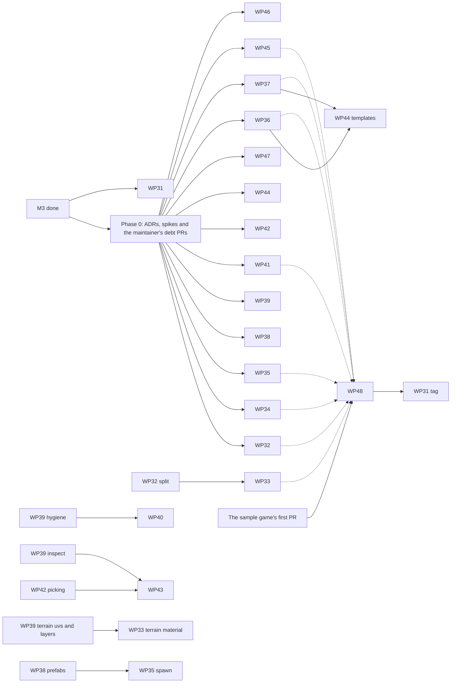

# M4 plan

**Status:** planned (2026-10-28). No WP has started; "How M4 starts" below is the order they follow.

M4 turns Real Engine from an engine that ships games into one that makes complete games, and makes them from procedural content as easily as by hand. When it is done, a developer can write a whole game on the engine's own API, with a title menu, a HUD, settings, saved games and several scenes; give it joints, compound bodies, triggers and surface materials; model its buildings and props with graph nodes instead of a modelling tool; light a large generated world with an atmosphere, terrain materials and instanced forests; and, as a designer, pick, move, tune and play-test it all in the editor without the command line. The same game builds for Windows, macOS, Linux and the browser from a tagged, versioned release. A new example, `examples/town`, grown from a sample game built on the engine right after M3, exercises all of it, and `real verify` checks it in CI like the island, the plaza and the valley.

The items come from the eight M4 audits in the private research folder (`research/m4/audit/`: vision against what was built, gameplay runtime, physics and the entity core, procedural, rendering, tooling, platforms with networking and CI, and code health) and from the sample game's findings (`research/m4/sample-game-findings.md`). [ROADMAP.md, M4](ROADMAP.md#m4-complete-games-procedural-modelling-and-the-designers-editor-planned) lists what M4 takes on and what it leaves for later. Each item needs an ADR before its WP starts code, as in M3; this plan names them.

This plan splits M4 into eighteen work packages: WP31 to WP48. Numbering continues from M3, so a WP number always means one thing.

**How M4 starts.**
- **Phase 0, now.** Each WP thread researches and drafts its ADR (or its amendments to an existing ADR) as a new file in `research/m4/adr/`, runs its spike if its section names one, and sends the draft to the maintainer, who accepts it and commits it to `docs/DECISIONS.md`. A PR that changes only documentation runs `fmt` alone in CI, so phase 0 costs almost no CI minutes. The maintainer's first PR puts the Windows and macOS checks back on every PR, and its debt PRs that touch many crates (the crash paths, workspace lints and the `App` split, under "Ownership in M4") merge in phase 0, before feature code piles onto the same files.
- **WP31** (CI, toolchain and releases) starts at once, because it makes every later PR's checks faster, and cheaper should the repository go private again.
- **Phase 1, wave 1.** Once its ADR is accepted, each of these starts its code: **WP32** (renderer foundations), **WP34** (physics), **WP35** (gameplay scripting API), **WP38** (prefabs and the entity core), **WP39** (procedural authoring), **WP41** (modelling kernel, after its spike), **WP42** (editor scene view), **WP44** (docs, tools and the AI track; its PR "safety" first) and **WP47** (compat fidelity).
- **Phase 1, wave 2.** **WP33** (rendering at world scale) starts after WP32 PR "split"; **WP36** (native UI) and **WP37** (scenes, saves and settings) after their ADRs; **WP40** (graph language v2) after WP39 PR "hygiene"; **WP43** (editor authoring) after WP42 PR "picking" and WP39 PR "inspect"; **WP45** (audio and animation) and **WP46** (secure online play) after their ADRs.
- **WP48** (`examples/town`) starts when the sample game's first PR has merged. It grows as each feature lands and closes M4.
- **CI.** The repository is public again (the owner, 2026-10-28), so GitHub's hosted runners cost nothing and the waves overlap freely. If it goes private again, CI is billed: PR #187's run, which started every check, billed about 170 minutes and a push to main about 35, so GitHub Free's 2,000 minutes a month would cover about ten of M4's 120 or so merged PRs. The owner would then choose between paying, a self-hosted runner and a slower pace, and the maintainer would start one wave at a time.

**Every WP section below is a self-contained brief**, as in [M1_PLAN.md](M1_PLAN.md), [M2_PLAN.md](M2_PLAN.md) and [M3_PLAN.md](M3_PLAN.md). It gives the goal, the owned paths, when the WP starts, what to build, the non-goals, the acceptance commands and the definition of done.

**Private material.** The M2 and M3 rules carry over unchanged: nothing from the owner's sample projects is committed, and no public file names them, quotes their code or gives their counts, timings or layout. Private checks report in a PR description only whether they pass.

## Defaults this plan picks

These are open questions or owner-set values. The plan goes ahead with the default and changes when the owner decides.

| Question | Default | Who decides |
|---|---|---|
| Scope of M4 | **Complete games on the native API, procedural modelling and a designer's editor**, as the vision audit recommends, with release hygiene, user documentation, encrypted online play and proportionate compat work beside them; `examples/town` is the goal. Performance work is done where a measurement asks for it (WP32, WP33, WP34, WP47). | Plan (owner: "Do all", 2026-10-27) |
| CI cost | **Free while the repository is public** (the owner made it public again on 2026-10-28 rather than pay for minutes). If it goes private again, a merged PR costs about 200 billed minutes until WP31's cuts land, and the owner chooses between paying, a self-hosted runner and a slower pace. | Owner |
| The primary path for new games | **The native API.** Compat stays the way to run existing Roblox-style content; a new gameplay feature lands natively first, and compat maps onto it where a compat member exists. | Owner |
| Native UI | **One UI core, `re_ui`, shared by native UI and the compat GUI**, so layout, text, input routing and gamepad focus are written once (ADR-0058, after a spike). | Owner |
| Modelling kernel | **Pure Rust in `re_geom`**, with no C++ boolean library; mesh booleans and CSG stay later work. Every new modelling operation is D2: bit-identical on Linux, Windows and macOS. | Owner |
| Showcase generators | **Buildings from footprints** (masses by floors, facade modules, roofs) and placement along paths, which the town needs. | Plan |
| Online play | **A Noise handshake with authenticated encryption, and join codes**, for UDP and WebSockets alike (ADR-0050 names encryption M4's first networking item). No hosted relays or matchmaking; a native networking API for `game` scripts is M5. | Owner |
| Releases | **Version 0.4.0 at the end of M4** (the minor number follows the milestone), with a build id in every binary and the first tag `v0.4.0`. Releases stay GitHub draft releases, which only the repository's writers can see even while the repository is public, until the owner decides how the engine is distributed and sold. No installers or code signing in M4, since they need paid certificates. | Owner |
| Web runtime size | **Raise the budget from 8 MB to 10 MB gzip** (an ADR-0049 amendment), since the runtime ended M3 with about 7 KB to spare and every M4 runtime feature adds to it; no runtime variants in M4. | Owner |
| Rust toolchain | **Pinned** in `rust-toolchain.toml` to an exact stable release, bumped by a PR after each release, so the cargo caches stay valid between bumps; the MSRV stays 1.95. | Plan (WP31) |
| Platforms | **Linux x86_64, Windows x86_64, macOS arm64 and the browser** (Chromium required; Firefox and Safari reported). macOS x86_64 is dropped from the claims, since nothing builds or tests it. No mobile or consoles in M4. | Owner |
| Windows and macOS in CI | **On every PR that changes code, while the repository is public**: from the maintainer's first M4 PR, `ci.yml` calls `platforms.yml` (`build-windows`, `build-macos`, their package jobs and `d2`) in every run that starts its release checks. If the repository goes private again, `ci.yml` skips the call and `platforms.yml` runs by hand (ADR-0023's amendment of 2026-10-27). | Plan |
| Navigation | **A spike and an ADR only** (WP34's stretch); navmeshes are built in M5. | Owner |
| Generated vegetation and props | **Render-only instance sets**, outside `state_hash` and with colliders from batched static bodies, not one entity per instance (ADR-0052). Promoting an instance to an entity for gameplay is later work. | Plan |
| GraphDoc v2 | **Stays JSON**, migrated by `real migrate-graph`. | Plan |
| GPU procedural evaluation | **Not in M4.** | Plan |
| Luau type checker (DECISIONS, open question 2) | **(a) unchanged:** luau-lsp as an external tool; `real doctor` checks it is installed. | Owner |
| Localisation | **Not in M4** beyond UTF-8 text in the UI; string tables are WP36's stretch. | Owner |
| Compat | **Proportionate:** the crash paths, GUI input and focus, images, tools and teams, and the cost of big maps. Terrain voxels are not in M4. | Owner |
| Example name | `examples/town`, the sample game "Town Courier". | Plan |

## Ownership in M4

The M1, M2 and M3 ownership rules carry over, with these changes:
- The maintainer keeps the root files, `.github/` (lent to WP31 for its PRs), `tools/` (WP31 has `tools/ci/`, WP44 its docs generator in `tools/xtask/src/docs.rs`), `README.md`, `docs/` (WP44 owns the new `docs/guide/`), the WP0 crates (`re_core`, `re_noise`, `re_types`, `re_reflect`, `re_scene`, `re_command`), `re_assets`, `re_script_check`, and `re_compat`'s shared files (`Cargo.toml`, `src/lib.rs`, `src/codes.rs`, `src/class/`, `src/data.rs`, `src/scene.rs`).
- The maintainer also runs the **M4 maintainer track**, in maintainer PRs reviewed by the WPs whose code they touch:
  - in phase 0: the Windows and macOS checks and `d2` back on every PR while the repository is public (an ADR-0023 amendment); the three crash paths of the code-health audit (audio durations from scripts or `real.toml`, compat GUI paint on negative or NaN sizes, and deep binary place files), with regression tests; `[workspace.lints]` with `unsafe_code` denied outside the crates that need it, `#[expect(reason)]` in place of `#[allow]`, and the missing `# Safety` sections; and `re_app/src/app.rs` split into modules by concern, with no change in behaviour, before WP32, WP34, WP35, WP36, WP37 and WP42 all edit it;
  - later: the duplicated helpers (edit distance, mip chains, AABB transforms, built-in meshes), the unreferenced `pub fn`s, dependency bumps (tokio, rmcp, notify and quick-xml first; oxijolt 1.3.0 not before mid-November; egui 0.37 once egui_dock and egui-snarl support it), fuzz targets for the place readers, the package archive and the wire decoders on a weekly schedule, and the docs as built after each WP.
- Crates pass to the M4 WP that changes them most:
  - `.github/workflows/`, `tools/ci/` and the release parts of `re_cli` to WP31, for its PRs; they return to the maintainer when WP31 is done;
  - `re_render` to WP32, which shares it with WP33: WP33 owns the new modules it adds (`instances/`, `terrain/` and `atmosphere/` under `crates/re_render/src/`) and changes WP32's frame code through small PRs that WP32 reviews;
  - `re_physics`, `crates/re_app/src/sync/physics.rs` and the `physics` library of the Luau API to WP34;
  - `re_script` (except `src/generator/` and `src/debug/`) to WP35; WP37 adds its `scene`, `save` and `settings` libraries in new files there, which it owns;
  - the new crate `re_ui`, `crates/re_app/src/ui/` (new, in place of `hud.rs`) and the `ui` library to WP36; `re_compat/src/gui/` moves onto `re_ui` in WP36's PR "core", which WP47 reviews;
  - `re_input`, and a new `crates/re_app/src/scenes/` module, to WP37;
  - `re_scene/src/prefab.rs`, `re_scene/src/ids.rs` and the prefab commands in `re_command` to WP38, maintainer-reviewed, since they are WP0 contracts;
  - `re_proc` (except the files WP40 and WP41 own), `re_geom/src/terrain/`, `crates/re_cli/src/graph.rs` and `crates/re_app/src/procedural.rs` to WP39;
  - `re_proc/src/graph.rs`, `canon.rs` and `migrate.rs`, the subgraph machinery it adds, and `re_script/src/generator/` to WP40;
  - `re_geom` (except `src/terrain/`) and the modelling node kinds it adds under `re_proc/src/nodes/` to WP41;
  - `re_editor` to WP42, which shares it with WP43: WP42's PR "split panels" makes `panels.rs` a module per panel (`src/panels/`), and WP43 owns `canvas.rs`, `src/widgets.rs` (the field widgets), `src/panels/procedural.rs` and the new asset, material and prefab panels;
  - `re_agent`, `re_mcp`, `re_cli/src/tooling/{mcp,agent}.rs`, `templates/`, the new `docs/guide/` and the new `real test` and `real doctor` commands to WP44;
  - `re_audio` and `re_anim` to WP45;
  - `re_net` and `re_compat/src/net/` to WP46;
  - `re_compat` (except its shared files, `src/gui/` until WP36's PR "core" merges, and `src/net/`) and `re_import` to WP47;
  - `examples/town/` to WP48, from the sample game's thread once its first PR has merged.
- `re_app` and `re_cli` are shared, as in M3. After the `App` split, each WP owns the modules named above, and any other change to them is a small PR the maintainer reviews.
- **Planned edits across owners.** Each rides in the PR of the WP that needs it, listed in the PR's body for the owner's review:
  - WP32's native frame path in `crates/re_app/src/gfx.rs` and render sync in `crates/re_app/src/sync/render.rs` (the maintainer reviews), and its material slots in `re_assets` (the maintainer reviews);
  - WP33's render-only mode of `points.instance` and the `Instances` output in `re_proc` (WP39 reviews), and texture arrays in `re_assets` (the maintainer reviews);
  - WP34's `Joint`, `Trigger` and `PhysicsMaterial` components in `re_scene` and its additions to `re_types/src/physics.rs` (the maintainer reviews), and compat's joints mapped onto native joints (WP47 reviews);
  - WP34's trigger delivery in `re_script/src/runtime.rs` (WP35 reviews), and its edits to `re_app`'s host and `[physics]` in its config (the maintainer reviews);
  - WP35's new host calls in `re_types::HostServices`, added as provided methods with a default body, as in M2 (the maintainer reviews);
  - WP36's compat GUI on `re_ui` and the switch of `crates/re_app/src/compat.rs` onto its routing (WP47 reviews), `ScriptHost::ui()` (WP35 reviews), UI textures in `gfx.rs` (WP32 reviews), and its UI components in `re_scene`, the `ui` rows of `ReplayDoc`, the theme schema and `[ui]` in its config (the maintainer reviews);
  - WP38's prefab expansion in `re_proc` (WP39 reviews), its change-signal binding in `re_script` (WP35 reviews), and its edits to `re_app`'s files module, `verify.rs` and `[history]` in its config and to `re_cli`'s prefab schema (the maintainer reviews);
  - WP39's metre UVs in `re_geom/src/terrain/` and the `terrain.layers` node, which WP33's terrain material reads (WP33 reviews the data shape); its deferred regeneration in `re_scene` (`Generators::set_deferred`, `World::apply_generated`) and `[proc]`'s editor budget in its config (the maintainer reviews), and the editor socket's wait for regeneration (WP42 reviews);
  - WP40's `re_types::graph` additions and `schemas/graph.schema.json` in its PR "params" (the maintainer reviews);
  - WP41's `polymesh` arms in `re_proc`'s `value.rs`, `cache.rs`, `nodes/fragment.rs` and test support, and later in `check_streaming` (WP39 reviews), in `re_script`'s generator marshal (WP40 reviews) and in the editor's canvas (WP43 reviews);
  - WP42's id buffer for picking in `re_render` (WP32 reviews) and its play session in `crates/re_app/src/play.rs` (the maintainer reviews);
  - WP43's document commands (`material.*`, `prefab.*`, `scene.new`, `scene.open`, `config.*`) in `re_command` and `re_app` (the maintainer reviews);
  - WP44's screenshot path rule in `re_command` and `re_agent`'s policy (the maintainer reviews);
  - WP45's Ogg import in `re_assets`, and its streamed reads through `ProjectFiles::open` in `re_core` and the archive layer (the maintainer reviews);
  - WP47's GUI input feed in `crates/re_app/src/compat.rs` (the maintainer reviews).

## Common rules for every WP

The M1, M2 and M3 common rules hold, with these changes and additions:
- **CI.** A WP iterates locally and keeps its PR a draft, which runs no CI, until `cargo fmt`, clippy (desktop and `wasm32` where the runtime changes) and the tests of the crates it touched pass in the reference container; marking the PR ready starts its run. CI is free while the repository is public, but a red run still costs a cycle, so fix-ups are batched and nothing is pushed only to rerun CI. A PR is squash-merged when every check its last run started is green, as ADR-0023's amendment of 2026-10-28 says.
- **Three platforms.** While the repository is public, every PR that changes code runs the Windows and macOS checks and `d2` again (from the maintainer's first M4 PR). If it goes private again, ADR-0023's amendment of 2026-10-27 applies: a PR that changes simulation, physics, procedural output, script scheduling or platform-specific code gets one green `platforms.yml` run on its final head before it merges. Either way, each WP's definition of done includes green Windows and macOS checks on its last PR.
- **D2 is kept.** `cargo xtask d2` compares the island's, plaza's, valley's and (from WP48's first PR) the town's replays across the three platforms. A WP that changes simulation keeps those hashes, or re-records them in the same PR with the reason; a new simulated feature adds a replay that exercises it.
- **Diagnostic codes.** The new crate `re_ui` gets `RE7700`–`RE7799` (WP36 adds it to ARCHITECTURE §7 and `tools/xtask/src/explain.rs`). Where two WPs share a crate, they split its free codes: `re_render` WP32 `RE6042`–`RE6099`, WP33 `RE6100`–`RE6199`; `re_proc` WP39 `RE4030`–`RE4099` and `RE4311`–`RE4399`, WP40 `RE4200`–`RE4299`, WP41 `RE4150`–`RE4199` (and `re_geom`'s `RE4510`–`RE4599`); `re_script` WP35 `RE3016`–`RE3069`, WP37 `RE3100`–`RE3149`, WP40 `RE3150`–`RE3199`, WP44 `RE3250`–`RE3299`; `re_editor` WP42 `RE8805`–`RE8849`, WP43 `RE8850`–`RE8899`; `re_command` WP38 `RE2009`–`RE2049`, WP43 `RE2050`–`RE2099`; `re_app` WP35 `RE0530`–`RE0569`, WP37 `RE0570`–`RE0599`, WP42 `RE0650`–`RE0699`, WP32 `RE0700`–`RE0719`, WP34 `RE0720`–`RE0739`; `re_cli` WP44 `RE0904`–`RE0949`, WP31 `RE0976`–`RE0989`. Other WPs use the free codes of the crates they own. Every code has an explain page.
- **Native first.** A gameplay feature lands on the native API, and the compat layer maps onto it where a compat member exists (joints, particles, UI); no new behaviour exists only in compat.
- **The web build stays inside its budget.** A PR that grows the runtime says by how much in its description, and `build-web` fails over the budget, as now.
- **The user guide is kept true.** Once WP44's PR "guides" has merged, a PR that changes a feature the guide describes updates the guide in the same PR, and the generated reference is regenerated (its CI check fails otherwise).
- **Agent-facing commands are walked.** Once WP44's PR "safety" (#202) has merged, a PR that adds or changes a command agents can call adds its row, with valid arguments, to the walk's `arguments` table in `crates/re_cli/src/tooling/mcp/walk.rs`, whose test fails on a command it has no row for. Every argument that names a file declares it with `#[schemars(extend("x-real-path" = "read" | "write" | "output"))]`, and a handler that writes a file no argument names asks `Call::check_write` first (ADR-0020's WP44 amendment).
- **New dependencies** need an ADR and a `docs/DEPENDENCIES.md` row through the maintainer, as before, and a licence that a proprietary, compiled-only distribution can carry (ADR-0019 and its amendment): permissive licences, MPL-2.0 by named exception, and never GPL, LGPL or AGPL in a shipped build. Each WP lists its candidates below, and the ADR picks one after checking the crate's real API and version.

---

## Cross-WP contracts

A contract is **frozen** at the point named here. After that, changing it follows the ownership rule.

| Contract | Defined in | Defined by | Frozen at | Consumed by |
|---|---|---|---|---|
| Native environment and lights: the `Environment` component (sky, fog, ambient, exposure), `LightKind::Spot`, per-entity shadow flags, the `[render]` keys of `real.toml`, and native frames drawn with the renderer's extras | `crates/re_scene/src/components.rs`, `crates/re_types/src/render.rs` | WP32 | WP32 PR "environment" | WP33 (atmosphere), WP43 (inspector), WP47 (compat lighting), WP48 |
| Instance sets: the retained `InstanceSet` in the render snapshot and the procedural `Instances` output that fills it | `crates/re_types/src/render.rs`, `crates/re_proc/src/value.rs` | WP33, with WP39 | WP33 PR "instances" | WP39, WP41, WP42 (picking), WP48 |
| Terrain materials: the layered terrain material and its splat-weight data on terrain meshes and chunks | `crates/re_assets/src/material.rs`, `crates/re_types/src/mesh.rs` | WP33, with WP39 | WP33 PR "terrain material" | WP39 (`terrain.layers`), WP48 |
| Physics for gameplay: the `Joint`, `Trigger` and `PhysicsMaterial` components, the new `PhysicsCmd`s, compound bodies, and the query and contact payloads | `crates/re_types/src/physics.rs`, `crates/re_scene/src/components.rs` | WP34 | WP34 PR "joints" (joints), PR "queries" (queries and contacts), PR "compounds" (compound bodies, the new shapes and the colliders in payloads), PR "materials" (`PhysicsMaterial` and surfaces) | WP35, WP37 (saved physics), WP47 (compat joints), WP48 |
| The UI core: `re_ui`'s layout, text, draw lists, input routing and focus, and the native UI components | `crates/re_ui/`, `crates/re_scene/src/components.rs` | WP36 | WP36 PR "core" (the core), PR "components" (components) | WP37 (loading and settings screens), WP43 (inspector), WP47 (compat GUI), WP48 |
| Scenes and saves: the `scene`, `save` and `settings` libraries, the `[scenes]` table of `real.toml`, and the save file format with its version | `crates/re_script/src/api/`, `crates/re_app/src/scenes/` | WP37 | WP37 PR "scenes" (scenes), PR "saves" (saves) | WP36 (screens), WP44 (guide and templates), WP48 |
| Prefabs v2: the prefab file format with nesting and variants, `World::instantiate` and the `prefab.instantiate` command | `crates/re_scene/src/prefab.rs`, `crates/re_command/` | WP38 | WP38 PR "prefabs" | WP35 (`world.instantiate`), WP40 (prefab items), WP41 (generators), WP43 (prefab editing), WP48 |
| Seeded ids: the per-session `IdGen` seed and how it passes through a forked world | `crates/re_scene/src/ids.rs` | WP38 | WP38 PR "ids" | every WP that spawns at run time |
| `graph.inspect`: the per-node images and statistics it returns | `crates/re_proc/src/commands.rs` | WP39 | WP39 PR "inspect" | WP43 (previews), WP44 (the AI track) |
| GraphDoc v2: graph params, declared outputs, subgraphs, multiple outputs and point attributes | `crates/re_proc/src/graph.rs`, `schemas/graph.schema.json` | WP40 | WP40 PR "params" | WP39, WP41, WP43 (canvas), WP44 (reference), `templates/` |
| The modelling port type `PolyMesh` and its attribute model | `crates/re_geom/`, `crates/re_proc/src/value.rs` | WP41 | WP41 PR "polymesh" | WP40, WP48 |
| The play session: a forked world stepped frame by frame in the editor; `re_app::play::PlaySession` and the `play.status` JSON (ADR-0063 §9) | `crates/re_app/src/play.rs` | WP42 | WP42 PR "play" | WP35 (recording), WP44 (watches and approvals) |
| Recorded replays: what `real run --record` writes, and the replay seed it honours | `crates/re_types/src/replay.rs` | WP35 | WP35 PR "record" | WP42, WP44, WP48 |
| Versions and build ids: `real --version`, the build id in `runtime.json`, crash reports and notices, and the tag check | `crates/re_cli/`, `crates/re_app/src/package/` | WP31 | WP31 PR "version" | WP44 (`real doctor`), WP46 (transport version) |
| Secure transport: the Noise handshake, join codes, transport version 2 and the `[net]` keys | `crates/re_net/src/`, `docs/ARCHITECTURE.md` (networking section) | WP46 | WP46 PR "secure" | WP47 (compat sessions) |
| Animation and script events: clip markers that raise script events, and typed script events | `crates/re_types/src/anim.rs`, `crates/re_script/src/api/` | WP45, with WP35 | WP45 PR "events" | WP48 |

Changes to `re_types` stay maintainer-reviewed frozen-contract changes, as in M3: a new field is added with a default, so nothing else breaks.

---

## WP31: CI, toolchain and releases

**Goal.** CI is fast, and would be cheap again if the repository went private; the toolchain no longer moves under the caches; and a release says exactly which build it is: version 0.4.0, a build id in every binary, checksums, and the first tag at the end of M4.

**Owned paths:** `.github/` (workflows and actions), `tools/ci/` and `.github/workflows/release.yml` for its PRs; the version and build-id code in `re_cli` and `re_app/src/package/`, through maintainer-reviewed PRs.

**Starts after:** nothing. It starts in phase 0; PR "version" needs ADR-0068.

**Build, PR "toolchain":**
- `rust-toolchain.toml` pins the stable release CI uses (1.99.1 today), and the README says how to bump it: a PR after each stable release that changes the pin and whatever the new compiler asks for. Between bumps every cargo cache key stays valid, which closes the gap ADR-0023's amendment of 2026-10-28 names (after a release, PR runs rebuilt every dependency until main saved new caches).
- The `msrv` job keeps 1.95.0.

**Build, PR "one build":**
- Release `real` is built once per run on ubuntu-latest and used by every job that runs it (the demo, plaza, valley and, from WP48, town checks and the Xvfb smoke run), by merging those jobs into one, `verify`, which WP31's spike measured cheaper than passing the binary between jobs (ADR-0023's amendment for PR "one build"). `build-package` keeps its own build on ubuntu-22.04, for the glibc floor.
- Dependencies are built with optimisation in the test profile (`[profile.dev.package."*"]`), if the committed hashes and poses do not depend on it (measured, not assumed); the 250,000-part incremental-render test stays in the debug suites, where optimised dependencies make its binary take 27 s (measured; in a release job it cost 4 minutes); the tests that assert on wall-clock time count budget trips instead where they can.
- The job-minutes and wall time of a PR run and of a push run, before and after, go into the ADR.

**Build, PR "version"** (ADR-0068):
- The workspace version is `0.4.0-dev` during M4 and `0.4.0` at its tag; the minor number follows the milestone.
- A build id (the commit and its date, and whether the tree was clean) in `real --version`, the runtime's `--version`, `runtime.json`, crash reports and the notices file.
- `release.yml` refuses a tag that does not match the workspace version, writes `SHA256SUMS` for its assets, drafts the release notes from the merged PRs' titles, creates the GitHub release as a draft (a published release's assets would be public while the repository is), uploads its runtimes as workflow artifacts only while the repository is private (anyone signed in to GitHub can download a public repository's artifacts), and its Windows and macOS jobs restore the cargo caches.
- A release checklist (`docs/RELEASING.md`), with a full run of the Windows and macOS checks.

**Build, PR "web budget":** the ADR-0049 amendment for the budget the owner chooses (by default 10 MB gzip), and `build-web` prints the runtime's size and its margin in the job summary.

**Build, PR "platforms":** `d2-run` folded into the Windows and macOS build jobs of `platforms.yml`, so a run builds each platform once, whether `ci.yml` calls it or it runs by hand; macOS x86_64 dropped from the documents' platform claims.

**Build, PR "tag"** (at the end of M4, after WP48): the version set to 0.4.0, the tag `v0.4.0`, and the release workflow's run checked: the desktop and web runtimes, `real` itself for the three platforms (the tools and the editor, embedding the user guide of WP44 rather than the internal design documents), and `SHA256SUMS`. The release stays a draft until the owner decides how the engine is distributed.

**Non-goals:** installers, code signing and notarisation, auto-update, crash upload, Linux arm64, mobile.

**Acceptance:**
```sh
real --version
cargo xtask check
```
- `real --version` prints the version and the build id.
- On three consecutive merged PRs that change code, the Linux checks of the PR's run take at most 100 job-minutes and the push to main at most 30 (PR #187's took about 170 and 37 on the private repository's 2-core runners); ADR-0023 records the numbers.
- The release workflow fails on a tag that does not match the workspace version.

**Definition of done:** the six PRs merged, ADR-0068 accepted, and `v0.4.0` tagged, with its draft release, at the end of M4.

---

## WP32: Renderer foundations and the native environment

**Goal.** The renderer reports what it drops and what it costs, draws distant ground without z-fighting, shadows foliage properly, and gives native games the sky, fog, spot lights and effects only compat places had; and its CPU cost per frame falls by half on the valley, which leaves room for M4's denser worlds.

**Owned paths:** `crates/re_render/` (shared with WP33, see "Ownership in M4"); `crates/re_app/src/gfx.rs` and `crates/re_app/src/sync/render.rs`, through maintainer-reviewed PRs.

**Starts after:** nothing for PRs "visibility", "split" and "sync"; ADR-0051 for "environment" and "effects"; an ADR-0038 amendment for "depth" and "lights and masks".

**Build, PR "visibility":**
- `FrameReport` warnings reach the console and the editor, once per code per session; today they are collected and dropped.
- `PerfReport.renderer` carries `RenderStats` and `FrameStats` (draws, instances, triangles, culled items, lights kept and dropped), and per-pass GPU times where the adapter offers `TIMESTAMP_QUERY` (ADR-0022 amendment).

**Build, PR "depth":** reversed-Z with an infinite far plane (projection, compare functions, clears, the probe and the test helpers), so a road 5 cm above the ground no longer flickers from 250 m (sample finding F16). Goldens are re-recorded under the `MESA_VERSION` rules, with before and after images.

**Build, PR "split":** `draw_frame` (878 lines) split into prepare, shadow, scene and post modules, with per-frame containers kept between frames and bind groups cached by their inputs. Behaviour does not change: the goldens stay byte-identical.

**Build, PR "lights and masks":**
- An alpha-tested shadow pass for `Mask` materials, alpha-to-coverage under MSAA, blended items left out of the shadow casters by default, and anisotropic filtering.
- Lights chosen by visibility (frustum and sphere tests) instead of by distance alone, and the limits raised to 16 point and 16 spot lights within WebGL2's uniform budget (F19).

**Build, PR "environment"** (ADR-0051):
- An `Environment` component (sky gradient and sun, fog, ambient, exposure) that the editor edits and `real.toml`'s `[render]` keys set as defaults.
- `LightKind::Spot` in `re_types` and `re_scene`, and per-entity cast-shadow and receive-shadow flags.
- Native frames drawn with the renderer's extras, so a native scene gets sky, fog, spot lights and highlights (F14). Compat's mapping stays identical.

**Build, PR "effects":** native `ParticleEmitter`, `Trail` and `Highlight` components with Luau control, over the data model compat's emitters use, drawn through the same extras.

**Build, PR "sync":** the frame's CPU cost: sub-phase timers in Sync; asset names interned and handles cached per entity, refreshed on `Changed<MeshRef>`; no per-frame string clones; the normal matrix only for non-uniform scale; each instance computed once for all cascades; casters filtered by shadow distance first; a persistent instance buffer with dirty ranges for static items. The target, on the valley's drive replay: Sync at most 3 ms mean (6.15 ms at the end of M3) and the renderer's main-thread CPU at most 2 ms.

**Build, PR "materials":** emissive and occlusion texture slots, a UV transform, glTF samplers and `KHR_materials_unlit`, warnings for `texCoord` indices the renderer ignores, and a per-instance tint, within WebGL2's 16 samplers per stage (an amendment to ADR-0038's material contract).

**Non-goals:** clustered lighting and shadows for local lights, SSAO and a scene depth target, GPU particles, decals, water, TAA, a render graph, and a render thread (ADR-0038's thresholds still hold).

**Acceptance:**
```sh
cargo test --locked -p re_render
real verify --project examples/valley --json
```
- Goldens for native fog and sky, spot lights with shadows, shadows of masked foliage, and particles, on lavapipe and GL.
- On the valley's drive replay in the reference container, PerfReport shows Sync at most 3 ms mean and the renderer's CPU at most 2 ms.
- A WebGL2-limits test: the most lights and samplers a frame can use fit the downlevel limits.

**Definition of done:** the eight PRs merged; ADR-0051 and the ADR-0022 and ADR-0038 amendments accepted; green Windows and macOS checks on its last PR.

---

## WP33: Rendering at world scale

**Goal.** A procedural world draws forests and props by the hundred thousand with no per-instance CPU cost, its terrain has real materials, and its sky and distance look physically right.

**Owned paths:** `crates/re_render/src/instances/`, `crates/re_render/src/terrain/` and `crates/re_render/src/atmosphere/` (new) and their shaders; changes to WP32's frame code through PRs WP32 reviews.

**Starts after:** WP32 PR "split", and for each PR its ADR: ADR-0052 (instance sets) and ADR-0054 (atmosphere and image-based lighting) after their spikes, ADR-0053 (terrain materials, with WP39) after a small one. PR "terrain material" also needs WP39 PRs "terrain uvs" and "layers".

**Spikes (phase 0):**
- a forest of 100,000 instances in the valley: CPU per frame, memory and draw count on lavapipe, and on a hardware GPU where one is available;
- triplanar mapping and texture arrays on software rendering and on WebGL2;
- a sky from precomputed lookup tables (transmittance and sky view, built in fragment passes) against an analytic sky, on lavapipe and WebGL2.

**Build, PR "instances"** (ADR-0052):
- Retained `InstanceSet`s, one per stream cell and (mesh, material): compact transforms, per-instance tint and scale, and the cell's bounds. A set is made once, when its cell's scatter is generated, and the snapshot refers to it with an origin offset (ADR-0042's corner scheme).
- Culling per cell (frustum, distance, and per cascade) and one instanced draw per (mesh, material) per cell, with nothing done per instance on the CPU each frame.
- A render-only mode of `points.instance` that makes no entity per instance (PR "render only", in WP39's paths, after WP38's `World::resolve_prefab`), with colliders from batched static bodies near the focus (PR "instance colliders", after ADR-0056 and WP34's PR "compounds").
- Optional, on WebGPU and native only: compute culling into compacted instance buffers with indirect draws. WebGL2 keeps culling per cell on the CPU.

**Build, PR "terrain material"** (ADR-0053):
- A terrain material of up to eight layers in texture arrays (albedo with roughness, and normals), block-compressed with the CPU fallback of ADR-0047, blended by the splat weights of WP39's `terrain.layers` node, with height-based blending, triplanar mapping on steep slopes and macro variation against visible tiling.
- Weights carried per vertex or as a weight texture per chunk (the ADR picks), and stitched at LOD borders like the heights.

**Build, PR "atmosphere"** (ADR-0054): a physically based sky driven by the sun's direction, with aerial perspective and exponential height fog as the defaults in place of linear fog; the hemisphere ambient stays as a fallback setting.

**Build, PR "ibl":** an environment cubemap rendered from the sky when the sun moves, prefiltered for specular light and reduced to spherical harmonics for diffuse light. Compat's `Skybox` becomes a cubemap, which closes compat's Sky and Lighting partials with WP47.

**Stretch, in this order:** level-of-detail chains and octahedral impostors for instance sets (a simplifier dependency, through an ADR); wind and two-sided lighting for foliage; auto exposure.

**Non-goals:** occlusion culling, global illumination or lightmaps, ray tracing, a render thread.

**Acceptance:**
```sh
cargo test --locked -p re_render
cargo run --release --locked -p re_render --example forest -- --instances 100000 --json
```
- The renderer's CPU time per frame does not grow with the number of instances inside instance sets.
- The forest stays under ADR-0038's thresholds in the reference container.
- Goldens for terrain splatting, the atmosphere at three sun angles, and image-based lighting on metals, on lavapipe and GL.

**Definition of done:** "instances", "render only", "instance colliders", "terrain material", "atmosphere" and "ibl" merged; ADR-0052, ADR-0053 and ADR-0054 accepted with the spikes' numbers; green Windows and macOS checks on its last PR.

---

## WP34: Physics for gameplay

**Goal.** Native games get the physics that gameplay code needs in nearly every genre: control of motion from scripts, shape casts and overlaps, triggers that keep working, body settings, joints with motors and breaking, compound bodies and surface materials. The queries and replays that games rely on stop giving silent wrong answers.

**Owned paths:** `crates/re_physics/`, `crates/re_app/src/sync/physics.rs`, the `physics` library in `crates/re_script/src/api/`, and its components in `re_scene` and its contract in `re_types` through maintainer-reviewed PRs.

**Starts after:** nothing for PRs "correctness" and "sync"; an ADR-0008 amendment for "queries", "triggers" and "settings"; ADR-0055 for the joint PRs, after a one-day spike on breaking and motor determinism across platforms; ADR-0056 for "compounds" and "materials".

**Build, PR "correctness":** ray and shape casts that start inside two overlapping rejected bodies (sensors among them) no longer crawl forward and miss; replacing a body keeps its linear and angular velocity, with `SetShape` for changes of shape only; kinematic meshes with an explicit mass; the `physics_step` label; tests for overlapping sensors, carried velocity, and sensors with sleep.

**Build, PR "sync":** the physics sync in O(changed): candidates from change ticks and removals, a persistent sorted index instead of a collect, sort and `BTreeSet` each step, structural fingerprints instead of `serde_json`, and `With<Vehicle>` queries. The valley's and plaza's `state_hash` values stay the same; the Physics phase on the valley is measured before and after (2.0 ms, of which the Jolt step is 0.13 ms, at the end of M3).

**Build, PR "queries"** (ADR-0008 amendment):
- Luau `physics.shape_cast` and `physics.overlap` (sphere, box and capsule); an `exclude` list and a `sensors` option on every query, and every hit for rays.
- `set_angular_velocity`, `add_force`, `add_torque`, `impulse_at`, `wake` and `sleep`, applied before the step in sorted order, beside the sample game's `set_velocity`.
- The impulse and the normal speed in contact events.

**Build, PR "triggers":** a `Trigger` component whose enter and exit events survive bodies falling asleep, tracked per sensor in sorted sets as compat's parts do, and a per-entity `on_touch_end`.

**Build, PR "settings":** `RigidBody` continuous collision, gravity factor, locked axes, sleeping and initial velocity; `CharacterController` jump speed and up axis; a `[physics]` table in `real.toml` with named layers, their collision matrix and `max_bodies`, defaulting to today's table.

**Build, PR "joints"** (ADR-0055): a `Joint` component (fixed, point, hinge, slider, cone, swing-twist, distance and six-DOF) naming its other body, with anchors, axes, limits, springs, friction, motors, and break force and torque; new `PhysicsCmd`s and a `Broken` event; joints re-added when a body is replaced; motor targets in the engine snapshot and `state_hash`; Luau `physics.joint`, `physics.set_motor` and `physics.on_joint_break`.

**Build, PR "compat joints":** compat's prismatic, cylindrical, spring and rope constraints mapped onto native joints, sharing what `parts/` already does (WP47 reviews).

**Build, PR "compounds"** (ADR-0056): a child `Collider` without its own `RigidBody` joins the compound shape of the nearest dynamic or kinematic ancestor body (a static body's children stay static bodies of their own, and sensors under moving bodies and colliders under characters, ragdolls and wheels follow them as kinematic bodies), and contact events name the child collider (F11); cylinder, plane and tapered shapes.

**Build, PR "materials"** (ADR-0056): a `PhysicsMaterial` with friction, restitution and a surface tag, combined per pair by a native contact listener (compat's combine rule), materials per triangle on meshes and heightfields, and the surface tag in contact events and in the character's ground state, for footsteps and tyre sounds.

**Stretch:** physics state in saved games, with WP37 (body motion, characters, vehicles and joints); a tyre friction curve with grip at zero slip (ADR-0040's follow-up); a navigation spike and an ADR for M5.

**Non-goals:** soft bodies, cloth, destruction, buoyancy, double-precision worlds, convex decomposition at import.

**Acceptance:**
```sh
cargo test --locked -p re_physics
cargo test --locked -p re_app
cargo xtask d2 --project examples/valley --json
```
- A hinge and a motorised slider reach their targets, and a joint breaks at its stated force, with the same `state_hash` on three platforms.
- A ray or shape cast that starts inside two overlapping sensors hits the body behind them.
- A trigger reports enter and exit while a body falls asleep inside it.
- The valley's and the plaza's replays keep their hashes after PR "sync".

**Definition of done:** the nine PRs merged; ADR-0055, ADR-0056 and the ADR-0008 amendment accepted; green Windows and macOS checks on its last PR.

---

## WP35: Gameplay scripting API

**Goal.** A native script does what a game needs without workarounds: it reads world transforms, spawns prefabs, defines and listens for its own events, locks the cursor, pauses and quits, maps between the screen and the world, controls sounds, draws debug shapes, and a replay can be recorded by playing.

**Owned paths:** `crates/re_script/` except `src/generator/`, `src/debug/` and WP37's new files; `engine.d.luau` and its snapshot; the host glue in `re_app` and new `re_types::HostServices` calls through the maintainer.

**Starts after:** ADR-0057, and the maintainer's split of `app.rs` (every WP35 PR edits `re_app`). PR "spawn" needs WP38's PRs "prefabs" and "ids". The sample game's first PR (#191) brought seeded `math.random` and `os.clock`, `physics.set_velocity`, `time.set_scale` and HUD text colours, and with them the replay's `seed` (F9) and pause as a time scale of zero (F7); WP35 builds on it. ADR-0057 §13 gives the order of the PRs below.

**Build, PR "correctness":** render interpolation for the children of moving bodies, and a late camera hook, so a camera follows the drawn pose instead of the last step's (gameplay audit B2); HUD text in the same frame, bounded script output, and every line logged once (B4, B5); the `engine.d.luau` header (B9); and default bodies for the host calls #191 added.

**Build, PR "budget":** a script call's budget counted in safepoints, as generators count theirs, with the wall clock only as a backstop (F21; an ADR-0011 amendment).

**Build, PR "world":** `Entity:world_transform()` (F13), reparenting, tags and attributes on entities, and typed script events (`events.define`, `fire` and `connect`), dispatched in a fixed order.

**Build, PR "spawn":** `world.instantiate(path, {parent, transform, overrides})` over WP38's `World::instantiate`, with ids from the seeded `IdGen`, so spawns at run time repeat in replays (F5). WP35 builds the binding, and WP38 reviews its use of `World::instantiate`.

**Build, PR "input and time":** cursor lock and hide (F3), raw key and mouse queries, `game.quit()`, and `camera.world_to_screen` and `camera.screen_to_ray`.

**Build, PR "audio control":** stop, pause, resume, seek and fade for sources and one-shot handles, over the audio commands that exist.

**Build, PR "debug draw":** `debug.line`, `debug.box`, `debug.sphere` and `debug.text` with a duration, into the snapshot's debug lines, and a toggle for physics debug drawing; drawn in development runs and the editor, never in packaged games.

**Build, PR "events":** a regeneration-finished event, a "ground ready" event for streamed cells, and the binding for WP45's animation events.

**Build, PR "record":** `real run --record <file>` writes the replay of what was played (actions and axes per frame, the seed and the start), which `real verify` plays back to the same `state_hash` (F10).

**Stretch:** a camera rig module (follow and orbit, collision through shape casts, smoothing and shake) and standard Luau modules for state machines and tweens. Starter templates are WP44's.

**Non-goals:** a native networking API (M5), navigation, visual scripting.

**Acceptance:**
```sh
cargo test --locked -p re_script
cargo test --locked -p re_app
```
- A fixture project calls every new function, and its replays end with the same `state_hash` on two runs and on three platforms.
- `real run --record` during a run driven by an input replay writes a replay that `real verify` plays back to the same `state_hash`.
- `engine.d.luau`'s snapshot lists every new function with its types.

**Definition of done:** the nine PRs merged; ADR-0057 and its ADR-0011 amendment accepted.

---

## WP36: Native UI

**Goal.** A native game builds its menus, HUD, settings screens and dialogs from UI components and Luau: layout, text, images, buttons, bars and scrolling lists, keyboard and gamepad focus, and text input. The compat GUI runs on the same core.

**Owned paths:** `crates/re_ui/` (new), `crates/re_app/src/ui/` (new, in place of `hud.rs`), the `ui` library in `crates/re_script/src/api/`, `crates/re_compat/src/gui/` from PR "core" on (WP47 reviews), and the UI components in `re_scene` through maintainer-reviewed PRs.

**Starts after:** ADR-0058, after a spike that moves one path of the compat GUI (the layout and painting of frames, text and images) behind a crate boundary and draws a native panel with it, with the compat GUI's goldens unchanged.

**Build, PR "core":** the crate `re_ui`: layout (anchors, sizes as scale plus offset, padding, stacks and grids), text with the fonts compat bundles (ADR-0035), images, clipping, and draw lists for `re_render`'s UI pass. `re_compat/src/gui/` is rebuilt on it, with its goldens unchanged.

**Build, PR "input":** input routed between the UI and game actions (the UI first while it has focus); pointer hover and press; keyboard and gamepad focus navigation; and text input. Replays record UI input as they record actions. WP47's PR "gui input" gives the compat GUI its input first; this PR moves it onto the shared routing.

**Build, PR "components":** `UiRoot` (on the screen or in the world), `UiNode` (layout), `UiText`, `UiImage`, `UiButton`, `UiBar`, `UiPanel`, `UiScroll` and `UiTextInput`, with styles and a theme, shown and edited in the inspector.

**Build, PR "luau":** the `ui` library: create, find and bind nodes; `clicked`, `changed` and `submitted` events; focus; show and hide; and tweens of UI properties. `HudText` stays, as a thin wrapper over a `UiText`, so existing projects still run.

**Build, PR "screens":** starter screens as prefabs (a title menu, a pause menu, a settings screen bound to WP37's settings, and a results screen), used by the templates and the town.

**Stretch:** string tables and `loc.t`, a UI scale setting, font fallback for non-Latin scripts.

**Non-goals:** a UI design canvas (the inspector and prefabs suffice in M4), rich text beyond colour and size, accessibility tooling beyond focus navigation.

**Acceptance:**
```sh
cargo test --locked -p re_ui
cargo test --locked -p re_compat --test gui
```
- Goldens for each component at two resolutions; a gamepad moves through a menu and presses a button in a replay; the compat GUI's goldens are unchanged; the web build stays within its budget.

**Definition of done:** the five PRs merged; ADR-0058 accepted.

---

## WP37: Scenes, saves and settings

**Goal.** A game moves between scenes behind a loading screen, saves and loads progress in slots, and keeps the player's settings and key bindings between runs, deterministically in verify runs and replays.

**Owned paths:** `crates/re_app/src/scenes/` (new), the `scene`, `save` and `settings` libraries in new files under `crates/re_script/src/api/`, and `crates/re_input/`.

**Starts after:** ADR-0059; PR "rebinding" also needs an ADR-0030 amendment.

**Build, PR "scenes":** `scene.load` and `scene.switch`, additive scenes and unloading, entities kept across loads, a `[scenes]` list in `real.toml`, asynchronous loading with progress for a loading screen, and scene changes recorded in replays and checked by `real verify`. Today's restart, which rebuilds the world, physics, audio and the VMs, becomes a scene switch.

**Build, PR "saves":** a `save` library over `writable(Data)`: named slots, a version number with a migration hook, and table values. Verify runs and replays use a seeded in-memory store, as compat's data services do; desktop runs write files, and the browser IndexedDB.

**Build, PR "settings":** user settings (volume per mixer bus, display mode, resolution, vsync, a quality preset, and key bindings), stored apart from saves and applied at start.

**Build, PR "rebinding":** rebinding actions from scripts, kept through settings; action contexts (gameplay, menu, vehicle); one-dimensional and trigger axes. Replays record the bindings they ran with. It also builds the `re_input` half of WP36's PR "input" (ADR-0058): `InputUse`, `ActionMap::actions_using`, and the action filter's latch and reset, which WP36 reviews and calls.

**Stretch:** saved games that include physics state, with WP34, restored within a documented tolerance; touch input with on-screen sticks in the browser.

**Non-goals:** cloud saves, encrypted saves, a gamepad per local player and rumble (every pad still drives one input).

**Acceptance:**
```sh
cargo test --locked -p re_app
cargo test --locked -p re_input
```
- A fixture project switches scenes and saves and loads a slot during a replay, with the same `state_hash` on two runs and on three platforms.
- A save written by version 1 of a project loads through its migration hook in version 2.

**Definition of done:** the four PRs merged; ADR-0059 and the ADR-0030 amendment accepted.

---

## WP38: Prefabs v2 and the entity core

**Goal.** Prefabs become the way to build reusable content: nested, with variants, placed in scenes as linked instances whose overrides survive edits of the prefab, and spawned at run time with ids that repeat in replays. Scripts get change signals from the entity core.

**Owned paths:** `crates/re_scene/src/prefab.rs`, `crates/re_scene/src/ids.rs` and the prefab commands in `crates/re_command/`, through maintainer-reviewed PRs, since they are WP0 contracts.

**Starts after:** nothing for PR "ids" (an ADR-0036 amendment); ADR-0060 for the others.

**Build, PR "ids":** `IdGen` seeded per play session and carried through `fork`, so a native game that spawns without explicit ids repeats its `state_hash` across runs and platforms; today its seed comes from the clock. Replays and goldens that spawned without ids are re-recorded, with the reason.

**Build, PR "prefabs":** nested prefabs and variants (a base plus overrides); entity references inside a prefab remapped at instantiation (refused today); `World::instantiate` and an undoable `prefab.instantiate` command; prefab fingerprints in source fingerprints, so editing a prefab regenerates only what uses it.

**Build, PR "instances":** linked prefab instances in hand-authored scenes, whose per-instance overrides are kept across prefab edits, stored by `StableKey` like procedural overrides, with `prefab.apply` and `prefab.revert` for an instance's overrides.

**Build, PR "signals":** `on_added`, `on_removed` and `on_changed(component)` for scripts, driven by ECS change ticks and fired in a fixed order; cached `world.query` handles; and `world.tagged`.

**Build, PR "history":** a bounded undo history and transaction log, sized in `real.toml`, so a long editor session stops growing.

**Non-goals:** the prefab editing UI (WP43), and a typed fast path for bulk spawns unless a measured consumer needs it (ADR-0016's amendment).

**Acceptance:**
```sh
cargo test --locked -p re_scene
cargo test --locked -p re_command
```
- An instantiation followed by undo restores the world exactly.
- A nested variant's override survives an edit of its base.
- Two runs of a game that spawns without ids end with the same `state_hash`.

**Definition of done:** the five PRs merged; ADR-0060 and the ADR-0036 amendment accepted.

---

## WP39: Procedural authoring and the evaluator

**Goal.** Authors and agents see what every node of a graph makes, the editor stays responsive while a graph regenerates, and the evaluator stops wasting work before WP40 and WP41 multiply the number of nodes. Terrain gets UVs in metres and splat weights for WP33's terrain material, and scatter gets variable density and headings.

**Owned paths:** `crates/re_proc/` except the files WP40 and WP41 own; `crates/re_geom/src/terrain/`; `crates/re_cli/src/graph.rs`; `crates/re_app/src/procedural.rs`.

**Starts after:** nothing for PRs "hygiene" and "scheduler"; an ADR-0042 amendment for "erosion cache"; an ADR-0044 amendment (inspection and previews) for "inspect"; an ADR-0017 amendment for "async editor"; ADR-0053 (with WP33) for "layers".

**Build, PR "hygiene":**
- The procedural audit's quick fixes: its stale docs, a warning for malformed overrides on streamed sources (silently ignored today), `terrain.water_plane`'s `subdivisions` validated, a warning when `field.combine` pairs fields of different extents or spacings, `proc.create_source` removing its file on undo, and a check-time hint for builder nodes without explicit ids (inserting a node renumbers the later default ids, which reshuffles their seeds and orphans their overrides).
- Canonical cache keys: params normalised through their typed structs with defaults filled in, so `16`, `16.0` and an omitted default give one key. Caches are invalidated once.
- Nested `read` and `sample` evaluations reuse a prepared subgraph and never evict their parent's entries; asset deduplication in O(n).
- Every kind's golden output hash stays the same.

**Build, PR "scheduler":** dataflow scheduling in place of level barriers, so a slow node no longer holds up the next level; cancel checks inside long nodes through `NodeCtx`, so a deadline or a cancel stops within a node; `levels()` and `inputs_of` made linear, ready for subgraphs. Output hashes stay the same.

**Build, PR "erosion cache"** (ADR-0042 amendment): the erosion tile cache with an in-flight marker (no tile eroded twice), least-recently-used eviction, its memory counted in streaming's accounting, and a disk tier in the procedural disk cache (`[proc] disk_cache_mb`); whole-field erosion in parallel. The open ADR-0042 audit items with it: `RE4304` wired, waits counted outside `stream_walk`, and a streaming row in `PerfReport`.

**Build, PR "inspect"** (ADR-0044 amendment):
- A `graph.inspect { source, node, format }` read command: a field as a PNG with statistics, points and shapes or paths as a PNG or SVG, and a mesh as statistics with a thumbnail from the offscreen renderer; for a streamed source, a chosen cell or window, and a report for each of the last N cells.
- `real graph eval` accepts a builder script or a scene's source as well as a graph file, uses the project's disk cache, and writes `--png` or `--out` per node (sample finding F15).

**Build, PR "async editor"** (ADR-0017 amendment): in the editor, regeneration runs on the pool with cancel, keeps the last good output drawn while it computes, and has a default budget. Play, verify and replays stay synchronous, for determinism.

**Build, PR "graph tests":** `tests/*.proctest.json` files (params, a seed and expectations: entity counts, bounds and fragment hashes) and property checks across N seeds, run as a stage of `real verify` and by WP44's `real test`.

**Build, PR "terrain uvs":** UVs in metres from the global sample index for heightfield and chunk meshes (`terrain.mesh@4`, `terrain.chunks@2`), so texture density no longer halves at each LOD border; tests for continuity across chunk and LOD borders. The older versions keep their output.

**Build, PR "layers"** (ADR-0053, with WP33): a `terrain.layers` node that computes splat weights from height, slope, curvature and erosion's flow and deposit (which erosion now exports), with masks from shapes and roads, in the data shape WP33's terrain material reads.

**Build, PR "scatter":** variable-density scatter (a density field, the mask as a probability, a radius per layer), ecosystem layers that exclude each other, and headings for instances: from a field's gradient, toward a point, or along a path's tangent (F18). Scale, rotation and variant from point attributes follow WP40's PR "attributes".

**Non-goals:** GPU evaluation, regeneration during play beyond today's seed changes (an ADR-0017 note says what M5 needs), hand-painted layers (WP43's stretch).

**Acceptance:**
```sh
cargo test --locked -p re_proc
cargo test --locked -p re_geom
real graph eval scripts/tools/island_graph.luau --json --project examples/island
real verify --project examples/valley --json
```
- `16`, `16.0` and an omitted default give one cache key; no erosion tile is computed twice under concurrency (a test counts them).
- After "hygiene" and "scheduler", the golden output hashes of every kind and the island's, plaza's and valley's `state_hash` values are unchanged.
- With the editor open on the valley, no frame waits for a regeneration.
- UVs are continuous across chunk and LOD borders.

**Definition of done:** the nine PRs merged; the ADR-0017, ADR-0042 and ADR-0044 amendments accepted; green Windows and macOS checks on its last PR.

---

## WP40: Graph language v2

**Goal.** Graphs become reusable: typed graph params that the inspector and recipes show, declared outputs, subgraphs as node kinds, nodes with several outputs, a subgraph run once per point, and attribute columns on points. Luau node kinds get helpers, their own implementation hashes, shared meshes, prefab items and streaming.

**Owned paths:** `crates/re_proc/src/graph.rs`, `canon.rs` and `migrate.rs`, the subgraph machinery it adds, and `crates/re_script/src/generator/`; `schemas/graph.schema.json` through the maintainer.

**Starts after:** ADR-0061 and WP39 PR "hygiene"; an ADR-0043 §4 amendment for "luau kinds". The PRs go in the order below: params, subgraphs, attributes, copy, luau kinds (ADR-0061 §12).

**Build, PR "params"** (ADR-0061): GraphDoc v2, still JSON: typed graph params with ranges, defaults and docs, bound to node params; declared outputs; and `real migrate-graph` from v1, all or nothing as now. The inspector and recipes show a graph's params. The template's and the examples' graph files are migrated in the same PR.

**Build, PR "subgraphs":** subgraphs as node kinds, versioned and keyed by their content; nodes with several outputs; a subgraph's streaming class derived from its contents; StableKeys `<node>/<inner key>`, so overrides inside a subgraph survive regeneration.

**Build, PR "attributes":** attribute columns on points, nodes that set them from fields (scale by a mask, rotation by slope), Scalar and Curve ports, a deterministic `field.expr` node, and blending by a mask.

**Build, PR "copy":** `points.copy`, which runs a subgraph once per point with a per-point seed and the point's attributes, with StableKeys `<node>/<point id>/<inner key>`.

**Build, PR "luau kinds"** (ADR-0043 §4 amendment):
- Helpers in the generator VM: noise (cellular and 3D included), field sampling (bilinear and gradient), point and polygon helpers, and mesh builders.
- An implementation hash per kind that follows its `require`s, so editing one script no longer invalidates every Luau kind.
- Content-addressed meshes, so identical meshes from a fragment are one asset (F17); prefab items in fragments (F6).
- A declared streaming class (`pointwise` or `cell`), with the domain window passed in, so Luau kinds can stream.
- It builds on the generator definitions (`generator.d.luau`) the sample game's PR adds for `real check --types`.

**Stretch:** a Luau VM per pool worker, if a measurement shows the gain.

**Non-goals:** RON or comments in graph files, visual groups beyond subgraphs, GPU evaluation.

**Acceptance:**
```sh
cargo test --locked -p re_proc
cargo test --locked -p re_script generator
real migrate-graph --dry-run --json --project examples/valley
```
- Every v1 graph in the repository migrates to v2 with the same output hashes.
- A subgraph used twice is evaluated once per distinct input; an override inside it survives a change of the outer seed.
- Editing one Luau kind's script re-evaluates only the nodes that use it.

**Definition of done:** the five PRs merged; ADR-0061 and the ADR-0043 §4 amendment accepted; green Windows and macOS checks on its last PR.

---

## WP41: Procedural modelling

**Goal.** A graph can model a 3D object. A pure-Rust kernel in `re_geom` gives an attributed polygon mesh with extrusion, insets, bevels, subdivision, sweeps, lofts and lathes, UVs in metres and colliders, all bit-identical on the three platforms. Two showcase generators come with it: buildings from footprints, and placement along paths.

**Owned paths:** `crates/re_geom/` except `src/terrain/`; the modelling node kinds in new files under `crates/re_proc/src/nodes/`, and the `PolyMesh` value in `crates/re_proc/src/value.rs` (WP39 reviews).

**Starts after:** ADR-0062, after a spike that compares a half-edge mesh with an indexed n-gon mesh on four operations (extrude, inset, bevel and subdivide): timings, memory, and the D2 hashes on Linux, Windows and macOS.

**Build, PR "polymesh"** (ADR-0062): the `PolyMesh` port type, with n-gons, face groups and vertex, face and corner attributes, triangulated to `MeshData`; bounds, area and volume; primitives (rounded box, icosphere, cone, torus, stairs and arch); mirror, weld and flip.

**Build, PR "extrude":** extrude faces, inset and single-segment bevel, with degenerate and self-intersecting results refused by a diagnostic rather than emitted.

**Build, PR "subdivide":** Catmull-Clark subdivision, and normals by angle that keep creases.

**Build, PR "sweep":** shapes extruded into solids (holes included), loft, sweep along a path with twist and scale curves, and lathe; `path.sample`, which turns a path into points with tangents, for fences, walls, posts and lamps (F18).

**Build, PR "uv":** box, planar and cylindrical projections in metres, with UVs kept through the other operations.

**Build, PR "stream":** a mesh made once (the Global class) and placed in every cell that needs it, shared by every placement; mesh and convex colliders from modelled meshes, with a convex hull node.

**Build, PR "buildings":** the showcase generators, as node kinds or a subgraph library (with WP40's subgraphs): lots from road footprints, `building.mass` (floors extruded from a footprint), facade modules placed by split-and-repeat rules, and hip and gable roofs from a straight skeleton, with a flat roof and a diagnostic where the skeleton fails. WP48's town is built with them.

**Stretch:** levels of detail for generated meshes (with WP33's stretch, through one simplifier dependency); signed-distance primitives meshed by surface nets.

**Non-goals:** mesh booleans and CSG, a C++ kernel, sculpting, modelling by hand in the editor (the editor shows and tunes graphs), dungeon and interior generators (M5).

**Acceptance:**
```sh
cargo test --locked -p re_geom
cargo test --locked -p re_proc
```
- `re_geom`'s goldens for every new operation pass on Linux, Windows and macOS.
- Property tests (`proptest`, a new dev-dependency) feed random polygons and meshes to every operation: none panics, and every output is valid (closed where the input was, no NaN, consistent winding).
- A two-storey house with a gable roof and facade modules builds from a footprint, closed and valid, within the counted bounds on its work that the ADR sets; PR "buildings" reports its release time against the ADR's 20 ms target.

**Definition of done:** the seven PRs merged; ADR-0062 accepted with the spike's numbers; green Windows and macOS checks on its last PR.

---

## WP42: The editor's scene view and play-in-editor

**Goal.** A designer builds a level in the viewport and plays it without leaving the editor: an editor camera, click and box selection, gizmos on several entities, a grid and icons, delete, duplicate, copy and paste, a hierarchy with rename, search and drag to reparent; then Play, Pause, Step and Stop on a forked world, with the debugger attached.

**Owned paths:** `crates/re_editor/` except what WP43 owns; the editor-only drawing in `re_app` and the play session in `crates/re_app/src/play.rs` (the maintainer reviews); the id buffer in `re_render` (WP32 reviews).

**Starts after:** nothing for PR "saving"; an ADR-0044 amendment (editor state against scene state, multiple selection with the gizmo, the clipboard format, picking) for "camera", "selection", "picking", "edit" and "hierarchy"; ADR-0063 and an ADR-0045 amendment for "play".

**Build, PR "saving"** (first, since it loses work today):
- The editor watches the scene it edits, refuses to save over a change made outside it, and reloads when it has no edits of its own (the tooling audit's weakness 3).
- A gizmo drag saves once, at its end, instead of up to 20 times a second.
- A windowed editor smoke run (`real editor --frames 120` under Xvfb) on the island, the valley and a Roblox-style project, added to an existing CI job through WP31.

**Build, PR "camera":**
- Orbit, pan, fly and zoom; focus on the selection (F) and frame everything; an adjustable speed; and a toggle to look through the game camera.
- The editor camera stays out of `state_hash` and of the saved scene (it lives in the layout file), and streamed worlds stream around it.
- Overlays only the editor sees: a grid, an axis indicator, a selection outline, and icons for lights and cameras.

**Build, PR "selection":** multiple selection in the Hierarchy and the view; one gizmo transaction for several entities, about the active one or the selection's centre; and deleting the selection as one undo step.

**Build, PR "picking"** (after WP32's PR "split"): click and box selection through an entity-id render target, which maps merged static cells and instance sets back to their entities or StableKeys; and a read command that answers which entity is at a pixel, for agents (WP44).

**Build, PR "edit":** duplicate (Ctrl+D), and copy, cut and paste as a scene subtree through `scene.apply` with fresh ids; in the Hierarchy, rename in place, notes and a context menu.

**Build, PR "hierarchy":** search and filter in the Hierarchy, drag to reparent (`entity.reparent`, or `proc.move` for a generated entity), and snap steps in the UI.

**Build, PR "play"** (ADR-0063, ADR-0045 amendment):
- Play, Pause, Step and Stop. Play forks the world (from `App::play_copy`'s fork) and steps it frame by frame in the editor window, with input from the viewport; Stop throws the fork away, and the edit world and its undo history are never touched.
- The debugger attaches to the play world, so the Debugger panel and `real editor --debug` stop at breakpoints; script output goes to the console.
- A Roblox-style project runs its server and client in the editor's process; streaming follows the play camera.
- Agent commands during play are refused or queued, as the ADR decides; a Record button writes a replay through WP35's recorder.

**Build, PR "panels":** console filters, search and click-through to source, with a setting for the external editor; a History panel (the transactions with their origins); a Profiler panel over the `perf` phases; a Settings panel (snap steps, camera speed, keymap); a menu bar and a View menu that reopens closed panels; indicators for unsaved and outside changes; and a banner where a Roblox-style place cannot be shown in edit mode.

**Non-goals:** an edit-mode view of Roblox-style places and editing their Instances (later), an editor in the browser, keeping changes made during play (an ADR-0063 question for M5).

**Acceptance:**
```sh
cargo test --locked -p re_editor
xvfb-run -a target/release/real editor --frames 120 --project examples/island
```
- Headless editor tests drive picking, multiple selection, duplicate and paste, reparenting, and Play, Step and Stop: after Stop, the edit world's `state_hash` and undo history equal those before Play.
- A breakpoint set in the Debugger panel stops a play started from the toolbar.

**Definition of done:** the eight PRs merged; ADR-0063 and the ADR-0044 and ADR-0045 amendments accepted.

---

## WP43: Editor authoring: previews and documents

**Goal.** The node canvas becomes where a graph is tuned (typed widgets, previews, timings, seed thumbnails, builder graphs shown read-only, override markers and spline handles), and every document a game needs (materials, prefabs, scenes and `real.toml`) is made and edited through commands and the editor, with an asset browser and drag and drop.

**Owned paths:** `crates/re_editor/src/canvas.rs`, `src/widgets.rs`, `src/panels/procedural.rs`, and the new asset, material and prefab panels in `re_editor`; the document commands in `re_command` and `re_app` (the maintainer reviews).

**Starts after:** WP42 PR "picking" and WP39 PR "inspect"; the ADR-0044 amendment (previews) for "parameters", "previews" and "builder graphs"; ADR-0064 for "documents" and "assets".

**Build, PR "parameters":** parameter editing on the canvas through `graph.set_default`, with typed widgets built from each kind's params schema (sliders, enums, colours, file pickers) and, after WP40's PR "params", from graph params; a parameter picker in the Procedural panel in place of its free-text boxes; a seed scrubber.

**Build, PR "previews":** per-node previews from `graph.inspect` (a heat map for a field, a scatter for points, a thumbnail for a mesh); per-node badges for time, cache state, size and diagnostics from `EvalReport`; seed thumbnails. Previews are computed off the main thread at a capped resolution.

**Build, PR "builder graphs":** a builder script's graph shown read-only on the canvas, with "open script" and "convert to a graph file"; markers on a generated entity's overridden fields, with revert; structural edits from the Hierarchy (`proc.move`, `replace`, `insert`, `clear_structure` and `bake`); handles for `path.spline`.

**Build, PR "documents"** (ADR-0064):
- Commands for documents, each with a validator: `material.create` and `material.edit`; `prefab.create` and `prefab.edit` (instantiation is WP38's); `scene.new` and `scene.open`; `config.get` and `config.set` for `real.toml`.
- A material editor with a preview; a mode for editing a prefab, over WP38's prefabs v2; several scenes open in turn, from WP37's `[scenes]` list.

**Build, PR "assets":** an Assets panel with thumbnails and import state; assets and prefabs dragged into the viewport, placed by a pick ray; asset and entity pickers, and list, map and record editors, in the Inspector.

**Stretch:** painted layers stored as field overrides (height, scatter density and material) that regenerate deterministically; an animation-graph canvas over `animgraph.*`.

**Non-goals:** a UI design canvas, sculpting, an editor in the browser.

**Acceptance:**
```sh
cargo test --locked -p re_editor
cargo test --locked -p re_command
```
- A headless editor test makes a material, makes a prefab with it, places the prefab by drag and drop, changes a graph param and plays, entirely through the editor's panels and their commands.
- Each new document command refuses an invalid document with a diagnostic, and undo restores the files exactly.

**Definition of done:** the five PRs merged; ADR-0064 and the ADR-0044 amendment accepted.

---

## WP44: User docs, tools and the AI track

**Goal.** A newcomer installs the engine and finishes a game from the user guide; the generated reference always matches the code; `real test` and `real doctor` exist; the editor socket works on Windows; and agents get the safety fixes, eyes (screenshots from a camera, graph previews, play watches), the user guide as MCP resources, and evaluations that measure the workflows that matter.

**Owned paths:** `crates/re_agent/`, `crates/re_mcp/`, `crates/re_cli/src/tooling/{mcp,agent}.rs`, `templates/`, `docs/guide/` (new), `tools/xtask/src/docs.rs` (new), and the new `real test` and `real doctor` commands in `re_cli`.

**Starts after:** an ADR-0020 amendment (path checks for every tier that writes) for PR "safety", which goes first; nothing for "honesty"; ADR-0065 for "reference", "guides", "doctor" and "test"; an ADR-0020 amendment (the single-writer section) for "windows pipe"; ADR-0046 and ADR-0020 amendments (evaluations, approvals in the editor) for "agents".

**Build, PR "safety":** `screenshot` limited to `.real/out/` or to `*.png` inside the policy's scopes, with a test that a read-only policy cannot overwrite `real.toml` (the tooling audit's weakness 1); `anims/**` in the default scopes; commands declare their path arguments in `CommandSpec` and the policy checks them all, the `graph` argument included.

**Build, PR "honesty":** the claims the tooling audit found false corrected (README, ARCHITECTURE, ADR-0020, and the debugger's F-key hints until WP42's play binds them); mentions of the nonexistent `scene.save` removed, with a test that command descriptions name only commands that exist; stale explain pages fixed, and `xtask explain` checks their structure; `real new` writes `schemas/` and prints next steps; codes reused with unrelated meanings split; consistent path bases in the CLI; numeric checks in evaluation cases (`at_least`, `at_most`, approximately equal, on a JSON pointer).

**Build, PR "reference":** `cargo xtask docs` generates the reference into `docs/guide/reference/`: the Luau API (from the libraries and `engine.d.luau`), components, node kinds, commands with their tiers, `real.toml` keys, schemas and the index of explain pages. CI's `xtask` job fails when it is stale.

**Build, PR "guides":** install and first steps; your first game (native); a procedural landscape; modelling a building (after WP41); the Roblox-style layer; the editor manual; agent setup; scripts with luau-lsp; and a cookbook. Each guide's steps are run by a test where they can be. `real` embeds the user guide, not the internal design documents, in builds for players.

**Build, PR "doctor":** `real doctor [--json]` checks the GPU adapters and backends, luau-lsp and its version, the project's lint, the lock state and the build id (WP31), and prints what to fix; the default backends on macOS are checked on a real machine.

**Build, PR "windows pipe":** a Windows named pipe for the editor socket, open to the current user only, in place of `RE8004`, so `real do` and `real mcp` reach an open editor on Windows.

**Build, PR "test":** `real test [--filter] [--json]` runs a project's tests without the rest of `real verify`: graph tests (WP39), replays, goldens, and Luau unit tests (`tests/*.test.luau` with a small `expect` library).

**Build, PR "eyes":** `screenshot` from a given camera, pose or framing (`re_app::view::ViewArgs`, which WP42's `pick` shares); previews from `graph.generate` and `graph.inspect`; watches and captures in `play.run`; images in MCP results.

**Build, PR "evals":** procedural, gameplay and Roblox-import evaluation suites with numeric and visual checks (visual checks with tolerances, as the goldens have), each run by CI with its reference solution.

**Build, PR "agents":** MCP prompts, `list_changed`, and the user guide as resources with `docs.search`; an AGENTS.md written for the project by `real new`, with a drift check; approving agent edits in the editor.

**Build, PR "templates":** starter templates on the M4 API (third person, first person, top-down and vehicle), each with a title menu, pause, settings and saves from WP36's screens and WP37's libraries, a replay and a golden. It starts after WP36 PR "screens" and WP37 PR "saves".

**Non-goals:** a public documentation website, bundling luau-lsp, an editor in the browser, models or hosted services in the evaluation harness (ADR-0046 stays model-free).

**Acceptance:**
```sh
cargo test --locked -p re_agent
cargo test --locked -p re_mcp
cargo xtask docs --check
real doctor --json
real test --project examples/island --json
```
- A read-only policy cannot write any file through any command (a test walks every command).
- The reference matches the code, and every guide's runnable steps pass.
- On Windows, `real do` reaches an open editor (a test in the Windows checks).

**Definition of done:** the nine PRs merged; ADR-0065 and the ADR-0020 and ADR-0046 amendments accepted.

---

## WP45: Audio and animation for games

**Goal.** Games play compressed music and long ambience streamed from disk, with attenuation, doppler and a listener of their choosing; animation clips raise script events, one-shot clips and montages play over the graph, layer weights come from scripts, and characters plant their feet and look at targets.

**Owned paths:** `crates/re_audio/`, `crates/re_anim/`; the Ogg import in `re_assets` and the animation graph's data in `re_types/src/anim.rs` (the maintainer reviews).

**Starts after:** ADR-0066 for "ogg"; nothing for "control"; an ADR-0039 amendment for "events" and "ik".

**Build, PR "ogg"** (ADR-0066): Ogg Vorbis through a decoder whose licence ADR-0019 allows (a permissive pure-Rust decoder first, or a named exception), imported by `re_assets`; long sounds streamed from disk instead of loaded whole; the same path in the browser; the web runtime's growth measured.

**Build, PR "control":** attenuation curves, doppler, an `AudioListener` component in place of "the first active camera", and the engine side of WP35's source control (stop, pause, resume, seek and fade for sources and one-shot handles).

**Build, PR "events":** markers on native graph clips that raise script events (the keyframe `Marker` design ported), one-shot clips and montages over the graph, and layer weights from scripts; the events reach scripts through WP35's typed events.

**Build, PR "ik":** foot IK and look-at as animation-graph nodes over the existing solvers; skinned poses interpolated between fixed steps.

**Stretch:** occlusion by ray casts; a mixer panel with levels in the editor; retargeting.

**Non-goals:** MP3 and AAC, HRTF, motion matching, an audio graph editor.

**Acceptance:**
```sh
cargo test --locked -p re_audio
cargo test --locked -p re_anim
```
- A three-minute Ogg track plays streamed within a fixed memory bound, in a desktop run and in the browser.
- Clip events fire on the same frames in two runs and on three platforms, and the replays that use them keep their `state_hash`.
- Goldens of the walker planting its feet on a slope.

**Definition of done:** the four PRs merged; ADR-0066 and the ADR-0039 amendment accepted; green Windows and macOS checks on its last PR.

---

## WP46: Secure online play

**Goal.** Online play is encrypted and authenticated, as ADR-0050 promised for M4: a Noise handshake and sealed packets over UDP and WebSockets alike, join codes for private games, transport version 2, and limits per address and on the server's total send rate.

**Owned paths:** `crates/re_net/` and `crates/re_compat/src/net/`.

**Starts after:** ADR-0067, which amends ADR-0050, after a spike that builds the Noise crate (`snow` is the first candidate) for native targets and `wasm32`, measures the handshake and the cost per packet, and checks its licence and dependencies.

**Build, PR "secure"** (ADR-0067): a Noise handshake (a pattern in which the client knows the server's static key, shown as a fingerprint) joined to the stateless cookie; every packet sealed with AEAD, the packet number as the nonce, with a replay window; transport version 2, which refuses version 1 with a clear diagnostic; the lockstep and link-conditioner tests over encrypted links; the cost per player measured on the plaza.

**Build, PR "join codes":** an optional join code mixed into the handshake as a pre-shared key: `real run --server` and `--host` print or take one, a client passes it with `--connect`, and the browser's join page asks for it; the user guide's recipe for a TLS proxy in front of a server, so a page served over HTTPS can join over `wss://`.

**Build, PR "limits":** limits per address on pending handshakes and connections, and a cap on the server's total send rate.

**Non-goals:** accounts, a backend, hosted relays or matchmaking, NAT traversal, QUIC, native `wss://`, and a native networking API for `game` scripts (M5).

**Acceptance:**
```sh
cargo test --locked -p re_net
cargo test --locked -p re_compat net
cargo build --locked -p re_net --target wasm32-unknown-unknown
real verify --project examples/plaza --json
```
- A packet altered or replayed on the wire is dropped and counted; a client with the wrong join code is refused with a diagnostic.
- The plaza's `net` stage passes over encrypted links with the same `state_hash` as before, on three platforms.

**Definition of done:** the three PRs merged; ADR-0067 accepted; green Windows and macOS checks on its last PR.

---

## WP47: Compat fidelity

**Goal.** Imported Roblox-style games look and behave closer to the original where players notice most: GUI input and focus, images on GUIs and parts, tools and teams, the classes whose absence drops whole subtrees at import, and the CPU cost of big maps.

**Owned paths:** `crates/re_compat/` except its shared files, `src/gui/` until WP36's PR "core" merges, and `src/net/`; `crates/re_import/`. The class index changes the maintainer's `src/class/` through a maintainer-reviewed PR, and the GUI input feed `crates/re_app/src/compat.rs` likewise.

**Starts after:** nothing for "gui input" and "class index"; WP33 PR "ibl" for sky boxes in "images"; WP32 PR "effects" and WP34 PR "queries" for the effect and force classes in "classes".

**Build, PR "gui input":** input fed to the compat GUI; `UserInputService:GetFocusedTextBox` and the focus events wired, so typing in a TextBox no longer walks the character; each gamepad with its own id instead of all reporting as Gamepad1. WP36's PR "input" later moves this onto the shared routing.

**Build, PR "class index":** class names interned with ancestor bitsets, so `IsA` is constant-time and allocation-free, and a per-class entity index in place of the six whole-world scans the code-health audit names; the big map re-measured with WP13's `bigmap`; replay hashes unchanged.

**Build, PR "images":** images loaded for ImageLabel, ImageButton, Decal, Texture and `MeshPart.TextureID`; textures for particles, beams and trails; sky boxes as cubemaps (with WP33); a report of missing assets and bulk mapping of substitute files (`RE9350`).

**Build, PR "tools and teams":** Tool with the Backpack equip flow and `Humanoid:EquipTool` and `UnequipTools`; Team and Teams, with `SpawnLocation.TeamColor`; nameplates and health bars.

**Build, PR "classes":** ClickDetector, Explosion, Fire, Smoke and Sparkles (over WP32's effects), SpecialMesh, and the legacy BodyMovers (BodyVelocity, BodyGyro, BodyPosition and BodyForce, over WP34's forces), so their subtrees no longer drop at import.

**Stretch:** chat with channels and a window; climbing; a local word filter for `TextService:FilterStringAsync`.

**Non-goals:** terrain voxels, CSG unions, platform services that need a backend (marketplace, badges, teleport, social calls), an asset downloader.

**Acceptance:**
```sh
cargo test --locked -p re_compat
cargo test --locked -p re_import
cargo run --release --locked -p re_compat --example bigmap -- --parts 250000 --frames 600
```
- A fixture calls every member these PRs implement, and `cargo xtask members` passes.
- `bigmap`'s frame time falls, with the number in the PR, and the plaza's replays keep their hashes.

**Definition of done:** the five PRs merged; `coverage.json` matches the code; green Windows and macOS checks on its last PR.

---

## WP48: The town

**Goal.** `examples/town`, grown from the sample game, becomes a complete native game that uses what M4 builds, and `real verify` checks it in CI. It is how M4 shows it is done.

**Owned paths:** `examples/town/`, and its steps in CI through WP31.

**Starts after:** the sample game's first PR, which merged as #191 on 2026-10-28; the sample game's thread runs WP48 from there. Each PR below starts once the features it uses have merged.

**Build, PR "menus and saves":** a title menu, a pause menu, a settings screen and a results screen (WP36 PR "screens"); best scores saved in slots and settings kept (WP37); key rebinding; the cursor locked while driving (WP35).

**Build, PR "two towns":** two scenes, two towns from two seeds with a loading screen between them (WP37 PR "scenes"); houses modelled by WP41's building generators, and fences and lamps placed along paths.

**Build, PR "physics":** a compound truck (cab and cargo box) with a jointed tailgate, parcels with surface materials, delivery zones as triggers, and shape casts for the autopilot (WP34).

**Build, PR "world":** a terrain material on the town's ground, instance sets for trees and props (WP33), an atmosphere at dusk with lit street lamps (WP32 and WP33), exhaust and dust (WP32 PR "effects"), and engine sounds in Ogg (WP45).

**Build, PR "replays":** replays recorded by playing (WP35 PR "record") that go through the menus, a save and a load, the scene switch and the tailgate; goldens at dusk; a `verify-town` step in an existing CI job; the town in `cargo xtask d2`; `real build` for the desktop platforms and the web within the budget.

**Non-goals:** online play in the town (a native networking API is M5), characters walking paths (navigation is M5).

**Acceptance:**
```sh
real check --types --project examples/town
real verify --project examples/town --json
real build --project examples/town --target web --out dist/town-web
cargo xtask d2 --project examples/town --json
```
- Every verify stage is ok, and the town's replays end with the same `state_hash` on Linux, Windows and macOS.
- The web build of the town fits the web budget and plays its replays in headless Chromium.

**Definition of done:** the five PRs merged, and items 3 and 4 of "Definition of done for M4" hold.

---

## Dependencies and ADRs

New dependencies are expected for property tests (`proptest`, a dev-dependency, WP41), Ogg decoding (WP45), the Noise protocol (WP46), and possibly a mesh simplifier (the stretch of WP33 and WP41). Each needs its ADR, a licence that ADR-0019 allows, and a row in `DEPENDENCIES.md`; `cargo deny` checks them.

The ADRs this plan adds:
- ADR-0051 (WP32): the native environment, spot lights, shadow flags and effects.
- ADR-0052 (WP33): instance sets.
- ADR-0053 (WP33, with WP39): terrain materials and splat weights.
- ADR-0054 (WP33): the atmosphere and image-based lighting.
- ADR-0055 (WP34): joints.
- ADR-0056 (WP34): compound bodies and physics materials.
- ADR-0057 (WP35): the gameplay scripting API: events, spawning, the cursor, pause and time scale in replays, and recording replays. It amends ADR-0009 and ADR-0012.
- ADR-0058 (WP36): native UI on one core, `re_ui`, shared with the compat GUI.
- ADR-0059 (WP37): scenes, saves and settings.
- ADR-0060 (WP38): prefabs v2: nesting, variants and linked instances.
- ADR-0061 (WP40): GraphDoc v2.
- ADR-0062 (WP41): the modelling kernel.
- ADR-0063 (WP42): the play session in the editor.
- ADR-0064 (WP43): materials, prefabs, scenes and `real.toml` as documents, and the asset browser.
- ADR-0065 (WP44): the user guide and generated reference, `real test` and `real doctor`.
- ADR-0066 (WP45): compressed and streamed audio.
- ADR-0067 (WP46): encrypted transport and join codes. It amends ADR-0050.
- ADR-0068 (WP31): versions, build ids and releases.

The amendments: ADR-0023 (the maintainer: the Windows and macOS checks back on every PR; WP31: one build per run, the pinned toolchain, the platform jobs and the measured job-minutes), ADR-0049 (WP31: the web budget), ADR-0011 (WP35: the script budget in safepoints), ADR-0057 (WP36: the UI's events at PreRender's settle), ADR-0022 (WP32: renderer statistics in `PerfReport`), ADR-0038 (WP32: reversed-Z, masked shadows, lights chosen by visibility and the material slots), ADR-0008 (WP34: queries, triggers and body settings), ADR-0036 (WP38: ids seeded per session), ADR-0030 (WP37: rebinding, contexts and 1D axes), ADR-0017 (WP39: regeneration off the editor's main thread), ADR-0042 (WP39: the erosion tile cache), ADR-0044 (WP39 and WP43: inspection and previews; WP42: editor state, selection and picking), ADR-0043 §4 (WP40: Luau kinds v2), ADR-0045 (WP42: the debugger on the play world), ADR-0039 (WP45: clip events, montages and IK nodes), ADR-0020 (WP44: path checks, approvals in the editor and the Windows pipe), and ADR-0046 (WP44: evaluation suites).

## Dependency graph



A solid arrow means "starts after" (a merge). Every WP also waits for its own accepted ADR, which the graph shows as phase 0. A dotted arrow into WP48 means that the town's PR which uses that WP's features waits for them.

Critical path: ADR-0058 and its spike → WP36 (five PRs) → WP48 "menus and saves". Beside it run two other long chains that also feed the town: ADR-0062 and its spike → WP41 (seven PRs) → WP48 "two towns"; and WP32 "split" → WP33 "instances" and "terrain material" → WP48 "world". The maintainer's `App` split comes first of all, since WP32, WP34, WP35, WP36, WP37 and WP42 all edit `re_app`.

## Definition of done for M4

M4 is done when **all** of these are true on a clean checkout, after the one-time setup:

1. Every check CI runs passes on main, and the Windows and macOS checks with `d2` pass on M4's final head.
2. The D2 harness gives identical `state_hash` values for the island's, plaza's, valley's and town's replays on Linux x86_64, Windows x86_64 and macOS arm64.
3. `real verify --project examples/town --json` exits 0 with every stage ok, in CI; the island, the plaza and the valley still pass.
4. The town is a complete game: a title menu, pause, settings, saved games, two scenes with a loading screen, a results screen, recorded replays, and builds for the desktop and the web. Its houses are modelled by graph nodes; its ground has a terrain material; its trees and props are instance sets; it is lit by an atmosphere and street lamps at dusk; and its truck is a compound body with a jointed tailgate.
5. A designer can pick, move, duplicate, tune and play-test a scene in the editor without the command line, as the editor's tests show.
6. The user guide covers installing the engine, a first game, procedural landscapes and modelling, the editor and agents, and the generated reference matches the code (CI checks it).
7. Online play is encrypted, and a join code keeps out a client that does not know it.
8. `real build` packages the town for Linux, Windows, macOS and the web, the web build within its budget.
9. `v0.4.0` is tagged, and its draft release carries the build id in every binary and `SHA256SUMS`.
10. Every ADR this plan lists is Accepted, or records why its feature was declined, with measurements.
11. On the valley's drive replay in the reference container, Sync takes at most 3 ms a frame on average and the renderer's CPU at most 2 ms, and a forest of 100,000 instances stays under ADR-0038's thresholds.
12. No document describes an unimplemented feature as done, and `coverage.json` matches the code.
